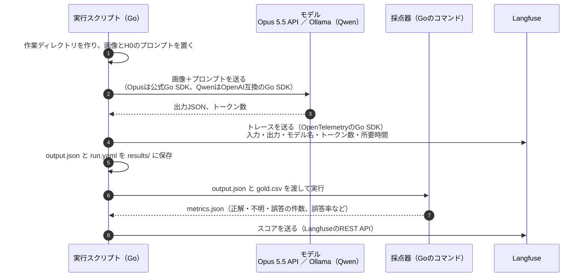
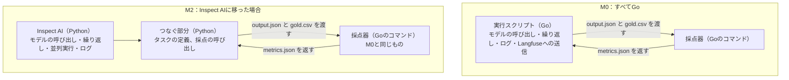
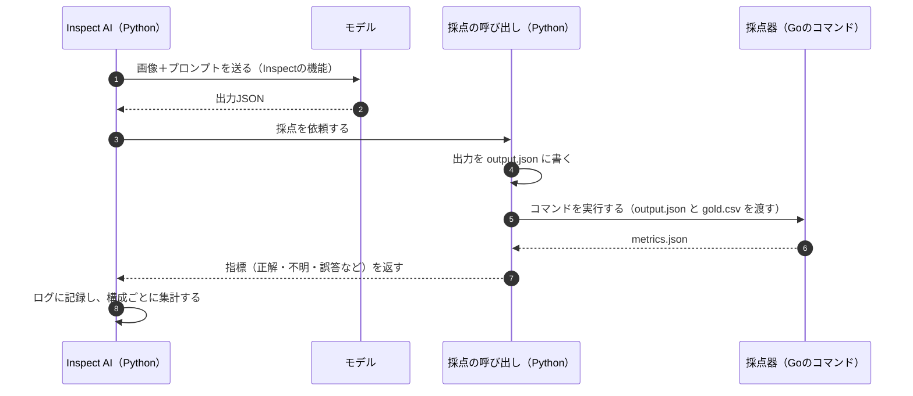

# 0012. 実装言語：Go

- ステータス：採用
- 日付：2026-10-26
- 決定者：kajiwara

## 背景

- 実行スクリプト、採点器、レポートの実装言語を決める必要がある（設計書 12章）。設計書ではPythonをおすすめにしており、[0008](0008-execution-framework.md) と [0010](0010-self-host-langfuse.md) もPythonを前提にしていた。
- 決定者はPythonも書けるが、Goのほうが好み。個人のプロジェクトでは、続けやすさが大事になる。

Goで必要なものがそろっているかを確認した（2026-10-26）。

| 必要なもの | Goでの状況 |
|---|---|
| Opus 5.5を呼ぶ | Anthropicの公式Go SDK（anthropic-sdk-go）がある。画像の入力にも対応している |
| Qwen（Ollama）を呼ぶ | OpenAIの公式Go SDK（openai-go）の接続先をOllamaに変えれば使える。Ollamaにも、Go用のクライアントがある |
| 出力JSONのスキーマ検証 | JSON Schemaを検証するライブラリがある |
| 印刷名の正規化（全角・半角など） | `golang.org/x/text` で対応できる |
| Langfuseへのトレース送信 | 公式のGo SDKはない。LangfuseはOpenTelemetryでの送信を案内している |
| Langfuseへのスコア送信、データセットの登録 | 公開されているREST APIを直接呼ぶ |
| Inspect AI | Python専用 |

## 検討した選択肢

| 選択肢 | 良い点 | 弱い点 |
|---|---|---|
| Python | AnthropicのSDK、LangfuseのSDK、Inspect AIがすべてそろう。集計や分析のライブラリが多い | 決定者の好みではない |
| Go | 1つの実行ファイルになり、コンテナイメージが小さく中身がはっきりする（[0011](0011-immutable-infrastructure.md)）。並列実行を書きやすい。型が厳しく、JSONの構造の間違いに早く気づける。決定者の好み | LangfuseのSDKがなく、一部を自作する。Inspect AIとつなぐ部分はPythonになる |

## 決定

- 実行スクリプト、採点器、レポートは **Go** で書く。
- **採点器は、言語に依存しない独立したコマンドとして作る。** 出力JSONと正解CSVを受け取り、`metrics.json` を出す。
- **Langfuseへは、トレースをOpenTelemetryのGo SDKで送り、スコアとデータセットはREST APIを直接呼んで送る。** 両方のモデルを同じ形で送る方針は変えない。

この決定で、次の部分を置き換える。

- [0008](0008-execution-framework.md) の「実装言語はPythonを前提とする」
- [0010](0010-self-host-langfuse.md) の「トレースは、LangfuseのPython SDK（v5以降）を使った自作の小さなラッパーから送る」

## 影響

### Goで書く範囲とLangfuseへの送り方

Goで書くのは **評価用ハーネス**（実行スクリプト・採点器・レポート）である（設計書 1.3）。M0の被験ハーネス（H0）はプロンプトだけで、Goのコードにはならない。Langfuseに送る処理は、実行スクリプトの一部としてGoで書く。

M0の1回の実行の流れ：

| 送るもの | 送り方 | Goで書く部分 |
|---|---|---|
| トレース（モデルに何を送り、何が返ってきたか） | OpenTelemetryのGo SDK | モデルの呼び出しの前後に区間（span）を作り、モデル名やトークン数を属性として付ける |
| スコア（採点の結果）、データセット | LangfuseのREST API | HTTPでJSONを送る薄いクライアント |

### Inspect AIとの関係

Goにしても、Inspect AIは使える。Inspect AIは、評価用ハーネスのうち **実行スクリプトの役割を代わりに受け持つ** フレームワークである。M2でInspect AIに移ると、Goの実行スクリプトの役割をInspectが引き継ぐ。Goの採点器はそのまま残し、Inspectから呼び出す。

「つなぐ部分」は、Inspectのルールに沿って書くPythonのコードで、次の2つだけを受け持つ。

- **タスクの定義**：`tasks/` の画像と正解データを、Inspectの問題として読み込む。どのモデルとプロンプトで解かせるかを指定する。
- **採点の呼び出し**：Inspectが受け取ったモデルの出力をファイルに書き、Goの採点器のコマンドを実行し、`metrics.json` を読んでInspectに返す。

Inspect AIで1問を採点する流れ：

採点のロジック（位置の対応付け、印刷名の正規化、正解・不明・誤答の判定）は、すべてGoの採点器の中にある。Pythonの側はファイルを渡して結果を受け取るだけなので、採点のルールを2つの言語で二重に持つことはない。

M2でInspect AIに移る場合（[0008](0008-execution-framework.md)）、M0で作ったものは次のように扱う。

| M0で作るもの | Inspect AIに移るとき |
|---|---|
| タスクセット（画像、正解データ、`meta.yaml`） | そのまま使う |
| 出力のスキーマ、プロンプト | そのまま使う |
| 採点器（Goのコマンド） | そのまま使う。Inspectの採点の部分から呼び出す |
| 実行スクリプト（Go）のうち、モデルの呼び出し・繰り返し・並列実行・ログ | Inspectの機能に置き換わる |
| Langfuseへの送信（Go） | Inspectの仕組みから送る形に、Pythonで作り直す |
| インフラ（Terraform、コンテナ） | ほぼそのまま使う |

新しく書くのは、Inspectとつなぐための薄いPythonのコードだけになる。M2の前の見直しでは、「Goの自作のまま続けるか、Inspect AIの部分だけPythonにするか」を判断する。

### そのほか

- 集計や分析のライブラリはPythonほど充実していない。M0のレポートはCSVとMarkdownを出すだけなので問題ない。深い分析が必要になったら、CSVを別のツールで読む。
- LangfuseのPython SDKにある実験用の便利な機能は使えない。REST APIの薄いクライアントを自作する。
