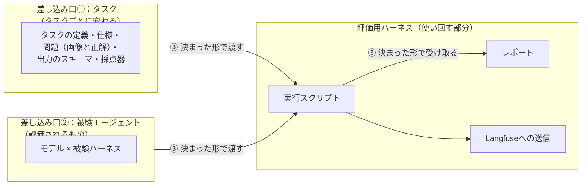
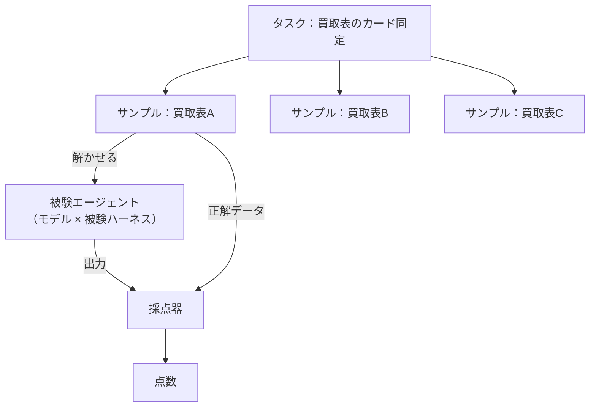
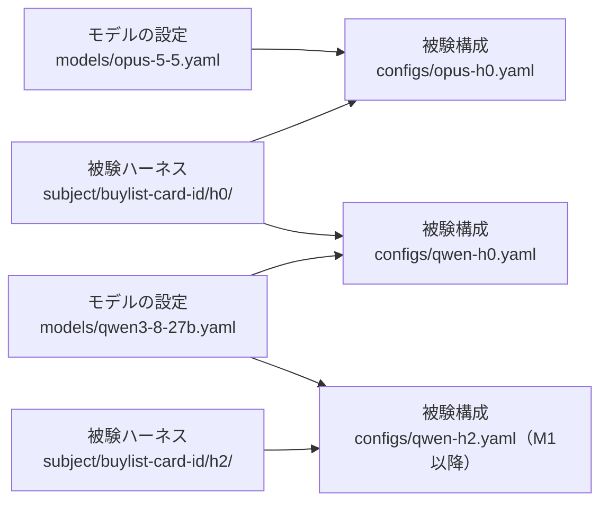
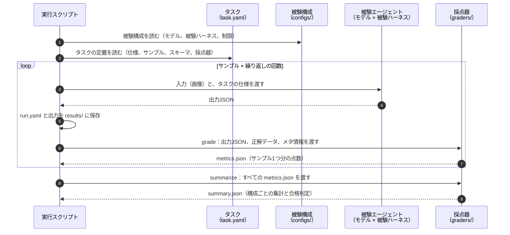
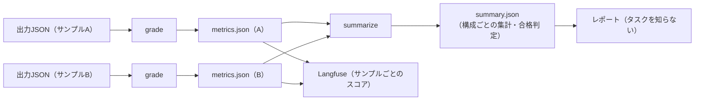

# 0016. 差し込み口の設計：タスクと被験エージェントを差し替えられるようにする

- ステータス：提案
- 日付：2026-10-28
- 決定者：kajiwara（未決定。この文書は Claude の案）

> [!NOTE]
> この ADR は、まだ決定していない **案** である。各節の「案」は Claude の考えで、「決めること」に挙げた問いに答えてから「採用」にする。

## 背景

設計書 0.3 で、このプロジェクトに2つの目的を置いた。

- **第一の目的**：ハーネスの設計が出力に与える影響を確かめる
- **第二の目的**：エージェント評価用のハーネスの仕組みを作り上げる（タスクと被験エージェントを差し替えて、同じ方法で何度でも評価できるようにする）

第二の目的を達成できたかどうかの基準は、次の2つとした（設計書 0.3）。

- 新しい被験エージェントを、評価用ハーネスのコードを変えずに、**設定だけで** 追加できる
- 新しいタスクを、**タスクセット・出力のスキーマ・採点器を足すだけで** 追加できる。実行の仕組みは変えない

この2つを満たすには、評価用ハーネスと、差し替えるもの（タスク、被験エージェント）の間の **境界（差し込み口）** を決めておく必要がある。決めずに作り始めると、買取表のタスクに特有の処理が、実行スクリプトやレポートの中に混ざってしまう。



一方で、M0 では第一の目的を優先し、汎用の仕組みを作り込みすぎないことにしている（設計書 0.3）。そのため、この ADR では **境界の形（何を、どの形で受け渡すか）だけ** を決め、仕組みの作り込みはしない。

## 考え方の土台：言葉をそろえる

最初に、言葉をそろえる。今の設計書では、`tasks/<task_id>/` が「買取表1枚」を指している。一方で、第二の目的でいう「タスク」は「買取表のカード同定」という **タスクの種類** のことである。この2つが同じ「タスク」という言葉になっていると、差し込み口を考えるときに混乱する。

**案：次の4つの言葉を使い分ける。**

| 言葉 | 意味 | 例 | Inspect AI での名前 |
|---|---|---|---|
| **タスク** | 評価する課題の種類。差し込み口①で差し替える単位 | 買取表のカード同定 | Task |
| **サンプル** | タスクの中の1つ1つの問題 | 買取表の画像1枚と、その正解データ | Sample |
| **被験エージェント** | タスクを解くもの。差し込み口②で差し替える単位 | Qwen3.8-27B × H0 | Solver |
| **採点器** | 被験エージェントの出力を、正解データと比べて点数を付けるもの | 買取表のカード同定の採点器 | Scorer |

Inspect AI の名前と対応させておくと、M2 の前に Inspect AI への移行を検討するとき（[0008](0008-execution-framework.md)、[0012](0012-implementation-language-go.md)）、そのまま対応づけられる。



## 案① タスクの差し込み口

### 1つのタスクを構成するもの

| 構成するもの | 中身 | 今の設計書での場所 |
|---|---|---|
| タスクの定義 | タスクの名前、版、各ファイルの場所、指標、合格ライン | （なし。新しく足す） |
| タスクの仕様 | 被験エージェントに渡す、課題の説明 | `docs/task-spec.md`（設計書 4章） |
| サンプル | 問題の入力（画像）、正解データ、メタ情報 | `tasks/<task_id>/`（設計書 4章、5.1、5.2） |
| 出力のスキーマ | 被験エージェントが返すJSONの形 | `schemas/output.schema.json`（設計書 5.3） |
| 正解データの定義 | 正解データの列の意味 | `schemas/gold.md`（設計書 5.2） |
| 採点器 | 出力と正解データを比べて点数を付ける | `graders/`（設計書 8章） |

今の設計書では、これらが種類ごとのフォルダ（`tasks/`、`schemas/`、`graders/`、`docs/`）に散らばっている。タスクが1つのうちは困らないが、タスクを足すときに、あちこちのフォルダにファイルを足すことになる。

### 置き方の選択肢

| 案 | 置き方 | 良い点 | 弱い点 |
|---|---|---|---|
| A. 種類ごと（今の設計書） | `tasks/`、`schemas/`、`graders/` に、それぞれのタスクの分を置く | 今の設計書のまま | 1つのタスクが散らばる。タスクを足すときに、どこに何を足すか分かりにくい |
| **B. タスクごと（案）** | 1つのタスクに関わるものを、`tasks/<タスク名>/` の1か所にまとめる | タスクを足すときは、フォルダを1つ足すだけ。差し込み口の単位とフォルダの単位が一致する | 設計書 4章のディレクトリ構成を直す必要がある |

**案：B にする。** タスクの中身の目録として、**タスクの定義ファイル（`task.yaml`）** を置く。評価用ハーネスは、このファイルだけを読めば、タスクの中身がどこにあるか分かるようにする。

```
tasks/
└── buylist-card-id/              ← タスク（買取表のカード同定）
    ├── task.yaml                 ← タスクの定義（目録）。差し込み口①の入口
    ├── spec.md                   ← タスクの仕様（被験エージェントに渡す説明）
    ├── schemas/
    │   ├── output.schema.json    ← 出力のスキーマ
    │   └── gold.md               ← 正解データの列の定義
    └── samples/                  ← サンプル（問題）
        ├── torekingu-akiba-2026-10-25/
        │   ├── meta.yaml         ← 出典、日付、段・列、分割（dev/test）
        │   ├── gold.csv          ← 正解データ
        │   └── input.jpg         ← 画像（リポジトリには入れない）
        └── ...

graders/
└── buylist-card-id/              ← 採点器のコード（Go）。タスクと同じ名前
```

**採点器のコードの置き場所** だけは、タスクのフォルダの外（`graders/`）に置く案にしている。採点器はGoのコードで（[0012](0012-implementation-language-go.md)）、Goのコードはリポジトリの中で1つのまとまり（モジュール）として扱うほうが、ビルドやテストがしやすいためである。タスクのフォルダとは、`task.yaml` の中で採点器のコマンドを指定してつなぐ。

### タスクの定義ファイル（`task.yaml`）の中身の案

```yaml
id: buylist-card-id
version: 1
description: 買取表の画像から、掲載されているカードを一意に特定する
spec: spec.md                       # 被験エージェントに渡す仕様
input:
  files: [input.jpg]                # サンプルのフォルダの中の入力ファイル
output:
  schema: schemas/output.schema.json
gold:
  file: gold.csv
  definition: schemas/gold.md
samples: samples/                   # サンプルのフォルダ
grader:
  command: graders/buylist-card-id  # 採点器のコマンド（③で入出力を決める）
pass:                               # 合格ライン（設計書 8.4）
  wrong_rate: {max: 0.02}
  identified_rate: {min: 0.80}
  format_errors: {max: 0}
```

## 案② 被験エージェントの差し込み口

### 被験エージェントを3つに分ける

被験エージェントは「モデル × 被験ハーネス」である（設計書 1.3）。このうち、モデルはタスクに関係なく使い回せるが、被験ハーネスはタスクに合わせて作り込むもの（第一の目的）である。そこで、設定を3つに分けることを提案する。

| 設定 | 中身 | タスクとの関係 | 置き場所の案 |
|---|---|---|---|
| **モデルの設定** | どのモデルを、どこに、どの設定で呼ぶか | タスクに関係なく使い回す | `models/<モデル名>.yaml` |
| **被験ハーネスの定義** | プロンプト、使えるツール、手順（H0〜H3） | タスクごとに作り込む | `subject/<タスク名>/<段階>/` |
| **被験構成** | どのモデルと、どの被験ハーネスを組み合わせ、どんな制限で動かすか | 1つのタスクに対して作る | `configs/<構成名>.yaml` |



こうすると、「モデルだけ取り替える」「被験ハーネスだけ取り替える」ことが、被験構成のファイルを1つ足すだけでできる。これが、第二の目的の「設定だけで被験エージェントを追加できる」にあたる。

### モデルの設定の案

クラウドのモデルとローカルのモデルを、同じ形で書けるようにする。違うのは、呼び出し先（`provider`）と、そのための設定だけ。

```yaml
# models/opus-5-5.yaml
id: opus-5-5
provider: anthropic                 # Anthropic の API
name: claude-opus-5-5
params:
  effort: medium                    # 思考の量（ADR-0009）
  max_tokens: 16000
```

```yaml
# models/qwen3-8-27b.yaml
id: qwen3-8-27b
provider: openai-compatible         # Ollama の OpenAI 互換の API
name: qwen3.8:27b-q4
endpoint: ${MODEL_ENDPOINT}         # GPU サーバーの接続先。環境ごとに変わるので、設定ファイルに直接書かない
params:
  thinking: false                   # 思考を切るか（ADR-0009）
  num_ctx: 32768                    # コンテキスト長を必ず明示する（ADR-0009）
  temperature: 0
```

APIキーや接続先のように、環境ごとに変わるもの・秘密のものは、設定ファイルには直接書かず、環境変数などで渡す（[0006](0006-cloud-model-authentication.md)、[0011](0011-immutable-infrastructure.md)）。

### 被験ハーネスの定義の案

```
subject/
└── buylist-card-id/
    ├── h0/
    │   ├── harness.yaml        ← 種類、使えるツール、手順
    │   └── prompt.md           ← プロンプト
    └── h2/                     ← M1以降
        ├── harness.yaml
        └── prompt.md
```

```yaml
# subject/buylist-card-id/h0/harness.yaml
id: buylist-card-id-h0
level: H0
type: direct-api                    # モデルの API を直接呼ぶ（ADR-0008）
prompt: prompt.md
tools: []                           # H0 はツールなし
```

M2 以降に Claude Code などの既製のハーネスを使う場合は、`type` を変えて表す（例：`type: external-cli`、`command: claude`）。M0 では `direct-api` だけを作り、ほかの種類は **形だけ決めて、作らない**。

### 被験構成の案

```yaml
# configs/qwen-h0.yaml
id: qwen-h0
task: buylist-card-id
model: qwen3-8-27b                  # models/ のどれを使うか
harness: buylist-card-id-h0         # subject/ のどれを使うか
limits:
  timeout_sec: 600
repeats: 3
```

設計書 6.3 の構成ファイルの例を、この形に直す。

## 案③ 受け渡しの決まり

### 1回の実行の流れ



### 被験エージェントとの受け渡し

| 方向 | 受け渡すもの |
|---|---|
| 評価用ハーネス → 被験エージェント | サンプルの入力ファイル（画像）、タスクの仕様（`spec.md`）、出力のスキーマ |
| 被験エージェント → 評価用ハーネス | 出力JSON（出力のスキーマに従う）、トークン数などの使用量 |

M0 の `direct-api` では、実行スクリプトがモデルの API を直接呼ぶので、受け渡しはプログラムの中で完結する。M2 以降に `external-cli`（Claude Code など）を使う場合は、作業用のフォルダに入力を置き、決めた場所に出力JSONを書かせる形にする（設計書 3.2、7.1）。

### 採点器との受け渡し

**案：採点器は、2つのコマンドを持つ。**

| コマンド | 受け取るもの | 返すもの | 役割 |
|---|---|---|---|
| `grade` | 1つのサンプルの出力JSON、正解データ、メタ情報 | `metrics.json`（サンプル1つ分） | 1つのサンプルを採点する |
| `summarize` | 1つの被験構成の、すべての `metrics.json` | `summary.json`（構成ごと） | サンプルをまとめて集計し、合格ラインで判定する |

`summarize` も採点器に持たせる理由：このタスクの指標（誤答率など）は、サンプルごとの率を平均するのではなく、**すべてのカードの件数を足してから率を出す** 必要がある（設計書 8.3 の「全枚数」が分母）。集計の仕方はタスクごとに違うので、タスクのことを知っている採点器に任せる。評価用ハーネス（レポート）は、集計の中身を知らなくてよくなる。



### `metrics.json` の形の案

タスクが変わっても共通の **外側の形** と、タスクごとの **中身** を分ける。

```json
{
  "task": "buylist-card-id",
  "task_version": 1,
  "sample_id": "torekingu-akiba-2026-10-25",
  "grader_version": "0.1.0",
  "gold_version": 1,
  "status": "graded",
  "counts": {
    "cards": 21,
    "identified_correct": 17,
    "identified_wrong": 1,
    "unknown": 3,
    "missing": 0,
    "extra": 0
  },
  "scores": {
    "identified_rate": 0.81,
    "wrong_rate": 0.048
  },
  "details": {
    "cards": [ { "row": 1, "col": 1, "result": "correct", "failure": null } ]
  }
}
```

| 部分 | 共通か | 内容 |
|---|---|---|
| `task`〜`gold_version` | 共通 | どのタスク・サンプル・採点器・正解データの版で採点したか（設計書 5.5 の実行記録とつなぐ） |
| `status` | 共通 | `graded`（採点できた）／`format_error`（出力がスキーマに合わない）／`no_output`（出力がない）。形式エラーも結果として残す（設計書 7.2） |
| `counts` | 名前はタスクごと、形は共通 | 足し算できる件数。`summarize` はこれを足して集計する |
| `scores` | 名前はタスクごと、形は共通 | サンプル1つ分の率などの数値。Langfuse にスコアとして送る（[0007](0007-use-langfuse-for-scoring-and-tracing.md)） |
| `details` | タスクごと | カードごとの判定や失敗の分類など。評価用ハーネスは中身を読まない |

評価用ハーネスは、`status`・`counts`・`scores` を **名前を知らなくても扱える数値の集まり** として扱う。これで、タスクが変わってもレポートや Langfuse への送信を書き直さずに済む。

### 採点器のコマンドの決まり

| 決まり | 内容 |
|---|---|
| 呼び出し方 | `grade --output <出力JSON> --gold <正解データ> --meta <メタ情報> --out <metrics.json>`、`summarize --in <metrics.jsonのフォルダ> --task <task.yaml> --out <summary.json>` |
| 終了コード | `0`：採点できた（出力が壊れていても、`status: format_error` として採点結果を書けたら `0`）。`0` 以外：採点器そのものの失敗（正解データが読めないなど） |
| 言語 | どの言語で書いてもよい。コマンドとして呼べればよい（[0012](0012-implementation-language-go.md)。M0 は Go） |

「出力が壊れていた」は被験エージェントの成績なので、採点器の失敗とは分ける。

## 案④ M0 でどこまで作るか

| 項目 | M0 で作る | 形だけ決めて、作らない |
|---|---|---|
| タスク | `buylist-card-id` の1つ。`task.yaml` を置く | 2つ目のタスク |
| サンプル | 1〜3件 | dev/test の分割（M2） |
| モデル | `opus-5-5`、`qwen3-8-27b` の2つ | ほかのモデル |
| 被験ハーネス | `direct-api` の H0 だけ | H1〜H3、`external-cli` |
| 被験構成 | `opus-h0`、`qwen-h0` の2つ | ― |
| 採点器 | `grade` と `summarize` | ほかのタスクの採点器 |
| 決まりの検証 | `task.yaml`・被験構成・`metrics.json` の形を、スキーマで確かめる | 汎用のプラグインの仕組み |

**境界の形は M0 で決めて守るが、汎用の仕組み（タスクを自動で見つけて読み込む仕組みなど）は作らない。** 2つ目のタスクを扱うときに、この境界で本当に足りるかを確かめ、必要なら直す。

## 決めること

この ADR を「採用」にする前に、次の問いに答える。

| # | 問い | Claude の案 |
|---|---|---|
| 1 | 「タスク」と「サンプル」を言葉で分けるか | 分ける。Inspect AI の名前にも合わせる |
| 2 | タスクに関わるものを、タスクごとのフォルダにまとめるか | まとめる（案B）。目録として `task.yaml` を置く |
| 3 | 採点器のコードを、タスクのフォルダの外（`graders/`）に置くか | 置く。Go のコードは1つのまとまりで扱う |
| 4 | 被験エージェントの設定を、モデル・被験ハーネス・被験構成の3つに分けるか | 分ける |
| 5 | 採点器に `grade` と `summarize` の2つのコマンドを持たせるか | 持たせる。集計の仕方はタスクごとに違うため |
| 6 | `metrics.json` を、共通の外側（`status`・`counts`・`scores`）とタスクごとの中身（`details`）に分けるか | 分ける |
| 7 | M0 で作る範囲を、案④の表のとおりにするか | そのとおりにする |
| 8 | タスクの名前を `buylist-card-id` にするか | 案として。ほかの名前でもよい |

## 影響（採用した場合）

- 設計書の次の箇所を直す：1.3（用語）、3.1（構成要素）、4章（ディレクトリ構成）、5章（データ設計）、6.3（構成ファイルの例）、7章（実行スクリプト）、8章（採点器）。
- TODO の 7章（仕様とスキーマ）・8章（タスクセット）・9章（被験構成）・10章（実行）・11章（採点器）の置き場所とファイル名を、この ADR に合わせて直す。
- 仮のキーの方式（TODO 1.4）は、`schemas/output.schema.json` と `gold.csv` の中身に関わる。この ADR のあとで決める。
- M2 の前に Inspect AI への移行を見直すとき、タスク・サンプル・被験エージェント・採点器の対応が、そのまま使える。
