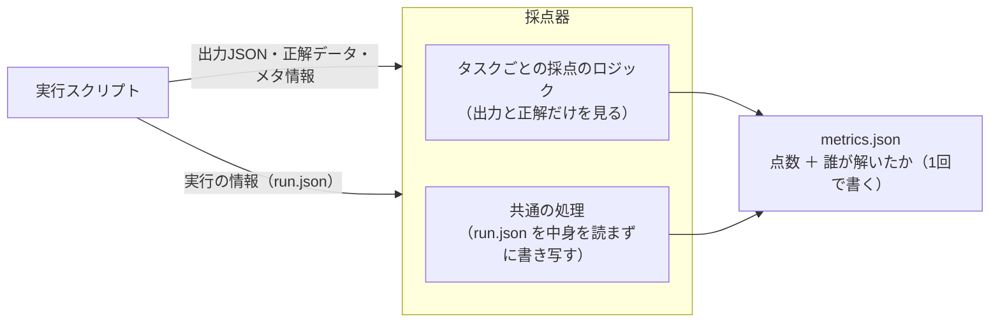

# 0018. 採点の結果に、誰が解いたか（被験エージェントの情報）を含める

- ステータス：採用
- 日付：2026-10-28
- 決定者：kajiwara
- 関係するADR：[0011](0011-immutable-infrastructure.md)（作ったものは変えない、バージョンを固定して記録する）、[0017](0017-grader-single-go-module.md)（採点器）、[0022](0022-harness-level-and-components.md)（被験ハーネスの段階と部品の組み合わせ）、[0023](0023-grader-interface.md)（採点器の入出力）、[0024](0024-show-harness-changes-and-effects.md)（改善の差分と結果を見えるようにする）

## 背景

- 採点器は、サンプルごとの点数（`metrics.json`）と、構成ごとの成績表（`summary.json`）を出す（[0023](0023-grader-interface.md)）。
- 最初の案では、これらにタスク・サンプル・採点器・正解データの版は入っていたが、**誰が解いたのか（モデルと被験ハーネス）が入っていなかった。** 結果のファイルだけを見ても、どの被験ハーネスの結果か分からない。
- このプロジェクトの第一の目的は、ハーネスの設計が出力に与える影響を確かめること（設計書 0.3）。結果と被験ハーネスが結びついていないと、改善の効果を確かめられない。
- 一方で、採点は「誰が解いたか」に左右されてはならない。

## 検討した選択肢

| 選択肢 | 内容 | 良い点 | 弱い点 |
|---|---|---|---|
| A. 含めない | 誰が解いたかは、実行記録（`run.yaml`）だけに残す | ファイルの役割がはっきり分かれる | 結果のファイルだけを見ても、どの被験ハーネスの結果か分からない。2つのファイルを毎回突き合わせる手間がかかる |
| B. 採点器が読んで使う | 採点器に被験ハーネスの情報を渡し、採点のロジックも参照できるようにする | 1回で書ける | 採点が「誰が解いたか」に左右される余地ができる |
| C. 実行スクリプトが、あとから書き足す | 採点器が点数を書いたあと、実行スクリプトがファイルを開き直して、実行の情報を書き足す | 採点器は誰が解いたかを知らない | 1つのファイルを2者が書き換える。書き足す前に処理が止まると、誰が解いたかが抜けたファイルが残る。一度書いたものを書き換える |
| **D. 実行の情報を渡し、採点器がそのまま書き写す** | 実行スクリプトが実行の情報（`run.json`）を採点器に渡す。採点器の共通の処理が、中身を読まずに結果の `run` の欄へそのまま書き写す。タスクごとの採点のロジックには渡さない | ファイルは1回で書け、抜けたファイルができない。採点のロジックは誰が解いたかを知らない | 採点器が、実行の情報のファイルを受け取る（中身は読まない） |

## 決定

**D にする。** 採点の結果（`metrics.json`、`summary.json`）に、**誰が解いたか（被験エージェントの情報）** を含める。実行スクリプトが実行の情報を採点器に渡し、採点器の共通の処理がそのまま書き写す。タスクごとの採点のロジックは、この情報に触れない。



含める情報（`run` の欄）：

| 項目 | 内容 |
|---|---|
| `run_id` | 実行ごとの一意なID。実行記録（`run.yaml`）とつなぐ |
| `config` | 被験構成の名前 |
| `model` | モデルの名前 |
| `harness` | 被験ハーネスの名前 |
| `harness_level` | 被験ハーネスの段階（H0〜H3）（[0022](0022-harness-level-and-components.md)） |
| `harness_components` | H0 に足した部品と、そのやり方の一覧（[0022](0022-harness-level-and-components.md)） |
| `harness_hash` | 被験ハーネスのファイルの中身から作ったハッシュ値 |
| `repeat` | 何回目の繰り返しか（`metrics.json` だけ） |

```json
{
  "run": {
    "run_id": "2026-11-05T10-00-00_qwen-h2-db-top5_r1",
    "config": "qwen-h2-db-top5",
    "model": "qwen3-8-27b",
    "harness": "buylist-card-id-h2-db-top5",
    "harness_level": "H2",
    "harness_components": [
      { "part": "grid-split", "variant": "per-card-crop" },
      { "part": "card-db-search", "variant": "top5-with-attacks" }
    ],
    "harness_hash": "sha256:…",
    "repeat": 1
  },
  "task": "buylist-card-id",
  "sample_id": "…",
  "…": "…"
}
```

## 理由

- **結果だけを見て、どの被験ハーネスの結果かを分かるようにするため。** 第一の目的には、結果と被験ハーネスの結びつきが欠かせない。結果のファイルを開けば、誰が、どの部品の組み合わせで解いたかが分かる状態にする。A を選ばなかったのは、毎回 `run.yaml` と突き合わせる手間と間違いが増えるため。
- **採点を公平に保つため。** タスクごとの採点のロジックは、出力と正解だけを見て点数を付ける。実行の情報を書き写すのは、どのタスクでも同じ共通の処理で、採点の中身には関わらない。B を選ばなかったのはこのため。
- **ファイルを1回で書くため。** C では、1つのファイルを2者が書き換えるうえに、途中で処理が止まると、誰が解いたかが抜けたファイルが残る。また、一度作ったものをあとから書き換えることになり、[0011](0011-immutable-infrastructure.md) の「作ったものは変えない」という考え方と合わない。D なら、採点器が1回で、すべてそろったファイルを書く。
- **`harness_hash` を入れるのは、** 部品の名前を変え忘れても、中身が変わったことが分かるようにするため（[0011](0011-immutable-infrastructure.md) の「バージョンを固定して記録する」の考え方）。

## 影響

- 採点器の `grade` と `summarize` は、実行の情報のファイル（`run.json`）を受け取り、結果の `run` の欄にそのまま書き写す（[0023](0023-grader-interface.md)）。
- 実行スクリプトは、採点器を呼ぶ前に `run.json` を作る。中身は実行記録（`run.yaml`）から取り出す。
- Langfuse にスコアを送るときも、同じ情報を付ける（[0007](0007-use-langfuse-for-scoring-and-tracing.md)）。
