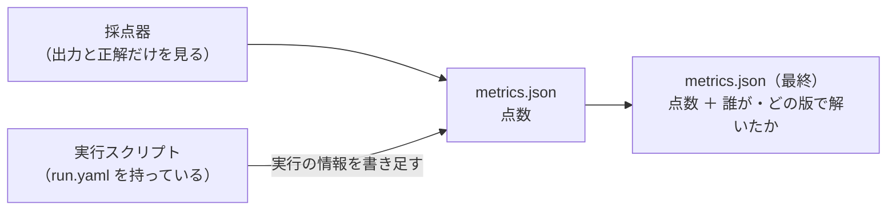

# 0018. 採点の結果に、誰が解いたか（被験エージェントの情報）を含める

- ステータス：採用
- 日付：2026-10-28
- 決定者：kajiwara
- 関係するADR：[0011](0011-immutable-infrastructure.md)（バージョンを固定して記録する）、[0017](0017-grader-single-go-module.md)（採点器）、[0022](0022-harness-level-and-version.md)（被験ハーネスの段階と版、提案）、[0024](0024-show-harness-changes-and-effects.md)（改善の差分と結果を見えるようにする、提案）

## 背景

- 採点器は、サンプルごとの点数（`metrics.json`）と、構成ごとの集計（`summary.json`）を出す。
- 最初の案では、これらにタスク・サンプル・採点器・正解データの版は入っていたが、**誰が解いたのか（モデルと被験ハーネス）が入っていなかった。** 結果のファイルだけを見ても、どの被験ハーネスの、どの改善の結果か分からない。
- このプロジェクトの第一の目的は、ハーネスの設計が出力に与える影響を確かめること（設計書 0.3）。結果と被験ハーネスが結びついていないと、改善の効果を確かめられない。

## 検討した選択肢

| 選択肢 | 内容 | 良い点 | 弱い点 |
|---|---|---|---|
| A. 含めない | 誰が解いたかは、実行記録（`run.yaml`）だけに残す | ファイルの役割がはっきり分かれる | 結果のファイルだけを見ても、どの被験ハーネスの結果か分からない。2つのファイルを突き合わせる手間がかかる |
| B. 採点器が含める | 採点器に、被験ハーネスの情報も渡して、結果に書かせる | 1回で書ける | 採点器が「誰が解いたか」を知ることになる。採点が被験エージェントに左右される余地ができる |
| **C. 実行スクリプトが書き足す** | 採点器は出力と正解だけを見て点数を付け、実行スクリプトが、結果のファイルに実行の情報を書き足す | 結果のファイルだけで、誰が解いたか分かる。採点器は誰が解いたかを知らないまま | 書き足す手順が1つ増える |

## 決定

**C にする。** 採点の結果（`metrics.json`、`summary.json`）に、**誰が解いたか（被験エージェントの情報）** を含める。書き足すのは実行スクリプトで、採点器は被験エージェントを知らないままにする。



含める情報：

| 項目 | 内容 |
|---|---|
| `run_id` | 実行ごとの一意なID。実行記録（`run.yaml`）とつなぐ |
| `config` | 被験構成の名前 |
| `model` | モデルの名前 |
| `harness` | 被験ハーネスの名前 |
| `harness_level` | 被験ハーネスの段階（H0〜H3）。[0022](0022-harness-level-and-version.md) で決める |
| `harness_version` | 同じ段階の中での版。[0022](0022-harness-level-and-version.md) で決める |
| `harness_hash` | 被験ハーネスのファイルの中身から作ったハッシュ値 |
| `repeat` | 何回目の繰り返しか |

```json
{
  "run": {
    "run_id": "2026-11-05T10-00-00_qwen-h2_r1",
    "config": "qwen-h2",
    "model": "qwen3-8-27b",
    "harness": "buylist-card-id-h2",
    "harness_level": "H2",
    "harness_version": 3,
    "harness_hash": "sha256:…",
    "repeat": 1
  },
  "task": "buylist-card-id",
  "sample_id": "…",
  "…": "…"
}
```

## 理由

- **結果だけを見て、どの改善の結果かを分かるようにするため。** 第一の目的（ハーネスの設計が出力に与える影響を確かめる）には、結果と被験ハーネスの結びつきが欠かせない。結果のファイルを開けば、誰が・どの版で解いたかが分かる状態にする。
- **採点を公平に保つため。** 採点器に被験ハーネスを知らせると、採点が「誰が解いたか」に左右される余地ができる。採点器は出力と正解だけを見て点数を付け、実行の情報は外側から書き足す。B を選ばなかったのはこのため。
- **A を選ばなかったのは、** 結果と実行記録を毎回突き合わせる必要があり、比べるときの手間と間違いが増えるため。
- **`harness_hash` を入れるのは、** 版の番号を上げ忘れても、中身が変わったことが分かるようにするため（[0011](0011-immutable-infrastructure.md) の「バージョンを固定して記録する」の考え方）。

## 影響

- 実行スクリプトは、採点器を呼んだあとに、結果のファイルへ `run` の項目を書き足す。
- `summary.json` にも、被験構成・モデル・被験ハーネスの段階・版・ハッシュを含める。
- Langfuse にスコアを送るときも、同じ情報を付ける（[0007](0007-use-langfuse-for-scoring-and-tracing.md)）。
- 段階と版の付け方は [0022](0022-harness-level-and-version.md) で決める。決まるまでは、`harness_level` と `harness_version` の形は仮。
