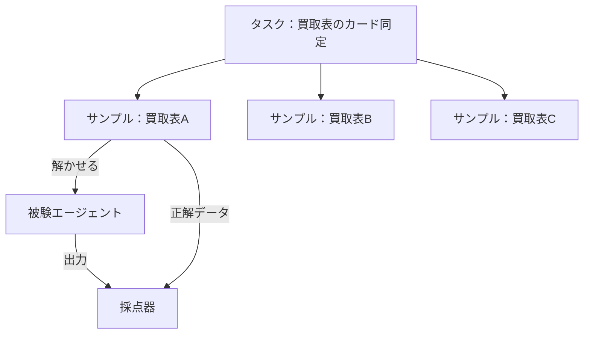

# 0020. 「タスク」と「サンプル」を言葉で分ける

- ステータス：提案
- 日付：2026-10-28
- 決定者：kajiwara（未決定。Claude の案）
- 関係するADR：[0016](0016-task-folder-per-task.md)（タスクごとのフォルダ）、[0008](0008-execution-framework.md)（Inspect AI への移行の見直し）

## 背景

- 今の設計書では、`tasks/<task_id>/` が「買取表1枚」を指している（設計書 4章、5.1）。
- 一方で、第二の目的でいう「タスク」は、「買取表のカード同定」という **課題の種類** のことである（設計書 0.3）。
- 同じ「タスク」という言葉が2つの意味で使われていると、差し込み口（タスクを差し替える単位）を考えるときに話がかみ合わない。

## 検討した選択肢

| 選択肢 | 言葉 | 良い点 | 弱い点 |
|---|---|---|---|
| A. 今のまま | 「タスク」で、買取表1枚も、課題の種類も指す | 設計書を直さなくてよい | 2つの意味が混ざり、差し込み口の話がかみ合わない |
| B. 独自の言葉で分ける | 例：「課題」と「問題」 | 日本語として分かりやすい | 評価のフレームワークの言葉と対応しない |
| **C. 評価のフレームワークの言葉に合わせて分ける** | 「タスク」（課題の種類）と「サンプル」（1つ1つの問題）。Inspect AI の Task・Sample に合わせる | 意味がはっきり分かれる。Inspect AI に移るときに、そのまま対応づけられる | 「サンプル」という言葉に慣れる必要がある |

## 決定（案）

**C にする。** 次の言葉を使い分ける。

| 言葉 | 意味 | 例 | Inspect AI での名前 |
|---|---|---|---|
| タスク | 評価する課題の種類。差し込み口で差し替える単位 | 買取表のカード同定 | Task |
| サンプル | タスクの中の1つ1つの問題 | 買取表の画像1枚と、その正解データ | Sample |
| 被験エージェント | タスクを解くもの | Qwen3.8-27B × H0 | Solver |
| 採点器 | 出力を正解データと比べて点数を付けるもの | 買取表のカード同定の採点器 | Scorer |

## 理由

- **差し込み口の単位をはっきりさせるため。** 差し替えるのは「タスク」（課題の種類）であり、買取表1枚ではない。言葉を分ければ、「タスクを足す」と「サンプルを足す」の違いが明確になる。
- **Inspect AI の言葉に合わせるのは、** M2 の前に Inspect AI への移行を見直すとき（[0008](0008-execution-framework.md)）、そのまま対応づけられるようにするため。評価の分野で広く使われている言葉なので、ほかの資料も読みやすくなる。
- A を選ばなかったのは、2つの意味が混ざったままでは、差し込み口の設計が進めにくいため。B を選ばなかったのは、評価のフレームワークの言葉と対応しないため。

## 影響（採用した場合）

- 設計書の用語（1.3）に、タスク・サンプルを足し、`task_id` などの名前を `sample_id` に直す（5.1、5.3、5.5）。
- `tasks/<タスク名>/samples/<サンプルのID>/` の形にする（[0016](0016-task-folder-per-task.md)）。

## 決めること

- 「サンプル」という言葉でよいか（ほかの候補：問題、ケース）
