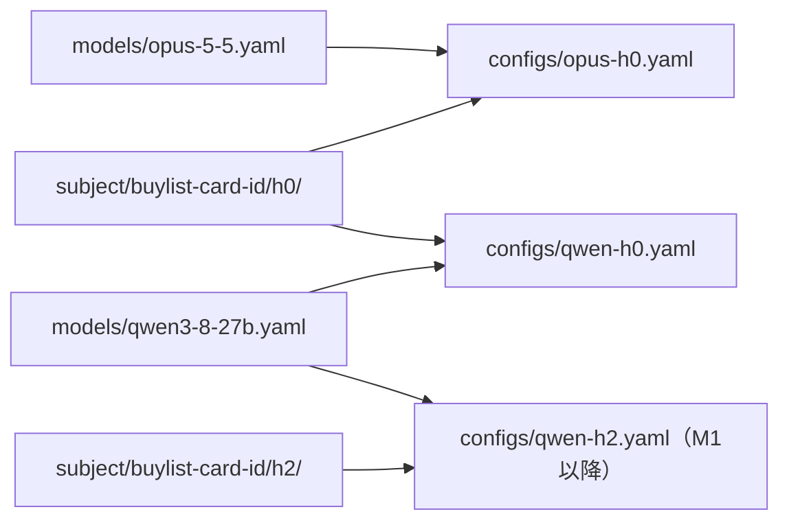

# 0021. 被験エージェントの設定を、モデル・被験ハーネス・被験構成の3つに分ける

- ステータス：提案
- 日付：2026-10-28
- 決定者：kajiwara（未決定。Claude の案）
- 関係するADR：[0009](0009-models-for-m0.md)（M0で使うモデル）、[0022](0022-harness-level-and-version.md)（被験ハーネスの段階と版、提案）

## 背景

- 設計書 0.3 の第二の目的の基準の1つは、「新しい被験エージェントを、評価用ハーネスのコードを変えずに、設定だけで追加できる」こと。
- 被験エージェントは「モデル × 被験ハーネス」である（設計書 1.3）。
- モデルはタスクに関係なく使い回せる。一方で、被験ハーネスはタスクに合わせて作り込むもの（第一の目的）である。
- 今の設計書（6.3）では、モデルと被験ハーネスと制限を、1つの構成ファイルにまとめて書いている。

## 検討した選択肢

| 選択肢 | 分け方 | 良い点 | 弱い点 |
|---|---|---|---|
| A. 1つのファイル（今の設計書） | 構成ファイル1つに、モデル・被験ハーネス・制限を書く | ファイルが少ない | 同じモデルの設定を、構成ごとに何度も書く。モデルだけ・被験ハーネスだけを取り替えにくい |
| **B. 3つに分ける** | モデルの設定、被験ハーネスの定義、被験構成（組み合わせと制限）を別のファイルにする | モデルだけ・被験ハーネスだけを取り替えられる。同じ設定を何度も書かずに済む | ファイルが増え、どのファイルを見ればよいか覚える必要がある |

## 決定（案）

**B にする。**

| 設定 | 中身 | タスクとの関係 | 置き場所の案 |
|---|---|---|---|
| モデルの設定 | どのモデルを、どこに、どの設定で呼ぶか | タスクに関係なく使い回す | `models/<モデル名>.yaml` |
| 被験ハーネスの定義 | プロンプト、使えるツール、手順 | タスクごとに作り込む | `subject/<タスク名>/<被験ハーネスの名前>/` |
| 被験構成 | どのモデルと、どの被験ハーネスを組み合わせ、どんな制限で動かすか | 1つのタスクに対して作る | `configs/<構成名>.yaml` |



ファイルの例：

```yaml
# models/qwen3-8-27b.yaml
id: qwen3-8-27b
provider: openai-compatible      # Ollama の OpenAI 互換の API
name: qwen3.8:27b-q4
endpoint: ${MODEL_ENDPOINT}      # 環境ごとに変わるので、直接書かない
params:
  thinking: false                # ADR-0009
  num_ctx: 32768                 # ADR-0009
  temperature: 0
```

```yaml
# subject/buylist-card-id/h0/harness.yaml
id: buylist-card-id-h0
type: direct-api                 # モデルの API を直接呼ぶ（ADR-0008）
prompt: prompt.md
tools: []
```

```yaml
# configs/qwen-h0.yaml
id: qwen-h0
task: buylist-card-id
model: qwen3-8-27b
harness: buylist-card-id-h0
limits:
  timeout_sec: 600
repeats: 3
```

- クラウドのモデルとローカルのモデルは、`provider` とその設定が違うだけで、同じ形で書く。
- APIキーや接続先など、環境ごとに変わるもの・秘密のものは、設定ファイルに直接書かない（[0006](0006-cloud-model-authentication.md)、[0011](0011-immutable-infrastructure.md)）。
- M2 以降に Claude Code などを使う場合は、被験ハーネスの `type` を変えて表す（例：`type: external-cli`）。M0 では `direct-api` だけを作る。

## 理由

- **「設定だけで被験エージェントを追加できる」を満たすため。** 3つに分けると、モデルを取り替えるときも、被験ハーネスを取り替えるときも、被験構成のファイルを1つ足すだけで済む。
- **使い回せるものと、作り込むものを分けるため。** モデルの設定はタスクに関係なく使い回せるが、被験ハーネスはタスクごとに作り込む。性質の違うものを同じファイルに書くと、片方を直すたびにもう片方に触ることになる。
- A を選ばなかったのは、同じモデルの設定を構成ごとに何度も書くことになり、モデルの設定を直すときに、すべての構成ファイルを直す必要があるため。

## 影響（採用した場合）

- 設計書 4章（ディレクトリ構成）と 6.3（構成ファイルの例）を直す。
- TODO 9章（被験構成）を、この形に合わせて直す。

## 決めること

- 3つに分けるか
- 置き場所（`models/`、`subject/`、`configs/`）の名前
