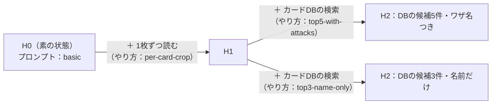

# 0022. 被験ハーネスを「段階」と「部品の組み合わせ」で表す

- ステータス：採用
- 日付：2026-10-28
- 決定者：kajiwara
- 関係するADR：[0018](0018-results-include-subject-info.md)（結果に被験エージェントの情報を含める）、[0021](0021-subject-config-split.md)（被験エージェントの設定を3つに分ける）、[0024](0024-show-harness-changes-and-effects.md)（改善の差分と結果を見えるようにする）

## 背景

- 設計書 6.2 では、被験ハーネスを H0〜H3 の段階に分けている。段階は「どの部品を足したか」で決まり、隣り合う段階の差分は1つだけにする。

| 段階 | 足した部品 |
|---|---|
| H0 | なし（素の状態） |
| H1 | 1枚ずつ読み取る手順 |
| H2 | カードDBの検索 |
| H3 | 自己検証 |

- 一方で、同じ段階の中でも、部品のやり方を変えることがある。たとえば、同じ「カードDBの検索」でも、候補を5件渡すか3件渡すか、ワザ名も使うか名前だけで検索するか、で結果が変わりうる。
- 評価で知りたいのは「何回直したか」ではなく、**「素の状態（H0）から、何をどう足したか」** と、それが結果にどう影響したかである。

## 検討した選択肢

| 選択肢 | 表し方 | 良い点 | 弱い点 |
|---|---|---|---|
| A. 段階だけ | H0〜H3 だけで表す | 単純 | 同じ段階の中のやり方の違いを区別できない |
| B. 段階と版（回数） | 段階に加えて、同じ段階の中の改善の回数（1版、2版…）を持つ | 改善の前後を区別できる | 番号から、何が変わったか分からない。番号の大小に意味がない（新しい版が良いとは限らない）。比べるたびに中身を開いて確かめる必要がある |
| C. Git のコミットだけ | 番号は付けず、コミットのハッシュで区別する | 何も足さなくてよい | 人が見て、何が違うのか分からない |
| **D. 段階と部品の組み合わせ** | 段階に加えて、H0 に **どの部品を、どのやり方で** 足したかを一覧で持つ。中身のハッシュも記録する | 名前を見るだけで、H0 からの差分（構成）が分かる。比較表に部品ごとの列を並べられ、部品ごとの効果が見える | 部品とやり方の名前の付け方を決める必要がある |

## 決定

**D にする。** 被験ハーネスを、**段階** と、**H0 に足した部品とそのやり方の一覧（部品の組み合わせ）** で表す。



`harness.yaml` の例：

```yaml
# subject/buylist-card-id/h2-db-top5/harness.yaml
id: buylist-card-id-h2-db-top5
level: H2                           # どの段階か（設計書 6.2）
base: buylist-card-id-h0            # 何を元にしたか
type: direct-api
components:                         # H0 に足した部品と、そのやり方
  - part: grid-split                # H1 で足す部品：1枚ずつ読む
    variant: per-card-crop          # やり方：1枚ずつ切り出して読む
  - part: card-db-search            # H2 で足す部品：カードDBの検索
    variant: top5-with-attacks      # やり方：候補5件、ワザ名も使って検索
prompt:
  file: prompt.md
  variant: basic                    # プロンプトの種類
tools: [card-db-search]
```

| 項目 | 意味 | 何が分かるか |
|---|---|---|
| `level` | 段階（H0〜H3） | どこまで部品を足したか（大まかな位置） |
| `base` | 元にした被験ハーネス | どこからの差分か |
| `components` | 足した部品（`part`）と、そのやり方（`variant`） | **H0 からの差分そのもの。被験ハーネスの構成** |
| `prompt.variant` | プロンプトの種類 | プロンプトの違い |
| ハッシュ（実行のたびに記録） | ファイルの中身から作る値 | 名前を変え忘れても、中身の違いが分かる（[0018](0018-results-include-subject-info.md)） |

- `variant` には、回数ではなく、**やり方を表す短い名前** を付ける（例：`top5-with-attacks`）。
- **1回の変更で変えるのは、1か所だけにする。** 部品を1つ足すか、1つの部品のやり方を1つ変えるか、プロンプトの種類を1つ変えるか。
- 結果（[0018](0018-results-include-subject-info.md) の `run` の欄）にも、部品の組み合わせを書く。
- 被験ハーネスのフォルダの名前は、**構成が分かる名前** にする（例：`h0`、`h1`、`h2-db-top5`、`h2-db-top3`）。段階を先頭に付け、足した部品ややり方を短く続ける。

この形にすると、比較表に部品ごとの列を並べられる（[0024](0024-show-harness-changes-and-effects.md)）。

| 構成 | 段階 | 1枚ずつ読む | カードDBの検索 | プロンプト | 誤答率 | 同定正答率 |
|---|---|---|---|---|---|---|
| qwen-h0 | H0 | ― | ― | basic | 9.0% | 55% |
| qwen-h1 | H1 | per-card-crop | ― | basic | 7.5% | 62% |
| qwen-h2-db-top5 | H2 | per-card-crop | top5-with-attacks | basic | 4.5% | 74% |
| qwen-h2-db-top3 | H2 | per-card-crop | top3-name-only | basic | 5.8% | 71% |

（数値は説明のための例）

## 理由

- **H0 からの差分（被験ハーネスの構成）を、名前を見るだけで分かるようにするため。** 評価で知りたいのは「何をどう足したか」であり、改善の回数ではない。部品とやり方の一覧なら、それをそのまま表せる。
- **部品ごとの効果を見えるようにするため。** 結果に部品の組み合わせが入っていれば、比較表に部品ごとの列を並べられる。「カードDBの検索を足すと誤答率が下がった」「同じ検索でも、やり方で差が出た」といったことを、表から読み取れる。第一の目的（ハーネスの設計が出力に与える影響を確かめる）に直接つながる。
- **1回の変更を1か所にするのは、** 結果の変化と変更を結びつけるため。2か所を同時に変えると、どちらが効いたのか分からない（設計書 6.2 の「隣り合う段階の差分が1つだけ」と同じ考え方）。
- A を選ばなかったのは、同じ段階の中のやり方の違いを区別できないため。B を選ばなかったのは、回数からは何が変わったかが分からず、番号の大小にも意味がないため。C を選ばなかったのは、人が見て分からないため（ハッシュは D の補いとして使う）。

## 影響

- 設計書 6.2 に、部品とやり方の考え方を足す。
- 結果の `run` の欄は、`harness_level` と `harness_components` で表す（[0018](0018-results-include-subject-info.md)）。
- レポートの比較表に、部品ごとの列を並べる（[0024](0024-show-harness-changes-and-effects.md)）。
