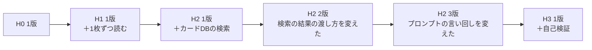

# 0022. 被験ハーネスに「段階」と「版」の2つを持たせる

- ステータス：提案
- 日付：2026-10-28
- 決定者：kajiwara（未決定。Claude の案）
- 関係するADR：[0018](0018-results-include-subject-info.md)（結果に被験エージェントの情報を含める）、[0024](0024-show-harness-changes-and-effects.md)（改善の差分と結果を見えるようにする、提案）

## 背景

- 設計書 6.2 では、被験ハーネスを H0〜H3 の段階に分けている。段階は「どの部品を足したか」で決まり、隣り合う段階の差分は1つだけにする。

| 段階 | 足した部品 |
|---|---|
| H0 | なし（素の状態） |
| H1 | 1枚ずつ読み取る手順 |
| H2 | カードDBの検索 |
| H3 | 自己検証 |

- 一方で、同じ段階の中でも改善は起きる。たとえば「H2 のプロンプトの言い回しを変えた」「検索の結果の渡し方を変えた」などである。
- 今の設計では、同じ段階の中の改善を表す方法がない。改善の前と後の結果を、区別して比べられない。

## 検討した選択肢

| 選択肢 | 表し方 | 良い点 | 弱い点 |
|---|---|---|---|
| A. 段階だけ | H0〜H3 だけで表し、同じ段階の改善は区別しない | 単純 | 同じ段階の中の改善の前後を比べられない |
| B. 改善のたびに段階を上げる | 改善するたびに H4、H5…と番号を上げる | 番号が1つで済む | 「部品を足した」のか「同じ部品を直した」のかが、番号から分からなくなる。設計書 6.2 の意味が崩れる |
| C. Git のコミットだけで区別する | 番号は付けず、コミットのハッシュで区別する | 何も足さなくてよい | 人が見て、どれが新しいか、どの段階の改善かが分からない |
| **D. 段階と版の2つを持たせる** | 段階（どの部品を足したか）と、版（同じ段階の中の改善の回数）を分けて持つ。中身のハッシュも記録する | 部品の追加と、同じ部品の改善を区別できる。人にも分かる | 版の番号を上げ忘れるおそれがある（ハッシュで補う） |

## 決定（案）

**D にする。**

| 軸 | 意味 | 上がるとき | 例 |
|---|---|---|---|
| 段階（level） | どの部品を足したか（設計書 6.2） | 部品を足したとき | H0、H2 |
| 版（version） | 同じ段階の中の改善の回数 | 同じ段階の中で直したとき | H2 の 1版、2版、3版 |



- **1回の変更で変えるのは、1か所だけにする。** 段階を上げるときも、版を上げるときも同じ。
- 被験ハーネスの定義（`harness.yaml`）に、段階と版を書く。

```yaml
# subject/buylist-card-id/h2/harness.yaml
id: buylist-card-id-h2
level: H2
version: 3
type: direct-api
prompt: prompt.md
tools: [card-db-search]
```

- 版の番号の上げ忘れに備えて、実行のたびに、被験ハーネスのファイルの中身のハッシュも記録する（[0018](0018-results-include-subject-info.md)）。

## 理由

- **「部品を足した効果」と「同じ部品を直した効果」を、分けて見るため。** 第一の目的は、ハーネスの設計が出力に与える影響を確かめることで、どの変更が効いたのかを区別できる必要がある。
- **1回の変更を1か所にするのは、** 結果の変化と変更を結びつけるため。2か所を同時に変えると、どちらが効いたのか分からない（設計書 6.2 の「隣り合う段階の差分が1つだけ」と同じ考え方）。
- A を選ばなかったのは、同じ段階の中の改善の前後を比べられないため。B を選ばなかったのは、段階の番号が「どの部品を足したか」を表さなくなり、設計書 6.2 の意味が崩れるため。C を選ばなかったのは、人が見て分からないため（ハッシュは D の補いとして使う）。

## 影響（採用した場合）

- 設計書 6.2 に、版の考え方を足す。
- 結果のファイルの `harness_level` と `harness_version` の形を、この決定に合わせる（[0018](0018-results-include-subject-info.md)）。
- 被験ハーネスのフォルダの名前を、段階（`h0`、`h2`）にするか、段階と版（`h2-v3`）にするかを決める。

## 決めること

- 段階と版の2つを持たせるか
- 版の付け方（1, 2, 3 と数えるか、日付にするか）
- 被験ハーネスのフォルダの名前に、版を含めるか（含めない場合、過去の版は Git の履歴で見る）
