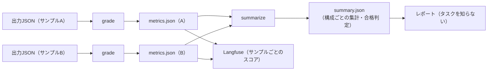

# 0023. 採点器の入出力：grade と summarize の2つのコマンドにする

- ステータス：提案
- 日付：2026-10-28
- 決定者：kajiwara（未決定。Claude の案）
- 関係するADR：[0017](0017-grader-single-go-module.md)（採点器のコードの置き場所）、[0018](0018-results-include-subject-info.md)（結果に被験エージェントの情報を含める）

## 背景

- 採点器は、1つのGoのコマンドから呼ぶ（[0017](0017-grader-single-go-module.md)）。実行スクリプトとの受け渡しの決まりを決める必要がある。
- このタスクの指標（誤答率など）は、サンプルごとの率を平均するのではなく、**すべてのカードの件数を足してから率を出す**（設計書 8.3 の「全枚数」が分母）。集計の仕方は、タスクごとに違う。
- 第二の目的のためには、レポートや Langfuse への送信が、タスクの中身を知らなくても動くようにしたい。

## 検討した選択肢

| 選択肢 | 内容 | 良い点 | 弱い点 |
|---|---|---|---|
| A. 採点だけ | 採点器はサンプルごとの採点だけをし、集計はレポートが行う | 採点器が単純 | レポートが、タスクごとの集計の仕方を知る必要がある。タスクを足すたびにレポートを直す |
| **B. 採点と集計の2つ** | 採点器に、サンプルごとの採点（`grade`）と、構成ごとの集計（`summarize`）の2つのコマンドを持たせる | 集計の仕方を、タスクのことを知っている採点器に閉じ込められる。レポートはタスクを知らなくてよい | 採点器のコマンドが2つになる |

## 決定（案）

**B にする。**



| コマンド | 受け取るもの | 返すもの |
|---|---|---|
| `grade` | 1つのサンプルの出力JSON、正解データ、メタ情報 | `metrics.json`（サンプル1つ分） |
| `summarize` | 1つの被験構成の、すべての `metrics.json`、`task.yaml`（合格ライン） | `summary.json`（構成ごと） |

呼び出し方の例：

```
grader grade     --task buylist-card-id --output <出力JSON> --gold <正解データ> --meta <メタ情報> --out <metrics.json>
grader summarize --task buylist-card-id --in <metrics.jsonのフォルダ> --out <summary.json>
```

`metrics.json` は、タスクが変わっても共通の **外側の形** と、タスクごとの **中身** に分ける。

| 部分 | 共通か | 内容 |
|---|---|---|
| `task`、`sample_id`、各種の版 | 共通 | どのタスク・サンプル・採点器・正解データの版で採点したか |
| `run` | 共通 | 誰が解いたか。実行スクリプトが書き足す（[0018](0018-results-include-subject-info.md)） |
| `status` | 共通 | `graded`（採点できた）／`format_error`（出力がスキーマに合わない）／`no_output`（出力がない） |
| `counts` | 形は共通、名前はタスクごと | 足し算できる件数。`summarize` はこれを足して集計する |
| `scores` | 形は共通、名前はタスクごと | サンプル1つ分の率などの数値。Langfuse にスコアとして送る |
| `details` | タスクごと | カードごとの判定など。評価用ハーネスは中身を読まない |

終了コード：

| 終了コード | 意味 |
|---|---|
| `0` | 採点できた。出力が壊れていても、`status: format_error` として結果を書けたら `0` |
| `0` 以外 | 採点器そのものの失敗（正解データが読めない、定義に合わないなど） |

## 理由

- **集計の仕方を、タスクを知っている採点器に閉じ込めるため。** 「件数を足してから率を出す」といった集計の仕方はタスクごとに違う。採点器に任せれば、レポートは集計の中身を知らずに、`summary.json` を表示するだけで済む。A を選ばなかったのはこのため。
- **結果の外側の形を共通にするのは、** レポートや Langfuse への送信を、タスクが変わっても書き直さずに済ませるため。`status`・`counts`・`scores` を、名前を知らなくても扱える数値の集まりとして扱う。
- **「出力が壊れていた」を、採点器の失敗と分けるのは、** 出力が壊れているのは被験エージェントの成績（形式エラー）であり、採点器の不具合とは別だから。形式エラーも結果として残す（設計書 7.2）。

## 影響（採用した場合）

- 設計書 8章（採点器）と 9章（レポート）を直す。
- TODO 11章（採点器）を、この形に合わせて直す。

## 決めること

- `grade` と `summarize` の2つにするか
- `metrics.json` の共通の外側（`status`・`counts`・`scores`）と、タスクごとの中身（`details`）の分け方
- 終了コードの決まり
