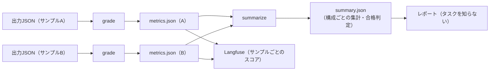
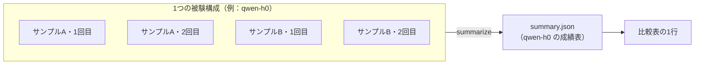

# 0023. 採点器の入出力：grade と summarize の2つのコマンドにする

- ステータス：採用
- 日付：2026-10-28
- 決定者：kajiwara
- 関係するADR：[0017](0017-grader-single-go-module.md)（採点器のコードの置き場所）、[0018](0018-results-include-subject-info.md)（結果に被験エージェントの情報を含める）

## 背景

- 採点器は、1つのGoのコマンドから呼ぶ（[0017](0017-grader-single-go-module.md)）。実行スクリプトとの受け渡しの決まりを決める必要がある。
- このタスクの指標（誤答率など）は、サンプルごとの率を平均するのではなく、**すべてのカードの件数を足してから率を出す**（設計書 8.3 の「全枚数」が分母）。集計の仕方は、タスクごとに違う。
- 第二の目的のためには、レポートや Langfuse への送信が、タスクの中身を知らなくても動くようにしたい。

## 検討した選択肢

| 選択肢 | 内容 | 良い点 | 弱い点 |
|---|---|---|---|
| A. 採点だけ | 採点器はサンプルごとの採点だけをし、集計はレポートが行う | 採点器が単純 | レポートが、タスクごとの集計の仕方を知る必要がある。タスクを足すたびにレポートを直す |
| **B. 採点と集計の2つ** | 採点器に、サンプルごとの採点（`grade`）と、構成ごとの集計（`summarize`）の2つのコマンドを持たせる | 集計の仕方を、タスクのことを知っている採点器に閉じ込められる。レポートはタスクを知らなくてよい | 採点器のコマンドが2つになる |

## 決定

**B にする。**



| コマンド | 受け取るもの | 返すもの |
|---|---|---|
| `grade` | 1つのサンプルの出力JSON、正解データ、メタ情報、実行の情報（`run.json`） | `metrics.json`（サンプル1つ分） |
| `summarize` | 1つの被験構成の、すべての `metrics.json`、`task.yaml`（合格ライン）、実行の情報（`run.json`） | `summary.json`（構成ごとの成績表） |

呼び出し方の例：

```
grader grade     --task buylist-card-id --output <出力JSON> --gold <正解データ> --meta <メタ情報> --run <run.json> --out <metrics.json>
grader summarize --task buylist-card-id --in <metrics.jsonのフォルダ> --run <run.json> --out <summary.json>
```

`metrics.json` は、タスクが変わっても共通の **外側の形** と、タスクごとの **中身** に分ける。

| 部分 | 共通か | 内容 |
|---|---|---|
| `task`、`sample_id`、各種の版 | 共通 | どのタスク・サンプル・採点器・正解データの版で採点したか |
| `run` | 共通 | 誰が解いたか。実行スクリプトから受け取った `run.json` を、採点器の共通の処理がそのまま書き写す（[0018](0018-results-include-subject-info.md)） |
| `status` | 共通 | `graded`（採点できた）／`format_error`（出力がスキーマに合わない）／`no_output`（出力がない） |
| `counts` | 形は共通、名前はタスクごと | 足し算できる件数。`summarize` はこれを足して集計する |
| `scores` | 形は共通、名前はタスクごと | サンプル1つ分の率などの数値。Langfuse にスコアとして送る |
| `details` | タスクごと | カードごとの判定など。評価用ハーネスは中身を読まない |

### `summary.json`（構成ごとの成績表）

`summary.json` は、**1つの被験構成について、すべてのサンプルと繰り返しをまとめた成績表**。レポートの比較表の1行が、1つの `summary.json` にあたる。



中身の例（数値は説明のための例）：

```json
{
  "run": {
    "config": "qwen-h0",
    "model": "qwen3-8-27b",
    "harness": "buylist-card-id-h0",
    "harness_level": "H0",
    "harness_components": [],
    "harness_hash": "sha256:…"
  },
  "task": "buylist-card-id",
  "task_version": 1,
  "grader_version": "0.1.0",
  "gold_version": 1,
  "samples": 3,
  "repeats": 3,
  "status": { "graded": 8, "format_error": 1, "no_output": 0 },
  "counts": {
    "cards": 189,
    "identified_correct": 140,
    "identified_wrong": 6,
    "unknown": 43
  },
  "scores": {
    "identified_rate": 0.741,
    "wrong_rate": 0.032,
    "unknown_rate": 0.228,
    "precision": 0.959,
    "effective_score": 128
  },
  "stability": {
    "identified_rate": { "mean": 0.741, "worst": 0.70, "stdev": 0.03 }
  },
  "pass": {
    "wrong_rate": { "value": 0.032, "max": 0.02, "ok": false },
    "identified_rate": { "value": 0.741, "min": 0.80, "ok": false },
    "format_errors": { "value": 1, "max": 0, "ok": false },
    "overall": false
  }
}
```

| 欄 | 内容 | 設計書との対応 |
|---|---|---|
| `run` | どの被験構成の成績か（繰り返しの番号は含まない） | [0018](0018-results-include-subject-info.md) |
| `samples`、`repeats` | 何件のサンプルを、何回ずつ解かせたか | ― |
| `status` | 採点できた回数、形式エラーの回数など | 7.2 |
| `counts` | すべてのサンプル・繰り返しの件数を足したもの | 8.3 の「全枚数」 |
| `scores` | 件数から計算した率（同定正答率、誤答率、不明率、適合率、有効スコア） | 8.3 |
| `stability` | 繰り返しのばらつき（平均、最悪値、標準偏差） | 8.3 の「安定性」 |
| `pass` | 合格ラインごとの判定と、全体の合否（`task.yaml` の `pass`） | 8.4 |

- `summary.json` に入れるのは **品質（QCDのQ）** だけ。所要時間・トークン数・費用（速さとコスト）は採点とは関係がないので入れない。これらは実行記録（`run.yaml`）にあり、比較表を作るときに、レポートが `summary.json` と `run.yaml` を合わせて並べる。

終了コード：

| 終了コード | 意味 |
|---|---|
| `0` | 採点できた。出力が壊れていても、`status: format_error` として結果を書けたら `0` |
| `0` 以外 | 採点器そのものの失敗（正解データが読めない、定義に合わないなど） |

## 理由

- **集計の仕方を、タスクを知っている採点器に閉じ込めるため。** 「件数を足してから率を出す」といった集計の仕方はタスクごとに違う。採点器に任せれば、レポートは集計の中身を知らずに、`summary.json` を表示するだけで済む。A を選ばなかったのはこのため。
- **結果の外側の形を共通にするのは、** レポートや Langfuse への送信を、タスクが変わっても書き直さずに済ませるため。`status`・`counts`・`scores` を、名前を知らなくても扱える数値の集まりとして扱う。
- **「出力が壊れていた」を、採点器の失敗と分けるのは、** 出力が壊れているのは被験エージェントの成績（形式エラー）であり、採点器の不具合とは別だから。形式エラーも結果として残す（設計書 7.2）。

## 影響

- 設計書 8章（採点器）と 9章（レポート）を直す。
- 実行スクリプトは、採点器を呼ぶ前に `run.json` を作り、`--run` で渡す（[0018](0018-results-include-subject-info.md)）。
- レポートは、`summary.json`（品質）と `run.yaml`（速さとコスト）を合わせて比較表を作る。
- TODO 11章（採点器）を、この形に合わせて直す。
