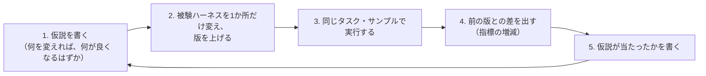

# 0024. 被験ハーネスの改善の差分と、結果への影響を見えるようにする

- ステータス：提案
- 日付：2026-10-28
- 決定者：kajiwara（未決定。Claude の案）
- 関係するADR：[0018](0018-results-include-subject-info.md)（結果に被験エージェントの情報を含める）、[0022](0022-harness-level-and-version.md)（被験ハーネスの段階と版、提案）

## 背景

- 第一の目的は、ハーネスの設計が出力に与える影響を確かめること（設計書 0.3）。そのためには、**何を変えたか** と **結果がどう変わったか** を、結びつけて見られる必要がある。
- 設計書 6.5 では、被験ハーネスの部品は「仮説」として扱い、評価で採否を決めるとしている。
- 決定者からは、「ハーネスの改善箇所と結果が見えるようにしたい」「改善の差分がどのような影響を与えるのかを見たい」という要望がある。

## 検討した選択肢

| 選択肢 | 内容 | 良い点 | 弱い点 |
|---|---|---|---|
| A. 結果だけを残す | 結果のファイルと比較表だけを残し、変更の内容は Git の履歴で見る | 手間が少ない | 何を狙って変えたのか（仮説）が残らない。結果と変更を毎回突き合わせる必要がある |
| **B. 仮説・変更・結果・差を1つの流れで残す** | 変更の前に仮説を書き、変更と結果を版で結びつけ、前の版との差を比較表に出す | 何を・なぜ変えて・どうなったかが、1か所で追える。仮説が当たったかも残る | 変更のたびに、変更の記録を書く手間がかかる |

## 決定（案）

**B にする。** 次の流れで残す。



| 残すもの | 置き場所の案 | 中身 |
|---|---|---|
| 変更の記録 | 被験ハーネスのフォルダの `CHANGELOG.md` | 版ごとに、何を変えたか、仮説、関係するコミット、仮説が当たったか |
| 変更そのもの | Git のコミット | プロンプトなどの差分。`harness_hash` で結果とつながる（[0018](0018-results-include-subject-info.md)） |
| 結果 | `summary.json`（構成ごと） | 版ごとの指標 |
| 前の版との差 | レポートの比較表 | 指標の増減 |

比較表のイメージ：

| 構成 | 段階・版 | 変えたこと | 誤答率 | 前の版との差 | 同定正答率 | 前の版との差 |
|---|---|---|---|---|---|---|
| qwen-h2 | H2 1版 | カードDBの検索を足した | 6.0% | ― | 70% | ― |
| qwen-h2 | H2 2版 | 検索の結果の渡し方を変えた | 4.5% | −1.5 | 74% | +4 |
| qwen-h2 | H2 3版 | プロンプトの言い回しを変えた | 4.8% | +0.3 | 75% | +1 |

変更の記録の例：

```markdown
## H2 3版（2026-11-10）
- 変えたこと：プロンプトで、パック名の書き方の例を示した
- 仮説：パック名の表記ゆれによる特定ミスが減り、誤答率が下がる
- コミット：abc1234
- 結果：誤答率 +0.3ポイント（4.5% → 4.8%）。ばらつきの範囲内で、効果は見られなかった
- 判断：採用しない（2版に戻す）
```

- **ばらつきも一緒に見る。** 同じ構成でも、実行のたびに結果は揺れる（設計書 8.3）。小さな差が改善によるものか、ただの揺れかを見分けるため、繰り返しの回数・最悪値・ばらつきを比較表に並べる。
- Langfuse でも、実験の名前に段階と版を入れて、比較の画面で同じように見比べられるようにする（[0007](0007-use-langfuse-for-scoring-and-tracing.md)）。

## 理由

- **何を・なぜ変えて・どうなったかを、1か所で追えるようにするため。** 第一の目的は、ハーネスの設計の影響を確かめることなので、結果だけでなく、変更の狙い（仮説）も残す必要がある。
- **仮説を先に書くのは、** 結果を見てから都合よく解釈するのを防ぐため。設計書 6.5 の「部品は仮説として扱い、評価で採否を決める」を、日々の改善の単位で回せるようにする。
- **前の版との差を比較表に出すのは、** 改善の効果を、毎回自分で計算しなくても見られるようにするため。
- A を選ばなかったのは、何を狙って変えたのかが残らず、あとから「なぜこの変更をしたのか」が分からなくなるため。

## 影響（採用した場合）

- 設計書 6.5（部品の採否）と 9章（レポート）に、この流れを足す。
- レポートに「前の版との差」と「ばらつき」の列を足す（TODO 12章）。
- 被験ハーネスのフォルダに `CHANGELOG.md` を置く。

## 決めること

- この流れで残すか
- 変更の記録の置き場所（被験ハーネスのフォルダの `CHANGELOG.md` か、別の場所か）
- M0 から始めるか（M0 は H0 だけなので、M1 で H2 を足すときから始めてもよい）
