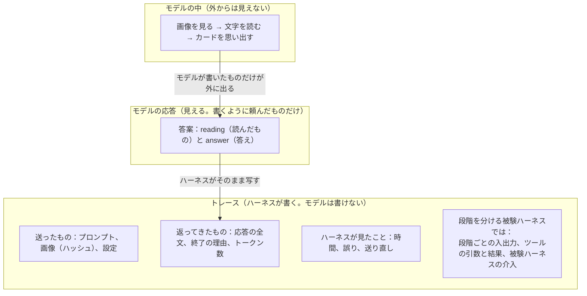
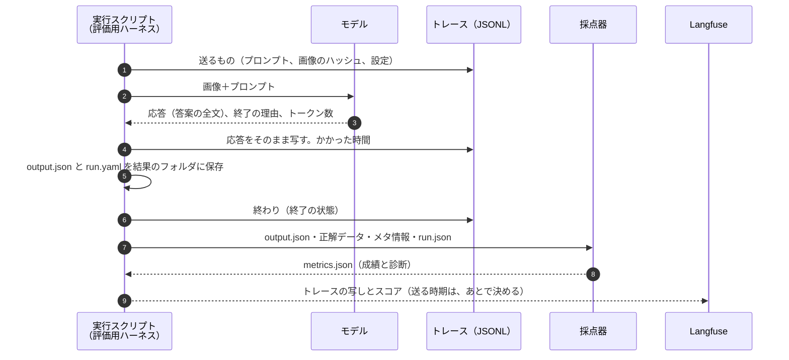
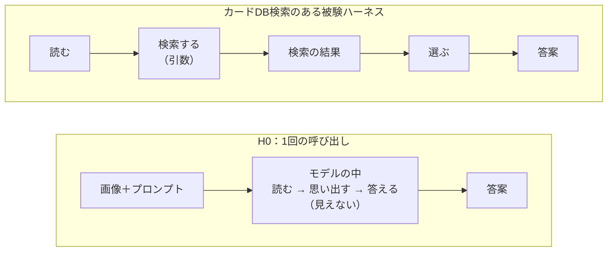
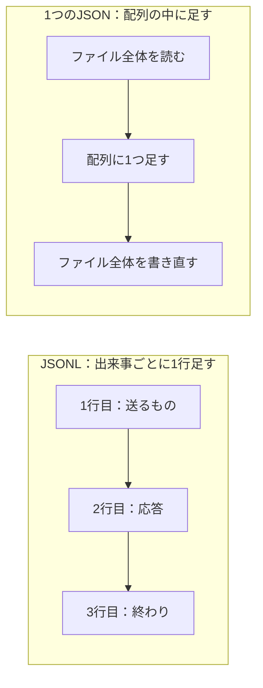

# 0050. トレースは、実行スクリプトがJSONLで結果のフォルダに残し、元の記録にする（0007・0010の一部を明確にする）

- ステータス：採用
- 日付：2026-11-02
- 決定者：kajiwara
- 関係するADR：[0007](0007-use-langfuse-for-scoring-and-tracing.md)（Langfuseを使う）、[0010](0010-self-host-langfuse.md)（Langfuseの運用）、[0012](0012-implementation-language-go.md)（実装言語：Go。トレースの送り方）、[0023](0023-grader-interface.md)（採点器の入出力）、[0037](0037-results-and-diagnosis.md)（成績と診断）、[0040](0040-intermediate-results-for-diagnosis.md)（段階ごとの中間結果）、[0047](0047-output-reading-and-answer.md)（reading と answer）

## 背景

- 評価用ハーネスの目的は、被験ハーネスのどこに問題があり、どこを直せばよいかを見えるようにすることである（[0037](0037-results-and-diagnosis.md)）。そのために、出力（答案）に、答え（`answer`）と、画像から読んだもの（`reading`）を書かせる。採点器は、それを正解と比べて、成績と診断を出す（[0040](0040-intermediate-results-for-diagnosis.md)、[0047](0047-output-reading-and-answer.md)）。
- ただ、答案からわかるのは、答案に書かれていることだけである。次のことは、答案からはわからない。
  - 答案がなぜその状態になったか（出力の上限で切れた、断られた、JSONの前後に文章が付いた、時間切れ）
  - どんな条件で解かせたか（実際に送ったプロンプトと画像、設定）
  - 段階を分けたりツールを使ったりする被験ハーネスで、どの段階で外れたか（検索の引数と結果、被験ハーネスのやり直しや補正）
- このような、被験エージェントが解いているあいだに起きたことの記録を、ここでは **トレース** と呼ぶ。実行の条件とまとめの数字を残す実行記録（`run.yaml`、設計書 5.5）とは別のものである。
- 今の計画では、トレースの送り先はLangfuseだけである（[0012](0012-implementation-language-go.md)）。結果のフォルダには、答案（`output.json`）と実行記録（`run.yaml`）しか残らない。
- そのLangfuseは、採点器とCSVの出力ができてから立て、使うときだけ動かす（[0010](0010-self-host-langfuse.md)）。このままでは、Langfuseを立てる前の実行や、止めているあいだの実行のトレースが、どこにも残らない。
- [0010](0010-self-host-langfuse.md) では、結果の正式な記録はCSVとし、Langfuseは比較と分析に使うと決めている。ただ、トレースの元の記録をどこに置くかは、決めていなかった。

### 試験に見立てると

答案とトレースの関係は、試験に見立てるとわかりやすい。

| 試験 | このタスク | 書き手 |
|---|---|---|
| 受験者の頭の中で考えること（誰にも見えない） | モデルの中で起きていること（画像を見る、文字を読む、カードを思い出す） | ― |
| 問題用紙の「途中式も書くこと」 | 出力のスキーマ（`output.schema.json`）の `reading` の欄 | 評価用ハーネス |
| 答案に書いた途中式 | `reading`：画像から読んだもの | 被験エージェント |
| 答案の答え | `answer`：どのカードか、価格 | 被験エージェント |
| 試験監督の記録（配ったもの、時間、途中の出来事、提出された答案の写し） | トレース | ハーネス（実行スクリプト、被験ハーネスのコード） |
| 採点 | 採点器が出す成績と診断（`metrics.json`） | 採点器 |

- **試験監督は、受験者の頭の中を見られない。** 見えるのは、受験者が書いたもの（答案）と、自分の目で見た出来事（記録）だけである。
- **途中式は、受験者にしか書けない。** 頭の中に立ち会っているのは受験者だけだからである。ただし、見えるのは本人が書いた途中式で、頭の中そのものではない。先に答えを決めてから、途中式を合わせて書いた可能性もある。
- **試験監督の記録は、点数を変えない。** 点数がなぜそうなったかを説明する。
- **問題を何枚かの用紙に分けて配ると、試験監督は1枚ずつ回収できる。** まず「印刷されている文字を書き写す用紙」を回収し、次に「その用紙を見てカードを特定する用紙」を配れば、どの用紙で間違えたかが記録に残る。段階を分ける被験ハーネスが、これにあたる。

何がどこまで見えるかを図にすると、次のようになる。



モデルの中で読んだ結果は、モデルが応答に書かない限り、どこにも出てこない。トレースは、モデルの応答を写すことはできるが、モデルの中を写すことはできない。`reading` は、モデルの中で読んだ結果を、応答に書き出してもらうための欄である。

## 検討した選択肢

| 選択肢 | 良い点 | 弱い点 |
|---|---|---|
| A. 今のまま。トレースはLangfuseにだけ送る | 作るものが少ない。画面で見られる | Langfuseを立てる前や、止めているあいだの実行は、トレースが残らない。結果のフォルダを見ても、その実行で何が起きたかを追えない |
| B. トレースは残さず、答案と実行記録だけを残す | いちばん単純 | 答案がなぜその状態になったか、途中のどこで外れたかがわからない |
| C. トレースを残し、`reading` を答案から外してトレースに移す | 答案が答えだけになる | H0では、`reading` を書くようにモデルに頼む必要は変わらない。採点器が、被験ハーネスごとのトレースの形を知る必要が出る。トレースのない被験エージェントは診断できない |
| D. トレースを、実行ごとに1つのJSONファイルにまとめる | ファイル全体を1つのデータとして読める | 出来事が起きるたびに、ファイル全体を書き直す。途中で止まると、それまでの記録が壊れたり、失われたりする |
| **E. 実行スクリプトがトレースをJSONLで結果のフォルダに残し、元の記録にする。答案はそのまま。Langfuseは写しを受け取る** | 必ず結果のフォルダに残る。途中で止まっても、そこまでの記録が残る。答案と採点の決まりを変えずに済む | 記録する仕組みを作る必要がある。出来事の形を決める必要がある。実行ごとにファイルが1つ増える |

## 決定

**E にする。**

- **実行スクリプトは、トレースをJSONLで、実行ごとの結果のフォルダ（`results/<run_id>/`）に残す。** これを、その実行で何が起きたかの **元の記録** にする。
  - JSONLは、1行に1つのJSONを書くテキストファイルである。出来事が起きるたびに、末尾に1行ずつ足していく。
- **Langfuseは、トレースの写しを受け取って見せる場所にする。** Langfuseを止めていても、トレースは結果のフォルダに残る。
- **答案と、採点の決まりは変えない。** 成績は、これまでどおり答案だけで決める（[0038](0038-score-by-assertion.md)、[0039](0039-deliverables-and-intermediates.md)）。`reading` も、これまでどおり答案に書かせる（[0047](0047-output-reading-and-answer.md)）。
- **トレースは成績を変えず、成績がなぜそうなったかを説明するのに使う。**

### 答案とトレースの役割

| | 答案（`output.json`） | トレース（JSONL） |
|---|---|---|
| 何の記録か | 被験エージェントの答え（`answer`）と、読んだもの（`reading`） | 答案ができるまでに起きたこと |
| 書き手 | 被験エージェント。H0ではモデルそのもの | ハーネス。H0では実行スクリプト。**モデルは書けない** |
| 中身 | モデルが何と答えたか | ハーネスが何を見たか。「モデルがこう答えた」という事実も含む |
| 形 | どの被験エージェントでも同じ（`output.schema.json`） | 被験ハーネスによって、出来事の数と種類が違う |
| 使い道 | 成績と診断。採点器が正解と比べる | デバッグ。人が1件ずつ読む。のちに、被験ハーネスの介入の分析 |
| 成績への影響 | 成績を決める | 変えない |

### 置き場所

```
results/<run_id>/
├── run.yaml       実行記録：実行の条件と、まとめの数字（所要時間、トークン数、終了の状態）
├── trace.jsonl    トレース：解いているあいだに起きたことを、1行に1つずつ（この決定で足す。ファイル名は案）
├── output.json    答案：被験エージェントの答えと、読んだもの
└── metrics.json   採点の結果：成績と診断
```

### 記録の決まり

| 決まり | 中身 | 理由 |
|---|---|---|
| 書くのはハーネスだけ | モデルの応答は、ハーネスが受け取った直後に、そのまま写して書く。モデルは書き込めない | モデルの言い分ではなく、ハーネスが見た事実の記録にするため。モデルの生の応答と、ハーネスが手を加えたあとの値の両方を残せる |
| 誰がしたことかを分ける | 出来事ごとに、モデル、被験ハーネス、ツール、実行スクリプト（評価用ハーネス）のどれがしたことかを書く | 実行スクリプトがAPIの誤りで送り直したり、時間切れで止めたりするのは、被験ハーネスの介入ではない。分けないと、被験ハーネスの貢献を多く数えてしまう |
| 採点の結果は書かない | 成績と診断は `metrics.json` に残す。トレースとは `run_id` で突き合わせる | 正解データを直して（`gold_version` を上げて）採点し直しても、トレースを書き換えずに済む（[0011](0011-immutable-infrastructure.md) の「作ったものは変えない」） |
| 画像は中身を書かない | 画像は、ハッシュと置き場所で残す | ファイルが大きくなるのを防ぐ。画像そのものはサンプルのフォルダにある |
| 思考は、人が読むためだけに使う | 思考が返ってくるときは記録する。ただし、機械の診断には使わない | モデルによって、見える深さが違う（[0009](0009-models-for-m0.md)）。2026年11月時点で、Opus 5.5は思考を空か要約でしか返さない。Qwenは、思考を切らなければ、思考の文章がそのまま得られる。診断に使うと、同じ物差しで比べられない |

### 記録の例

項目の名前は説明のための例で、実際の形は実行スクリプトを作るときに決める。

**H0**（1回の呼び出し）：M0では、記録する出来事はこの程度で足りる。ほかに、APIの誤りと送り直しがあれば記録する。

```jsonl
{"seq":1,"actor":"runner","type":"request","model":"opus-5-5","image":"sha256:…","prompt":"sha256:…"}
{"seq":2,"actor":"llm","type":"response","stop_reason":"end_turn","text":"{\"grid\":{…},\"cards\":[{\"position\":{…},\"reading\":{\"name\":\"ワタッコ\",\"price_text\":\"2,000円\",…},\"answer\":{…}},…]}","usage":{…},"duration_ms":…}
{"seq":3,"actor":"runner","type":"end","exit":"ok"}
```

**段階を分け、ツールを使う被験ハーネス**：段階やツールを足すときに、出来事の種類を増やす。

```jsonl
{"seq":1,"actor":"harness","type":"request","stage":"read","cell":"1-1","image":"sha256:…（切り出したマス）"}
{"seq":2,"actor":"llm","type":"response","stage":"read","text":"{\"name\":\"ワタッコ\",\"hp\":90,\"price_text\":\"2,000円\"}"}
{"seq":3,"actor":"harness","type":"request","stage":"identify","input":"（2行目の読み取りの結果）"}
{"seq":4,"actor":"llm","type":"tool_call","name":"search_card","args":{"name":"ワタッコ","hp":90}}
{"seq":5,"actor":"tool","type":"tool_result","name":"search_card","hits":3}
{"seq":6,"actor":"llm","type":"response","stage":"identify","text":"{\"pack\":…,\"number\":…}"}
```

### 1回の実行の流れ

[0012](0012-implementation-language-go.md) の流れに、トレースを書く手順を足したもの。



## 理由

### 優位性のまとめ

| 優位性 | 中身 | 選ばなかった選択肢 |
|---|---|---|
| 答案だけではわからない「なぜ」がわかる | 答案が壊れた理由、解かせた条件、時間と費用 | B |
| 読み取りより後のどこで外れたかを、観測で追える | 段階ごとの入出力、ツールの引数と結果、被験ハーネスの介入 | B |
| 成績と答案を変えずに済む | 採点器と答案の形を、そのまま使える | C |
| 必ず結果のフォルダに残る | Langfuseを立てる前でも、止めているあいだでも残る | A |
| 途中で止まっても残る | 1行ずつ足すので、時間切れや異常終了の前までの記録が残る | D |
| 道具で調べやすい | 1行が1つの出来事なので、grep や jq で絞り込める。DuckDB で、そのまま表として SQL で集計できる | D |

### トレースを残す理由（B を選ばなかった理由）

**答案だけではわからないことがわかるため。** トレースからわかることは、次の4つである。

| わかること | 試験でいうと | このタスクの例 | H0で取れるか |
|---|---|---|---|
| 解かせた条件 | 配った問題用紙、時間、受験者 | 実際に送ったプロンプトと画像、モデル、設定 | 取れる |
| 答案がその状態になった理由 | 時間切れ、答案を出さなかった、枠の外に書いた | 出力の上限で切れた、断られた、JSONが壊れた、時間切れ、APIの誤りで送り直した | 取れる |
| 途中の手順 | 用紙を分けて配ったときの、1枚ずつの回収 | 段階ごとの入出力、ツールの引数と結果、被験ハーネスの介入（検証、やり直し、補正） | 取れない（段階がない） |
| かかった時間と費用 | 各問にかけた時間 | 呼び出しごとのトークン数と時間 | 取れる |

たとえば、形式の誤りのうち「読めない」（[0041](0041-format-error-kinds-and-units.md)）は、原因によって直す場所が違う。出力の上限で切れたなら上限の設定を、JSONの前後に文章を付けたならプロンプトの書き方を直す。答案は壊れているので、答案からは原因がわからない。トレースには、返ってきた文章そのものと、終了の理由が残る。

**成績を変えずに、評価を深くできるため。**

| 評価のどこに効くか | 効き方 |
|---|---|
| 成績 | 変わらない。答案だけで決める |
| 診断 | 答案での診断（読み取り、照合など。[0040](0040-intermediate-results-for-diagnosis.md)）に、「なぜ」を足す |
| 改善の確かめ（[0024](0024-show-harness-changes-and-effects.md)） | 部品を足したとき、狙いどおりに動いたかがわかる。たとえば、出力の検証とやり直しを足したら（[0044](0044-schema-enforcement-is-harness-part.md)）、何回やり直して、何件直ったか |
| あとで足せる測り方 | 被験ハーネスの段階ごとに、「1回目でそのまま成功」「被験ハーネスの介入があって成功」「介入しても失敗」に分けられる。被験ハーネスの貢献を数字で表せる。トレースがないと測れない |

**読み取りより後のどこで外れたかを、観測で追えるため。** H0と、カードDB検索のある被験ハーネスを比べると、違いがはっきりする。



H0のトレースに残るのは、両端（送ったものと答案）だけである。段階を分けると、間の出来事が1つずつトレースに残る。

例として、`reading` の印刷名・HPは正しいのに、パック・番号を間違えたカード（照合の誤り）を考える。H0では、答えを決めるまでがすべてモデルの中で起きるので、わかるのは「照合の誤り」までである。カードDB検索のある被験ハーネスでは、同じ照合の誤りを、トレースで次のように分けられる。

| トレースに残っていたこと | 原因 | 直す場所 |
|---|---|---|
| 正しい印刷名で検索し、結果に正解があったのに、別のカードを選んだ | 選び方 | 選び方の指示、自己検証（H3） |
| 正しい印刷名で検索したのに、結果が0件だった | カードDBの抜け、または検索の決まり（完全一致など） | カードDB、検索の道具 |
| 印刷名を変えて検索した（「ex」を「EX」にした、など） | 引数の誤り | 表記の補正、道具の説明 |
| 検索を呼ばずに答えた | 道具を使わなかった | 道具の使い方の指示、流れの固定 |

- **モデルの言い分ではなく、ハーネスが見た事実で確かめられる。** モデルが「検索した」と書いていても、ツールを動かすのはハーネスなので、トレースに検索の記録がなければ、検索していないと確定できる。言い分と事実の食い違いも、それ自体が診断の材料になる。
- **候補の中に正解があったか（[0046](0046-gold-in-candidates-diagnosis.md)）も、事実として確かめられる。** モデルが答案に書いた候補だけでなく、検索の結果に正解があったかも見られる。
- **段階の間の受け渡しの誤りを見つけられる。** 段階を分ける被験ハーネスでは、トレースにある読み取りの段階の出力と、答案の `reading` を突き合わせられる。違っていれば、段階の間で結果を受け渡すハーネスのコードが壊れている。モデルの失敗ではないので、成績とは別に見つけたい。なお、H0では、トレースの応答は答案の写しなので、2つは必ず一致する。突き合わせても、新しいことはわからない。

### 元の記録を結果のフォルダに置く理由（A を選ばなかった理由）

- **Langfuseがなくても、トレースが残るようにするため。** Langfuseは、採点器とCSVの出力ができてから立て、使うときだけ動かす（[0010](0010-self-host-langfuse.md)）。トレースをLangfuseにだけ送ると、最初の実行や、止めているあいだの実行のトレースが失われる。結果のフォルダに残せば、Langfuseを立てたあとで、写しを送れる。
- **1つの結果のフォルダで、その実行を説明できるようにするため。** 実行記録（条件）、トレース（経過）、答案、採点の結果が、同じフォルダにそろう。
- **結果の正式な記録の考え方にそろえるため。** [0010](0010-self-host-langfuse.md) では、正式な記録はCSVとし、Langfuseは比較と分析に使うと決めている。トレースも、元の記録は結果のフォルダに置き、Langfuseは見て比べる場所にする。採点をLangfuseに頼らないと決めた [0033](0033-grading-by-grader-not-langfuse.md) と同じ考え方でもある。
- Langfuseの画面で見たり、構成どうしを比べたりする良さは、写しを送ることで残る。

### JSONLにする理由（D を選ばなかった理由）



| 観点 | JSONL | 1つのJSON |
|---|---|---|
| 書き足し | 末尾に1行足すだけ | 出来事のたびに、ファイル全体を書き直す |
| 途中で止まったとき | そこまでの行は残る | 書き直しの途中で止まると、ファイルが壊れることがある。最後にまとめて書く形だと、何も残らない |
| 絞り込み | 1行が1つの出来事なので、grep や jq でそのまま絞り込める | ファイル全体を読み込んでから探す |
| 集計 | DuckDB で、そのまま表として SQL で集計できる | 形をそろえ直してから集計する |
| 人が読む | 1行ずつ、起きた順に読める | 入れ子をたどって読む |

- **途中で止まった実行こそ、記録が要るため。** 時間切れや形式の誤りも、結果として残す（設計書 7.2）。止まった実行で何が起きたかを調べるには、止まる前までの記録が残っている必要がある。
- **たくさんの実行を、まとめて調べられるため。** 構成・サンプル・繰り返しごとにファイルができる。1行が1つの出来事なら、たくさんのファイルを、道具でまとめて絞り込み、集計できる。

### reading をトレースに移さない理由（C を選ばなかった理由）

- **H0では、どちらにしても、`reading` を書くようにモデルに頼む必要があるため。** 読み取りの結果は、モデルが書かない限り見えない。トレースに移しても、頼む部分はなくならない。H0では、トレースの応答は答案そのものなので、置き場所が変わるだけである。
- **採点器が、被験ハーネスごとのトレースの形を知らずに済むようにするため。** トレースの形は、被験ハーネスによって違う。採点器がトレースから読むと、どの被験ハーネスも、決まった形の「読み取りの出来事」を出す必要がある。これは、被験ハーネスの中の段階の形を、評価する側が決めることになる。評価する側が決めるのは、最後に出す答案の形だけにしたい。答案の欄なら、1回で書くか、段階に分けて集めるかは、被験ハーネスの自由のままである。
- **トレースのない被験エージェントも、同じ物差しで診断するため。** Webアプリで動かす参考値（Gemini）には、トレースがない。既製のハーネス（Claude Code、Codexなど）は、独自の形で記録を出す。答案の `reading` なら、どの被験エージェントからも同じ形で受け取れる。

## あとで決めること

- 記録する出来事の種類と、それぞれの項目。実行スクリプトを作るとき（TODO 10章）に決める。
- 自前の形で書くか、OpenTelemetryの形でファイルに書くか。OpenTelemetryの形にそろえると、ほかの道具に渡しやすい。実行スクリプトを作るときに決める。
- Langfuseに写しを送るのを、実行と同時にするか、あとからまとめてするか。Langfuseを立てるとき（TODO 6章）に決める。
- トレースのファイルが大きくなったときの扱い（分ける、圧縮する）。

## 影響

- 実行スクリプト（TODO 10章）に、トレースをJSONLで残す仕組みを足す。M0では、送ったもの、返ってきた応答、終わり、誤りと送り直しから始める。
- 採点器（TODO 11章）は変わらない。受け取るのは、これまでどおり答案・正解データ・メタ情報・`run.json` である（[0023](0023-grader-interface.md)）。
- Langfuse（TODO 6章・12章）は、トレースの写しを受け取る場所になる。Langfuseへの送り方（OpenTelemetryのGo SDK）は、[0012](0012-implementation-language-go.md) のまま変えない。
- [0007](0007-use-langfuse-for-scoring-and-tracing.md) の「記録・観測にLangfuseを使う」は、「トレースの元の記録は結果のフォルダのJSONL。Langfuseは、その写しを見て比べる場所」と読む。
- [0010](0010-self-host-langfuse.md) の「実行スクリプトがトレースを送る前に、Langfuseを起動しておく」は、写しを実行と同時に送る場合にだけ要る。
- 実行記録（`run.yaml`）の `langfuse_trace_id`（設計書 5.5）は、Langfuseの写しとつなぐために残す。
- README に、トレースを残すことを書く。設計書の 3.1・3.2・4章・5.5・7章は、TODO 3章でまとめて直す。
- `results/` は git の管理の外なので、トレースもリポジトリには入らない。Langfuseに画像を送ってよいかは、これまでどおり確かめる（TODO 2章）。
- 見直すきっかけ：Inspect AIへの移行を見直すとき（M2の前。[0008](0008-execution-framework.md)）。Inspect AIは、サンプルごとに、モデルの呼び出しとツールの呼び出しを記録する仕組みを持っている。
