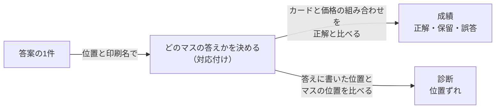

# 0051. 位置（段・列）がずれていても、カードと価格の組み合わせが合っていれば正解にする

- ステータス：採用
- 日付：2026-11-03
- 決定者：kajiwara
- 関係するADR：[0038](0038-score-by-assertion.md)（成績：正解・保留・誤答）、[0039](0039-deliverables-and-intermediates.md)（成果物と中間結果）、[0040](0040-intermediate-results-for-diagnosis.md)（段階ごとの中間結果）、[0047](0047-output-reading-and-answer.md)（reading と answer）

## 背景

- 採点器は、正解データのカード1枚ごとに成績を付ける（[0038](0038-score-by-assertion.md)）。そのためには、答案の1件ごとに、正解データのどのマスについての答えかを決める必要がある。これを **対応付け** と呼ぶ。
- 設計書 8.1 では、まず位置（段・列）で対応付け、対応付かなかったものだけを、価格＋名前で補助的に対応付けるとしていた。
- この決まりでは、1マス読み飛ばすと、後ろの答えが1つずつずれ、別のカードの正解と比べられて誤答になる。カードと価格は、正しく答えているのに、である。

| | 1-1 | 1-2 | 1-3 | 1-4 |
|---|---|---|---|---|
| 正解のマス | A | B | C | D |
| 答案（Bを読み飛ばした） | A | C | D | なし |

| 対応付けのしかた | A | B | C | D |
|---|---|---|---|---|
| 位置だけ | 正解 | Cの答えをBと比べて誤答 | Dの答えをCと比べて誤答 | 抜け |
| 位置と印刷名 | 正解 | 抜け | 正解（位置ずれ） | 正解（位置ずれ） |

- 補助の対応付けでも、この例は救えない。ずれたマスも、位置では対応付いてしまうためである。
- 価格は、対応付けの目印に向かない。価格は答え（成果物）の一部で、しかも同じ値が多い。1枚目（`magi-nagoya-20261030`）では、6,000円と3,000円が7枚ずつ、1,500円が5枚あり、3段目の6〜9列は4マス続けて6,000円である。一方、印刷名は40枚すべて違う。
- 位置は中間結果で、外れても、それだけでは誤答にしない（[0039](0039-deliverables-and-intermediates.md)）。ただ、位置がずれたときに成績をどう決めるかは、決めていなかった。

## 検討した選択肢

| 選択肢 | 良い点 | 弱い点 |
|---|---|---|
| A. 位置も成績に入れる。位置が違えば誤答 | 位置の正しさまで求められる | 1マスのずれで、後ろが全部誤答になる。カードと価格が正しくても誤答になり、「確定データとして使ってよいか」という成績の問い（[0038](0038-score-by-assertion.md)）と合わない |
| B. 位置で対応付け、対応付かなかったものだけ、価格＋名前で対応付ける（今の設計書 8.1） | 単純 | ずれたマスも位置で対応付くので、上の例を救えない。価格は答えの一部で、同じ値が多い |
| **C. 位置のずれは成績に入れない。どのマスの答えかを位置と印刷名で決め、成績はカードと価格の組み合わせで決める** | ずれても、正しい組み合わせは正解になる。成績が「データとして使えるか」と、そのまま重なる | 対応付けの決まりが増える。位置の正しさは、成績には表れない（診断で見る） |

## 決定

**C にする。**

- **成績は、カードと価格の組み合わせで決める。** 位置（段・列）が正解と違っていても、組み合わせが合っていれば正解にする。
  - ここでの「カード」は、カード名（印刷名）ではなく、答えの「何のカードか」（パック・番号・仕様。`answer.card`）である。
- **どのマスの答えかは、位置と印刷名（`reading.name`）で決める。答え（カードと価格）は使わない。** 決め方の詳しい決まりは、対応付けの決まりとして、別に決める（下の「あとで決めること」）。
- **位置のずれは、診断に「位置ずれ」として記録する。**
- **比較表に、位置ずれの件数を、保留率の隣に並べる。** 人が確かめる手間の目安にする（下の「人が確かめにくくなる点」）。

### 位置・印刷名・カードと価格と、成績

| 位置 | 印刷名 | カードと価格 | 成績 |
|---|---|---|---|
| 合っている | 合っている | 合っている | 正解 |
| 合っている | 違う（読み違い） | 合っている | 正解（診断に、カード名の読み違い） |
| ずれている | 合っている | 合っている | 正解（診断に「位置ずれ」） |
| ずれている | 合っている | 価格が違う（組み違い） | 誤答（診断に「価格の位置」） |
| ずれている | 違う | ― | どのマスの答えか、決められない。扱いは、対応付けの決まりで決める（案：同じ位置のマスと比べる。多くは誤答になる） |

### 言葉の使い分け

| 言葉 | 意味 |
|---|---|
| 対応付ける | 答案の1件を、正解データのどのマスと比べるかを決める。位置と印刷名を使う |
| カードと価格の組み合わせ | 答案の1件の中の、何のカードかと価格。確定データになる |
| 組み違い | カードに、別のマスの価格を付けること |
| 位置ずれ（診断） | 答えに書いた位置が、対応付いたマスの位置と違うこと |
| 価格の位置（診断。[0040](0040-intermediate-results-for-diagnosis.md)） | 答えの価格が、隣のマスの正解の価格と一致すること。組み違いの目印 |

## 理由

### 成績の問いと、そのまま重なるため

成績の問いは、「エージェントが断定した答えを、そのまま確定データとして使ってよいか」である（[0038](0038-score-by-assertion.md)）。確定データに残るのは、「よみがえる伝説 037/080 は、この店で17万円」のような、カードと価格の組み合わせで、位置は残らない。組み合わせが正しければ、データとして使える。

ずれ方は、次の3つに分けられる。データとして使えなくなるのは、組み違いだけである。

| ずれ方 | 例 | 試験でいうと | データとして | 成績 |
|---|---|---|---|---|
| 位置の書き間違い | Cのカードと価格を正しく読んだが、位置を1-2と書いた | 正しい答えを、隣の欄に書いた | 使える | 正解。診断に「位置ずれ」 |
| 組み違い | Cのカードに、隣のDの価格を付けた | 問4の答えに、問5の数字を書いた | 使えない | 誤答。診断に「価格の位置」 |
| 読み飛ばし | Bを読まなかった | 問2を飛ばした | Bのデータが欠ける | Bの成績は、抜けの扱いとして別に決める |

- **組み違いは、必ず誤答になる。** 価格の違うマスどうしで組み違えると、どちらのマスと対応付けても、カードか価格のどちらかが合わないためである。たとえば、答案が「よみがえる伝説 037/080（ブラッキー）は1.2万円」と答えたとする。1.2万円は隣のヘルガーの価格なので、確定データに誤りが入る（本当は17万円）。
- **価格が同じマスどうしの組み違いは、正解になる。** 組み合わせが本当のままで、データとしても正しいので、それで合っている。たとえば1枚目の3段目の6〜9列（イーブイ、ブースター、シャワーズ、サンダース）は、すべて6,000円である。ただし、ずれたこと自体は、診断にも表れない。

### 買取表の性質と、カードの性質を分けるため

| | 買取表の性質（並び） | カードの性質（カードと価格の組み合わせ） |
|---|---|---|
| 中身 | どのマスに、どのカードがあるか。カードとその価格の位置関係 | 何のカードが、いくらか |
| [0039](0039-deliverables-and-intermediates.md) の言葉 | 中間結果 | 成果物 |
| 確定データに | 残らない | 残る |
| 採点では | 診断（位置ずれ、格子の大きさ） | 成績 |
| 外れたときに直す部品 | 格子の把握（H1：分割） | 読み取り、照合（H2）、価格の換算など |

並びは、それ自体はデータにならない。ただ、正しい組み合わせを作るための手段としては大切である。1枚目のように、価格がカードのすぐ下にある買取表では、並びを取り違えると、隣の価格を付けてしまう。

- 並びの取り違えが組み違いまで及べば、成績（誤答）に表れる。
- 位置の書き方だけに留まれば、診断にだけ表れる。

### 対応付けに、答えを使わないため

試験にたとえると、答えを1つずれた欄に書いてしまった答案を、どう採点するかという問題である。

| 採点のしかた | 試験でいうと | 問題点 |
|---|---|---|
| 欄の位置だけで見る（A） | ずれたところから後ろは、すべて不正解 | 答えは正しいのに、欄を間違えただけで不正解になる |
| 答えの値を見て、どの問題の答えかを決める | 「答えが42だから、答えが42の問題5の答えだろう」 | 採点するもので、どの問題かを決めている。間違った答えは、本来の問題と対応付かない |
| **途中式を見て、どの問題の答えかを決める（C）** | 「この途中式は問題5の式だから、問題5の答え」 | 公平。答えの正しさは、そのあと別に見る |

このタスクの途中式は、`reading`（印刷名など）である。印刷名は中間結果なので、答えの正しさとは別に、どのマスの答えかを決められる。B の補助の対応付けが使う価格は、答えの一部で、しかも同じ値が多いので、目印にしない。

### 人が確かめにくくなる点

位置がずれていると、答えに書いてある段・列を見に行ったとき、違うカードがある。人が確かめにくくなる。ただ、成績ごとに分けると、困るのは保留のカードだけである。

| 成績 | 人が確かめるか | 位置ずれの影響 |
|---|---|---|
| 正解 | 確かめない（確定データになる） | ない（Card Pulseで、位置をデータの出どころとして残さない限り） |
| 誤答 | 気づかれない（それが誤答の怖さ） | 位置に関係なく、問題 |
| 保留 | 確かめる | 位置を頼りに見に行くと、違うカードがある。ただ、印刷名も書いてあるので、探せば見つかる。主に手間が増える |

成績に入れるほどではない。ただ、手間が増えることは、目に見えるようにしておきたい。そのため、比較表で、位置ずれの件数を、保留率（人が確かめる量）の隣に並べる。

## あとで決めること

それぞれ、TODOのタスクにしてある。

| 決めること | いつ決めるか | TODO |
|---|---|---|
| 対応付けの決まりの詳細：位置と印刷名を使う順番、同じ印刷名が複数あるとき、位置も印刷名も違うとき、表記だけの違い（全角・半角、空白）の扱い | 採点器を書く前 | 11章 |
| 抜け、余分、同じ位置に2枚の扱い（それぞれ別に決める） | 採点器を書く前 | 11章 |

## 影響

- 設計書 8.1（対応付け）を、この形に直す。価格＋名前で補助的に対応付けることは、やめる（TODO 3章）。
- 設計書 9.2（失敗の分類）の「位置ずれ」を、この形に合わせる（TODO 3章）。
- 採点器の対応付け（TODO 11章）は、対応付けの決まりの詳細を決めてから作る。価格では対応付けない。
- 採点器の動作の確かめに、位置をずらした出力（正解のまま）と、組み違えた出力（誤答）を入れる（TODO 11章）。
- 比較表に、位置ずれの件数の列を足す（TODO 12章）。
- 買取表を選ぶときに、区分（鑑定品、状態、BOXなど）ごとに価格の意味が違う買取表かを確かめる（TODO 8章）。1枚目には区分がなく、タスクの仕様（`spec.yaml`）も、カードと価格が格子状に並んでいることだけを前提にしている。
- 見直すきっかけ（TODO 13章）：
  - Card Pulseで、マスの位置をデータの出どころとして残す、またはマスを切り出して表示することになったとき。位置を成果物に入れるかを見直す。
  - 区分ごとに価格の意味が違う買取表を入れるとき。区分を成果物（答え）に足す。位置から区分を決めるのではなく、区分そのものを答えさせて採点する。
  - Card Pulseで、保留のカードを人が確かめるようになり、位置ずれが手間になるとわかったとき。成績や合格ラインに入れるかを見直す。
