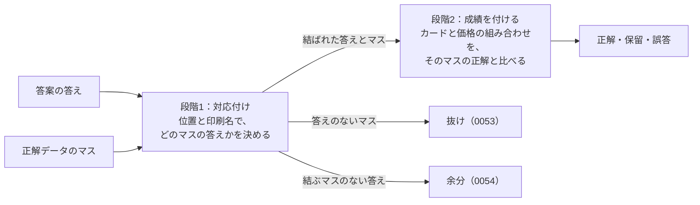

# 0052. 答えとマスの対応付けは、印刷名を位置より先に使う4つの手順で行う

- ステータス：採用
- 日付：2026-11-03
- 決定者：kajiwara
- 関係するADR：[0045](0045-card-name-strict-match.md)（カード名の比べ方）、[0051](0051-position-shift-not-graded.md)（位置と印刷名で対応付ける）、[0053](0053-missing-card-withheld.md)（抜け）、[0054](0054-extra-answer-counted-as-wrong.md)（余分）、[0055](0055-competing-answers-for-one-cell.md)（1つのマスに結べる答えが複数あるとき）

## 背景

### 採点は2つの段階に分かれる

採点器は、答案を次の2つの段階で採点する。

- **段階1：対応付け**。答案の答えを1つずつ、正解データのどのマスについての答えかを決めて、答えとマスを結ぶ。使うのは、読んだもの（位置・印刷名。迷ったときはHP・価格の文字）である。
- **段階2：成績を付ける**。結ばれた答えとマスについて、カードと価格の組み合わせを、そのマスの正解と比べる（[0038](0038-score-by-assertion.md)、[0039](0039-deliverables-and-intermediates.md)）。
- 答え（カードと価格の組み合わせ）は、段階1には使わない（[0051](0051-position-shift-not-graded.md)）。
- 段階1で、答えのないマスが残れば「抜け」（[0053](0053-missing-card-withheld.md)）、結ぶマスのない答えが残れば「余分」（[0054](0054-extra-answer-counted-as-wrong.md)）になる。

### 1つの答えに入っているもの

| 言葉 | 中身 | 出力のどこ | 採点での使い道 |
|---|---|---|---|
| 位置 | 答えに書いた段・列 | `position` | 段階1（対応付け） |
| 印刷名 | 画像に印刷されたカードの名前を、読んだもの | `reading.name` | 段階1（対応付け） |
| HP・価格の文字 | 画像に書かれたHPと価格の文字（例：1.5万円）を、読んだもの | `reading.hp`、`reading.price_text` | 段階1で迷ったときの手がかり。診断 |
| カードと価格の組み合わせ | 何のカードか（パック・番号・仕様）と、価格（円の値） | `answer.card`、`answer.price_jpy` | 段階2（成績） |

上の3行は「読んだもの」で、最後の行が「答え」である。「価格の文字（読んだもの）」と「価格（答え）」は、別のものである。

### 手順を決める必要

- [0051](0051-position-shift-not-graded.md) で決めたのは、「対応付けは位置と印刷名で行い、答えは使わない」という原則までだった。位置と印刷名が食い違ったときに、どちらを信じるかなど、細かい手順は決めていなかった。
- 手順によって、成績が変わる。たとえば、答案に次の答えがあったとする。

| 位置 | 印刷名 | カード | 価格 |
|---|---|---|---|
| 1-2 | ウインディ | ハートゴールドコレクション 014/070 | 15000 |

正解データ（1枚目の1段目）は、次のとおりである。

| マス | 印刷名 | カード | 価格 |
|---|---|---|---|
| 1-2 | ツボツボ | ハートゴールドコレクション 011/070 | 6000 |
| 1-3 | ウインディ | ハートゴールドコレクション 014/070 | 15000 |

位置は1-2を指し、印刷名は1-3を指している。

- 印刷名を信じれば、1-3と結ぶ。カードと価格の組み合わせは、1-3の正解と合うので、正解になる（診断に「位置ずれ」）。
- 位置を信じれば、1-2と結ぶ。カードも価格も、1-2の正解（ツボツボ）と違うので、誤答になる。

- 採点器が毎回同じに結び、なぜそのマスと結んだかを、人が決まりに照らして確かめられるようにする必要がある。

## 検討した選択肢

| 選択肢 | 良い点 | 弱い点 |
|---|---|---|
| A. 位置を先に使う。位置で結び、残りを印刷名で結ぶ | 単純 | 1マスのずれで、後ろの答えが別のマスと結ばれる。上の例は誤答になる |
| **B. 印刷名を先に使う。下の4つの手順で結ぶ** | 位置がずれても、正しいマスと結べる | 手順が増える |
| C. 似ている印刷名（1文字違いなど）でも結ぶ | 印刷名を読み違えても、印刷名で結べる | 似た名前のポケモンが多く（ヤドン、ヤドラン、ヤドキング）、別のカードと結んでしまう。なぜ結んだかも、説明しにくい |

## 決定

**B にする。**

### 手順

| 手順 | 結ぶもの | 診断に記録すること |
|---|---|---|
| 1 | 位置も印刷名もそろう答えとマス | ― |
| 2 | 残りの答えと、まだ結ばれていないマスのうち、印刷名がそろうもの | 位置ずれ |
| 3 | 残りの答えと、まだ結ばれていないマスのうち、位置がそろうもの | 印刷名の読み違い |
| 4 | それでも残ったもの | 答えは余分（[0054](0054-extra-answer-counted-as-wrong.md)）、マスは抜け（[0053](0053-missing-card-withheld.md)） |

- 1つの手順を、すべての答えについて終えてから、次の手順に進む。
- どの手順でも、答え（カードと価格の組み合わせ）は使わない（[0051](0051-position-shift-not-graded.md)）。

### 手順の中の決まり

| 決まり | 中身 |
|---|---|
| 印刷名がそろうとは | 全角・半角や空白だけの違いは、そろったとみなす。「EX」と「ex」は分ける（[0045](0045-card-name-strict-match.md)）。似ている印刷名（1文字違いなど）は、そろったとみなさない |
| 同じ印刷名のマスが複数あるとき（手順2） | HP・価格の文字・位置の近さで、1つに絞る。絞れなければ結ばず、手順3に回す |
| 1つのマスに、結べる答えが複数あるとき | [0055](0055-competing-answers-for-one-cell.md) のとおり。どの答えも、そのマスと結ぶ。断定した値が食い違っていれば、そのマスは誤答 |
| 対象外のマス（`meta.yaml` の `excluded`） | 結ぶ相手に含める。結ばれた答えは採点しない（[0054](0054-extra-answer-counted-as-wrong.md)） |

### 例：1枚目の1段目

正解データ：

| 1-1 | 1-2 | 1-3 | 1-4 | 1-5 | 1-6 | 1-7 |
|---|---|---|---|---|---|---|
| ワタッコ | ツボツボ | ウインディ | ヤドン | オクタン | ムチュール | ヤドキング |

答案（説明のために作った例）を、手順で結ぶと次のようになる。

| 答案の答え（位置：印刷名） | 結ばれる手順 | 結ぶマス | 診断に記録すること |
|---|---|---|---|
| 1-1：ワタッコ | 1 | 1-1 ワタッコ | ― |
| 1-4：ヤドン | 1 | 1-4 ヤドン | ― |
| 1-2：ウインディ | 2 | 1-3 ウインディ | 位置ずれ |
| 1-4：ヤドキング | 2 | 1-7 ヤドキング | 位置ずれ、同じ位置に複数の答え（[0055](0055-competing-answers-for-one-cell.md)） |
| 1-5：オクダン（オクタンの読み違い） | 3 | 1-5 オクタン | 印刷名の読み違い |
| 5-1：リザードン（買取表にない） | なし | ― | 余分 |
| （答えなし） | ― | 1-2 ツボツボ | 抜け |

## 理由

- **印刷名を、位置より先に使うため。** 位置は、1マスのずれで後ろまで崩れる。印刷名は、カード1枚ずつ独立している。位置を先に使うと、上の例の「1-2：ウインディ」が、1-2のツボツボと結ばれて誤答になる。A を選ばなかったのはこのため。
- **似ている印刷名で結ばないため。** ポケモンには、似た名前が多い（ヤドン、ヤドラン、ヤドキング）。あいまいに結ぶと、別のカードと結んでしまい、なぜ結んだかも説明しにくい。C を選ばなかったのはこのため。印刷名を読み違えた答えは、手順3で、位置で結べる。
- **1つの手順を、すべての答えについて終えてから進むため。** 答えを書いた順番で、結び方が変わらないようにする。
- **手順を、コードの書き方ではなく採点の決まりとして決めるため。** 手順によって成績が変わるので、被験ハーネスどうしの比べ方が、この手順で変わる。決まりとして残しておけば、なぜその答えをそのマスと結んだかを、人が確かめられる。手順を変えたときは、前の結果と同じ物差しで比べられなくなるので、採点器の版（`grader_version`。[0023](0023-grader-interface.md)）を上げる。

## 影響

- 採点器の対応付けを、この手順で作る（TODO 11章）。プログラムの組み立て方は決めない。この手順と同じ結果になればよい。
- 診断の種類に、「位置ずれ」「印刷名の読み違い」を入れる（TODO 11章の、診断のスキーマ）。
- 手順を変えたら、採点器の版を上げる（[0023](0023-grader-interface.md)）。
- 設計書 8.1（対応付け）に、2つの段階と、この手順を書く（TODO 3章）。
