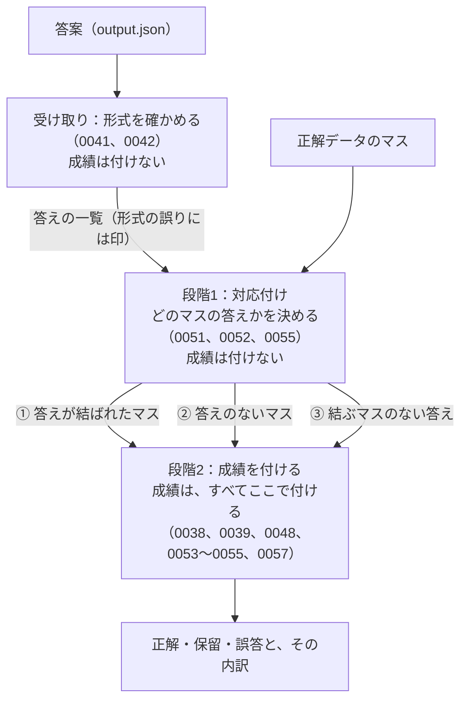

# 0058. 採点を、受け取り・段階1（対応付け）・段階2（成績を付ける）に分け、成績は段階2だけで付ける

- ステータス：採用
- 日付：2026-11-04
- 決定者：kajiwara
- 関係するADR：[0038](0038-score-by-assertion.md)（成績：正解・保留・誤答）、[0039](0039-deliverables-and-intermediates.md)（成果物と中間結果）、[0041](0041-format-error-kinds-and-units.md)（形式の誤り）、[0042](0042-out-of-vocabulary-values.md)（語彙の外）、[0048](0048-price-null-is-withheld.md)（価格の null）、[0051](0051-position-shift-not-graded.md)（位置ずれ）、[0052](0052-matching-procedure.md)（対応付けの手順）、[0053](0053-missing-card-withheld.md)（抜け）、[0054](0054-extra-answer-counted-as-wrong.md)（余分）、[0055](0055-competing-answers-for-one-cell.md)（1つのマスに複数の答え）、[0057](0057-answer-card-name-is-graded.md)（答えの名前）
- 採点の段階：全体。このADRが、採点の流れの地図になる

## 背景

- 採点は、「対応付け」（段階1）と「成績を付ける」（段階2）の2つの段階に分かれる（[0052](0052-matching-procedure.md)）。
- そのあとに決めた決まり（[0053](0053-missing-card-withheld.md)〜[0055](0055-competing-answers-for-one-cell.md)、[0057](0057-answer-card-name-is-graded.md)）には、どちらの段階の決まりかを書いていなかった。そのため、次のことが分かりにくくなっていた。
  - [0052](0052-matching-procedure.md) の図で、抜けと余分の矢印が、段階1から出たところで止まっていた。段階2に行くのか、そこで保留・誤答になるのかが、図から読めなかった。
  - 抜けを保留にする決まり（[0053](0053-missing-card-withheld.md)）と、余分を誤答にする決まり（[0054](0054-extra-answer-counted-as-wrong.md)）が、どの段階で成績を付けるのかを書いていなかった。
  - [0055](0055-competing-answers-for-one-cell.md) では、「どの答えも結ぶ」（段階1）と「食い違えば誤答」（段階2）が、1つの決定に混ざっていた。
  - 形式の誤り（[0041](0041-format-error-kinds-and-units.md)）が、どちらの段階にも入っていなかった。
- その結果、保留が、段階1と段階2とで違う意味を持つように見えていた。

## 検討した選択肢

| 選択肢 | 良い点 | 弱い点 |
|---|---|---|
| A. 今のまま。成績を付ける場所は、決まりごとに違ってよい | 書き直しがいらない | どの段階の決まりかが分からない。保留・誤答が、段階ごとに違う意味に見える |
| B. 段階1でも成績を付ける。抜けと余分は段階1で保留・誤答にし、段階2は結ばれたマスだけを扱う | 段階2が単純になる | 成績を付ける場所が2つになる。保留・誤答が、段階ごとに違う意味に見えるのは変わらない |
| **C. 段階1では成績を付けない。成績は、すべて段階2で付ける。形式の確かめは、段階1の前の「受け取り」で行う** | 部分ごとの役目が、1つずつになる。成績の意味が、1つにそろう | 段階1から段階2へ、3種類のもの（下の ①〜③）を渡す必要がある |

## 決定

**C にする。**

### 流れ

### 部分ごとの役目

| 部分 | 決めること | 決めないこと | 診断に記録すること |
|---|---|---|---|
| 受け取り | 答えとして受け取れるか（形式の誤りの種類と単位。[0041](0041-format-error-kinds-and-units.md)）。語彙の外の値の読み替え（[0042](0042-out-of-vocabulary-values.md)） | 成績、どのマスの答えか | 形式の誤り（種類・場所・出てきた値）、語彙の外の値 |
| 段階1：対応付け | どの答えを、どのマスと結ぶか（[0051](0051-position-shift-not-graded.md)、[0052](0052-matching-procedure.md)、[0055](0055-competing-answers-for-one-cell.md) の段階1） | 成績 | 位置ずれ、印刷名の読み違い、同じ位置に複数の答え |
| 段階2：成績を付ける | ①〜③のそれぞれの成績（正解・保留・誤答、または数えない） | どのマスの答えか | 抜け、余分、重複、対象外のマスへの答え、答えどうしの食い違い、答えの中の食い違い、表記だけの違い、被験エージェントの作業のどこで外れたか（読み取り・照合など。[0040](0040-intermediate-results-for-diagnosis.md)）、候補（[0046](0046-gold-in-candidates-diagnosis.md)） |

### 段階2で、①〜③に成績を付ける決まり

| 段階1から渡されるもの | 成績 | 内訳 | 決まり |
|---|---|---|---|
| ① 答えが結ばれたマス | 答えを、そのマスの正解と比べて、正解・保留・誤答 | 保留：エージェントが不明と示した、形式の誤り。誤答：正解データのカードを間違えた | [0038](0038-score-by-assertion.md)、[0039](0039-deliverables-and-intermediates.md)、[0048](0048-price-null-is-withheld.md)、[0057](0057-answer-card-name-is-graded.md) |
| ① のうち、結ばれた答えが複数あるマス | 断定した値が食い違っていれば誤答。食い違いがなければ、合わせて1つの答えにして、上と同じ | 誤答：正解データのカードを間違えた | [0055](0055-competing-answers-for-one-cell.md) |
| ① のうち、対象外のマス | 数えない | ― | [0054](0054-extra-answer-counted-as-wrong.md) |
| ② 答えのないマス | 保留 | 抜け。出力全体を受け取れなかったときは、形式の誤り | [0053](0053-missing-card-withheld.md)、[0041](0041-format-error-kinds-and-units.md) |
| ③ 結ぶマスのない答え（余分）で、カードか価格を断定している | 誤答 | ないカードを断定した | [0054](0054-extra-answer-counted-as-wrong.md) |
| ③ のうち、何も断定していないもの、すでに結ばれた答えとまったく同じ中身のもの | 数えない | ― | [0054](0054-extra-answer-counted-as-wrong.md) |

- カードの中に形の誤りがある答えを、段階1で結ぶかどうかは、まだ決めていない（TODO 11章）。結んだときは、段階2で、そのマスを保留（内訳：形式の誤り）にする。

### 成績の意味は1つにし、原因は内訳に残す

| 成績 | 意味（[0038](0038-score-by-assertion.md)） | 内訳（原因） | 原因が分かる部分 |
|---|---|---|---|
| 正解 | そのまま確定データとして使える | ― | 段階2 |
| 保留 | 確定データにできないが、汚しもしない | エージェントが不明と示した | 段階2 |
| | | 形式の誤り | 受け取り |
| | | 抜け | 段階1（② 答えのないマス） |
| 誤答 | 確定データを汚す | 正解データのカードを間違えた（値の違い、答えどうしの食い違い） | 段階2 |
| | | ないカードを断定した | 段階1（③ 結ぶマスのない答え） |

- 成績を付けるのは、どの内訳でも段階2である。受け取りと段階1は、原因を見つけて、段階2に渡すだけである。

### 決まりを足すとき

- 採点の決まりのADRには、最初に「採点の段階」（受け取り・段階1・段階2）を書く。
- 2つの部分にかかる決まりは、決定を部分ごとに分けて書く（[0055](0055-competing-answers-for-one-cell.md) のように）。
- 議論のときも、最初に、どの部分の話かを言う。

## 理由

試験に見立てると、段階1は、答案の答えを「どの問題への答えか」に仕分ける作業で、点は付けない。白紙の問題（抜け）にも、どの問題にも当たらない答え（余分）にも、点を付けるのは段階2である。受け取りは、答案が読める字で書かれているかを確かめる作業にあたる。

| | A. 今のまま | B. 段階1でも成績を付ける | **C. 成績は段階2だけ** |
|---|---|---|---|
| 成績を付ける場所 | 決まりごとにばらばら | 段階1と段階2の2か所 | 段階2の1か所 |
| どの段階の決まりかが分かるか | 分からない | 分かる | 分かる |
| 保留・誤答の意味 | 段階ごとに違って見える | 段階ごとに違って見える | 1つ（違いは内訳に残る） |
| 段階1の役目 | 結ぶことと、成績が混ざる | 結ぶことと、成績が混ざる | 結ぶことだけ |

- **部分ごとの役目を、1つずつにするため。** 段階1は「どのマスについての答えか」、段階2は「そのまま確定データとして使ってよいか」（[0038](0038-score-by-assertion.md)）に答える。役目が1つずつなら、決まりを足すときに、どの部分の決まりかで迷わない。A を選ばなかったのはこのため。
- **成績の意味を、1つにそろえるため。** 保留は、どの原因でも「確定データにできないが、汚しもしない」で、誤答は「汚す」である。成績を付ける場所を1つにすれば、成績の意味は1つになり、違うのは内訳（原因）だけになる。B を選ばなかったのは、成績を付ける場所が2つになり、意味が段階ごとに違って見えるのが、変わらないため。
- **形式の確かめを、段階1の前に置くため。** 段階1は、位置と印刷名を使う。読めない出力からは、答えを1つも取り出せない。どの答えを受け取れるかを先に決めておけば、段階1は、受け取った答えだけを考えればよい。
- **原因は、内訳として残すため。** 抜けと「エージェントが不明と示した」は、どちらも保留だが、人が気づけるかと、直す部品が違う（[0053](0053-missing-card-withheld.md)）。成績の意味をそろえても、内訳を残せば、診断で見分けられる。
- **決まりの中身は、変えないため。** このADRは、これまでの決まりが、どの部分で成績を付けるかを決めるだけである。どの答えが正解・保留・誤答になるかは、変わらない。

## 影響

- [0052](0052-matching-procedure.md)〜[0055](0055-competing-answers-for-one-cell.md)、[0057](0057-answer-card-name-is-graded.md) の最初に、採点の段階を書いた。[0052](0052-matching-procedure.md) の図は、抜けと余分も段階2に入る形にした。[0054](0054-extra-answer-counted-as-wrong.md) では、対象外のマスと結ばれた答えを、余分とは分けて書いた。[0055](0055-competing-answers-for-one-cell.md) の決定は、段階1と段階2に分けて書いた。
- 採点器の作業（TODO 11章）を、受け取り・段階1・段階2に分けて並べる。まだ決めていない決まりも、どの部分の決まりかで並べ直す。
- カードの中に形の誤りがある答えを、段階1で結ぶかを決める（TODO 11章）。
- 設計書 8章に、この流れの図と、どの決まりがどこに入るかを書く（TODO 3章）。
- これから採点の決まりを足すときは、そのADRの最初に、採点の段階を書く。
