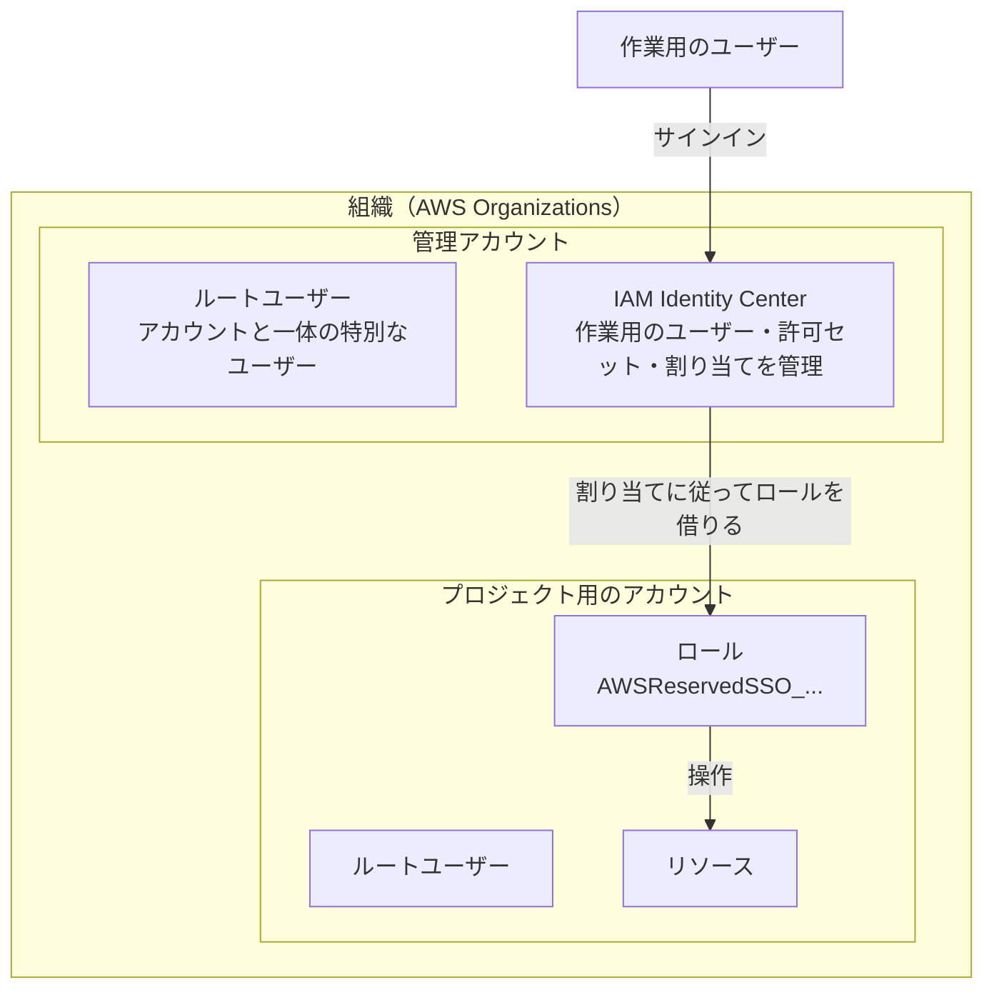
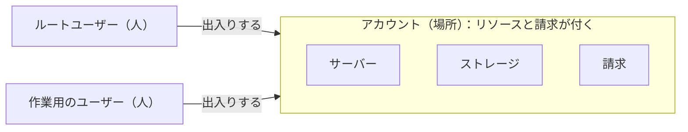
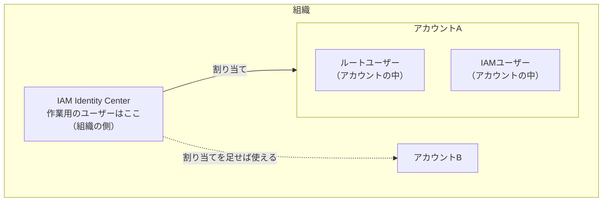
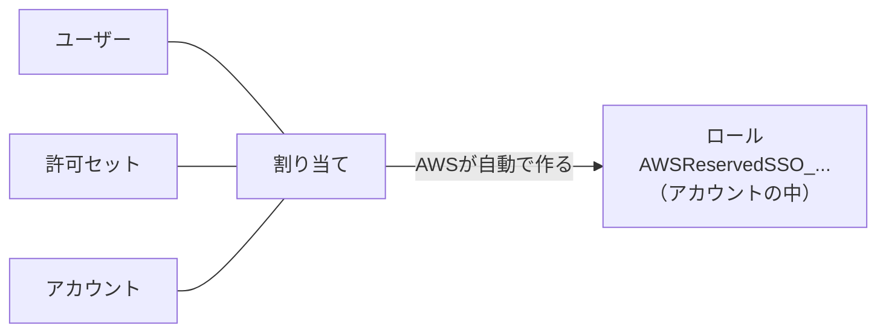
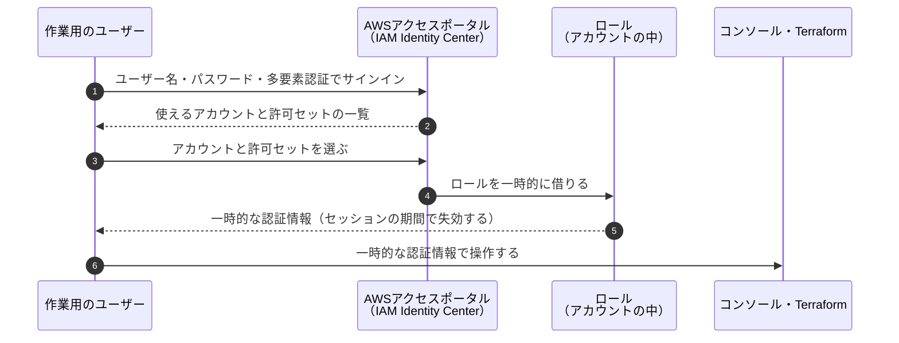
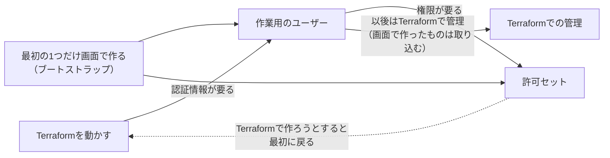

# AWSのアカウントの設計と管理の考え方

AWSの組織・アカウント・ユーザーの考え方と、アカウントの分け方・管理の原則をまとめる。特定のプロジェクトに限らない、一般的な内容である。

- このプロジェクトでの実際の運用は [AWSアカウントの運用](../operations/aws-accounts.md)、作業の記録は [AWSのアカウントの準備](../setup/aws-account.md)、決定の理由は [ADR](../adr/README.md) にある。
- 「統計ではなく一般的な傾向」と書いた部分は、よく見られる傾向であり、数字の裏付けがあるものではない。

## 1. 全体像

一番外側に組織があり、その中に、アカウントと作業用のユーザー（IAM Identity Center）の両方が入っている。

```
組織（一番外側の入れ物）
├── アカウント（場所）
│     ├── ルートユーザー（そのアカウントの中の人）
│     └── リソース（サーバー、ストレージなど）
└── IAM Identity Center
      └── 作業用のユーザー（組織の側の人。アカウントに割り当てて出入りする）
```



会社にたとえると、組織は会社、アカウントは会社が持っている建物、ルートユーザーは建物ごとのオーナー、作業用のユーザーは会社の社員にあたる。社員は特定の建物ではなく会社に属しているので、建物が増えても、社員証の行き先を足すだけで済む。

## 2. 用語

| 用語 | 意味 | たとえ |
|---|---|---|
| 組織（AWS Organizations） | 複数のアカウントをまとめて管理する入れ物 | 会社 |
| 組織単位（OU） | 組織の中で、アカウントをフォルダのように分けて整理する単位 | 会社の部署（ただし、部署で分けるのは勧められない。7.3） |
| AWSのアカウント | リソースと請求が付く単位 | 会社が持っている建物 |
| 管理アカウント | 組織を作ったアカウント。組織に1つだけ。組織の操作ができ、組織の中のアカウントの請求も、ここにまとめて届く | 本社のビル |
| メンバーアカウント | 組織の中の、管理アカウント以外のアカウント。組織の操作はできない | 支店のビル |
| ルートユーザー | アカウントを作ったときのメールアドレスとパスワードでサインインするユーザー。何でもできる | 建物のマスターキーを持ったオーナー |
| 多要素認証（MFA） | パスワードに加えて、スマートフォンの生体認証などでも本人を確かめる仕組み | マスターキーを金庫にしまう |
| IAM Identity Center | 普段の作業に使うユーザーを作って管理する仕組み | 社員証を発行する仕組み |
| 作業用のユーザー | IAM Identity Centerで作った、普段の作業に使うユーザー | 社員証を持った社員 |
| 許可セット | ユーザーに「何をしてよいか」を決める権限のまとまり | 社員証で入れる部屋の一覧 |
| 割り当て | 「どのユーザーが、どのアカウントで、どの許可セットを使えるか」の組み合わせ | 社員証と部屋の一覧を結びつける |
| ロール | 権限の付いた役割。人が一時的に借りて使う。割り当てをすると、AWSがアカウントの中に自動で作る | 部屋に入るための一時的な入館証 |
| サービスコントロールポリシー（SCP） | 組織・OU・アカウントにかける「これだけは絶対にさせない」というルール | 建物の規則 |
| 予算のアラート（AWS Budgets） | 費用が決めた額を超えそうになったら、メールで知らせる仕組み | 電気代の使いすぎを知らせる装置 |
| 利用枠（Service Quotas） | サービスごとに、使える量の上限。アカウントごと・リージョンごとに決まる | 大きな機械を使う許可 |
| AWS Builder ID | AWSの学習のサービス（AWS Skill Builderなど）、質問サイト（AWS re:Post）、一部の開発者向けのツールを使うための **個人のプロフィール**。Google・GitHub・Appleなどでサインインできる。新しいAWSエクスペリエンスのプロジェクトの持ち主にもなる。**AWSのアカウントとは別物** で、それだけではリソースも請求も付かない | 個人の会員証 |

## 3. アカウントとユーザー

### 3.1 違い

普段のWebサービスでは「アカウント」と「ユーザー」がほぼ同じ意味で使われるが、AWSでは別のものである。

| | 意味 | 問い |
|---|---|---|
| **アカウント** | リソースと請求が付く **場所** | **どこに** 作るか、**どこに** 請求が来るか |
| **ユーザー** | サインインして操作する **人** | **誰が** 操作するか |



- 1つのアカウントには、何人ものユーザーが出入りできる。IAM Identity Centerを使うと、1人のユーザーが複数のアカウントに出入りすることもできる。
- 紛らわしいのは、**ルートユーザーがアカウントを作るときに一緒にできる** から。アカウント（場所）ができて、そこにルートユーザー（最初の人）が自動で付いた、という関係である。

### 3.2 ユーザーの居場所

ユーザーがどこにいるかは、種類によって違う。

| ユーザーの種類 | どこにいるか |
|---|---|
| ルートユーザー | アカウントの中。アカウントごとに1人ずつ、アカウントと一体になっている |
| IAMユーザー（昔からある方法） | アカウントの中。そのアカウントだけで使える |
| IAM Identity Centerのユーザー（作業用のユーザー） | 組織の側。IAM Identity Centerは管理アカウントで動いているが、ユーザーは組織全体のもので、組織の中のアカウントに割り当てて使う。アカウントを増やしても、割り当てを足すだけで同じユーザーで使える |



### 3.3 管理アカウント、メンバーアカウント、ルートユーザー

#### 管理アカウントとメンバーアカウント

**管理アカウントかどうかは、「組織を作ったアカウントかどうか」で決まる。** 組織に必ず1つだけ。組織の中のそれ以外のアカウントは、すべて **メンバーアカウント**。

```
組織
└── Root
    ├── 管理アカウント       ← 組織を作ったアカウント。組織に1つだけ
    └── Workloads（OU）
        └── プロジェクト用のアカウント  ← メンバーアカウント
```

| | 管理アカウント | メンバーアカウント |
|---|---|---|
| 数 | 組織に1つだけ | いくつでも |
| どうやってできるか | 最初にサインアップして作り、そこで組織を作る | 管理アカウントから、組織の中に作る（または招待する） |
| できること | 組織の操作（OUやアカウントの作成、アカウントの移動）、IAM Identity Centerの割り当て、請求のまとめ | 組織の操作はできない。自分のアカウントの中のことだけ |

#### AdministratorAccessは「アカウントの種類」ではない

AdministratorAccessは、アカウントに付いているものではなく、**「このユーザーは、このアカウントの中で何でもできる」という、ユーザーの権限**。

```
割り当て ＝ 作業用のユーザー × AdministratorAccess × 管理アカウント
割り当て ＝ 作業用のユーザー × AdministratorAccess × プロジェクト用のアカウント
```

どちらも「そのアカウントの中で何でもできる」というだけで、アカウントが管理アカウントになるわけではない。社員証に「支店のビルの全部屋に入れる」権限を付けても、支店のビルが本社にならないのと同じ。

| 作業 | 管理アカウントで AdministratorAccess | メンバーアカウントで AdministratorAccess |
|---|---|---|
| OUやアカウントを作る、アカウントを移す | できる | **できない** |
| IAM Identity Centerの割り当て | できる | **できない** |
| サーバーやストレージを作る | できる（ただし、置かないのが原則。8章） | できる（**ここに作る**） |

#### 管理アカウントとルートユーザー

「管理アカウント」と「ルートユーザー」は、どちらか一方になるものではなく、種類の違うもの。管理アカウントは **場所**、ルートユーザーはその中の **人**。

- 最初の準備は「管理アカウントに、ルートユーザーとしてサインインして」行う。
- そのあとは「同じ管理アカウントに、作業用のユーザーとしてサインインして」行う。場所は変わらず、入ってくる人が変わるだけ。
- コンソールの右上には、今いるアカウントと、誰としてサインインしているかが表示される。作業用のユーザーでサインインすると、`許可セットの名前/ユーザー名` のように表示される。

### 3.4 AWS Builder ID

AWS Builder IDは、AWSのアカウントとは別物の、**個人のプロフィール**。従来の方法で作った組織やアカウントとは、つながっていない。

```
個人
├── AWS Builder ID（個人のプロフィール。Googleなどでサインイン）
│     ├── AWSの学習のサービス、質問サイト、一部の開発者向けのツール
│     └── 新しいAWSエクスペリエンスのプロジェクト（「Googleで続行」で作ったもの）
│
└── 組織（従来の方法で作ったもの）
      ├── 管理アカウント
      │     └── ルートユーザー（メールアドレスとパスワード）
      └── IAM Identity Center
            └── 作業用のユーザー
```

- サインアップの画面で「Googleで続行」を押すと、まずAWS Builder IDが作られ、それを持ち主として新しいAWSエクスペリエンスのプロジェクトが作られる。
- AWS Builder IDだけなら、リソースがないので費用はかからない。学習のサービスなどに使えるので、残しておいてよい。

## 4. 組織の階層

### 4.1 上下の関係

- 上下の関係は **組織 ＞ アカウント** だけ。ルートユーザーはアカウントの「上」ではなく、アカウントの中にいる特別なユーザー。
- 組織の中のアカウントは、木の形で整理される。組織の画面や、IAM Identity Centerの「AWSアカウント」の画面で、次のように表示される。

```
Root（組織のルート。ルートユーザーとは関係ない）
├── 管理アカウント
└── Workloads（OU）
    └── プロジェクト用のアカウント
          ├── ルートユーザー（アカウントの中の特別なユーザー）
          ├── ロール（割り当てで自動で作られる）
          └── リソース
```

### 4.2 組織の「ルート」

組織の画面に出てくる **「ルート」（Root）** は、組織の中のアカウントをまとめる一番上の入れ物のこと。組織に必ず1つだけある。**ルートユーザーとは別物。**

### 4.3 組織単位（OU）とOUの下のOU

Rootの下には、アカウントをフォルダのように分ける組織単位（OU）を作れる。OUの下にOUを作ることもできる。

| 決まりごと | 内容 |
|---|---|
| 深さの上限 | Rootの下に、OUを5階層まで重ねられる |
| アカウントの置き場所 | 1つのアカウントは、どこか1か所だけ（Rootの直下か、どれか1つのOU）に置く |
| ルールの引き継ぎ | 上のOUに付けたルール（SCP）は、下のOUとアカウントにも引き継がれる |

```
Root
└── Workloads（OU）     ルール：東京以外のリージョンを使えない
    ├── Prod（OU）      ルール：さらに、リソースの削除を制限する
    │   └── 本番用アカウント   → 両方のルールがかかる
    └── Non-Prod（OU）
        └── 開発用アカウント   → 「東京以外を使えない」だけがかかる
```

- 上の階層で共通のルールを決め、下の階層で用途ごとのルールを足していく。
- 階層は浅く保つのが一般的。深くすると、どのルールがどこから引き継がれているのか分かりにくくなる。多くの場合は2〜3階層で足りる。

## 5. 作業用のユーザーと権限

### 5.1 ユーザー・許可セット・割り当て・ロール



- ユーザーを作っただけでは、アカウントで何もできない。割り当てまで終えて初めて、そのユーザーでアカウントを操作できる。
- 割り当てをすると、AWSがアカウントの中に、許可セットの内容どおりの権限を持つロールを自動で作る。作業用のユーザーは、サインインするときにこのロールを一時的に借りて操作する。ユーザーそのものに権限を付けずにロールを借りる形にすることで、一時的な認証情報で安全に操作できる。

### 5.2 サインインの入口

作業用のユーザーは、ルートユーザーとは別の入口からサインインする。

| ユーザー | サインインの入口 | 入力するもの |
|---|---|---|
| ルートユーザー | AWSのコンソールのサインインのページ（`console.aws.amazon.com`） | メールアドレス、パスワード、多要素認証 |
| 作業用のユーザー | **AWSアクセスポータル**（`https://xxxx.awsapps.com/start` のような、組織ごとのURL） | **ユーザー名**（メールアドレスではない）、パスワード、多要素認証 |



### 5.3 最初のユーザーと許可セットは画面で作る（ブートストラップ）



- 許可セットやユーザーは、Terraformなどのファイルでも定義できる。ただし、Terraformを動かすには作業用のユーザーの認証情報が要るため、**最初の1つだけは画面で作るしかない**。
- ルートユーザーのアクセスキーを作ってTerraformを動かす方法もあるが、安全のためにアクセスキーは作らない。
- 画面で作ったものは、あとでTerraformの管理に取り込む（インポート）。

### 5.4 管理アカウントで行う作業と、実務で気をつけたいこと

- 組織の操作（OUやアカウントの作成、アカウントの移動）は、**管理アカウントからしかできない**。IAM Identity Centerの割り当ても、IAM Identity Centerが動いている管理アカウントで行う。
- 許可セットは1つでも、割り当てたアカウントごとに、そのアカウントの中にロールが作られる。同じ「AdministratorAccess」でも、管理アカウントで借りるロールと、ほかのアカウントで借りるロールは別のもの。
- 組織の中でアカウントを作ると、管理アカウントからそのアカウントに入るための非常用のロール（初期値の名前は `OrganizationAccountAccessRole`）が自動で作られる。普段の作業には使わない。
- 組織の中で作ったアカウントのルートユーザーには、最初はパスワードがない。

実務では、次の点も考えることが多い。

| 点 | 内容 |
|---|---|
| 管理アカウントの権限は特に強い | 管理アカウントのAdministratorAccessでは、組織全体の設定を変えられる。管理アカウントに割り当てる人は、ごく少数に絞る |
| 権限を絞った許可セットを使う | 組織の管理だけをする人には、組織の操作に必要な権限だけの許可セットを割り当てる。システムの作業をする人には、そのシステムのアカウントだけを割り当てる |
| 管理アカウント以外に任せる | IAM Identity Centerの管理などは、別のアカウントに任せる設定（委任された管理者）がある。そうすると、管理アカウントにサインインする機会をさらに減らせる |

## 6. ルートユーザーの扱い

ルートユーザーの一番大事な役割は、**作業用のユーザーで入れなくなったときの、非常用の鍵**。普段は使わないが、ルートユーザーでしかできない作業もある（[ルートユーザーの認証情報が必要なタスク](https://docs.aws.amazon.com/IAM/latest/UserGuide/id_root-user.html)）。

| 場面 | 例 |
|---|---|
| アカウントそのものの設定を変えるとき | アカウントの名前、ルートユーザーのメールアドレスやパスワードの変更 |
| 請求の一部の設定 | 請求の情報へのIAMアクセスの設定、税金に関わる一部の設定 |
| サポートプランを変えるとき | ベーシックから有料のプランへの変更や解約 |
| アカウントを閉じるとき | アカウントの解約 |
| 作業用のユーザーでサインインできなくなったとき | IAM Identity Centerの設定を誤って壊した、権限を消してしまった、などの非常時 |
| 一部の特殊な操作 | S3のバケットのポリシーで、誤って全員を締め出してしまったときの解除など |

いざというときに確実に使える状態にしておく。

- 多要素認証を設定し、アクセスキーは作らない
- ルートユーザーのメールアドレスを使える状態に保つ（パスワードの再設定は、このメールアドレスに届く）
- パスワードは、パスワード管理のアプリなどで安全に保管する
- 多要素認証のデバイスを機種変更するときは、先にルートユーザーの多要素認証を登録し直す
- 数か月に一度、サインインできるか確かめる

迷ったら、まず作業用のユーザーで試す。ルートユーザーでしかできない作業のときは、画面にそう表示される。

## 7. アカウントの分け方

AWSは、システムと用途（本番用・開発用など）ごとにアカウントを分けることを勧めている。費用と権限がアカウントごとにはっきり分かれ、問題が起きてもほかのシステムに影響しにくい。

### 7.1 実務での単位

| AWSの単位 | 実務での単位 | 数 |
|---|---|---|
| 組織 | **会社**（グループ会社ごとに分けることもある） | 会社に1つが基本 |
| Root | 組織の一番上の入れ物。**システムの単位ではない** | 組織に必ず1つだけ |
| 組織単位（OU） | **アカウントの役割や用途**（本番か開発か、セキュリティ用かなど） | 必要な数だけ |
| アカウント | **システム × 環境**（例：システムAの本番、システムAの開発） | システムと環境の数だけ |

### 7.2 実務でよくある構成

AWSが勧めている構成（マルチアカウントの指針）に沿った例：

```
組織（会社）
└── Root
    ├── 管理アカウント
    │     組織の管理と請求のまとめ役だけ。システムは置かない
    ├── Security（OU）
    │   ├── ログ保管用アカウント（全アカウントの操作の記録を集める）
    │   └── セキュリティ監視用アカウント
    ├── Infrastructure（OU）
    │   ├── ネットワーク用アカウント
    │   └── 共通サービス用アカウント
    ├── Workloads（OU）            ← 各システムはここ
    │   ├── Prod（OU）
    │   │   ├── システムAの本番用アカウント
    │   │   └── システムBの本番用アカウント
    │   └── Non-Prod（OU）
    │       ├── システムAの開発用アカウント
    │       └── システムBの開発用アカウント
    ├── Sandbox（OU）
    │   └── 個人の実験用アカウント（自由に試せる。費用の上限を厳しくする）
    └── Suspended（OU）
        └── 使わなくなったアカウント（閉じる前の置き場）
```

- **システムはOUではなく、アカウントで分ける。** OUは、同じ役割のアカウントをまとめる「棚」。
- **OUごとにルールを付けられる**（SCP）。例：「Prodでは東京以外のリージョンを使えない」「Sandboxでは高いGPUサーバーを起動できない」。
- **管理アカウントには、システムを置かない。**
- 大きな会社では、この構成を自動で作る仕組み（AWS Control Tower）を使うことが多い。

### 7.3 システムや部署でOUを分けるのは勧められない

絶対にだめではないが、システムを主な軸にしてOUを作るのは勧められていない。**OUは、同じルールをかけたいアカウントをまとめるもの** で、実務のルール（SCP）は、システムではなく **本番か開発か** で変わることが多いため。

システムでOUを分けると、同じOUの中に本番と開発が混ざり、「本番だけに削除の制限をかける」ことがOUの単位でできない。避けようとすると、システムごとに本番と開発のOUを作ることになる。

```
Root
├── システムA（OU）
│   ├── Prod（OU）     ← 本番のルール
│   └── Non-Prod（OU） ← 開発のルール
└── システムB（OU）
    ├── Prod（OU）     ← 同じ本番のルールを、もう一度付ける
    └── Non-Prod（OU） ← 同じ開発のルールを、もう一度付ける
```

| 問題 | 内容 |
|---|---|
| 同じルールを何度も付ける | システムが10個あれば、本番のルールを10か所に付ける。直すときも10か所を直す |
| 付け忘れが起きやすい | 新しいシステムを足すたびに、ルールを付け直す必要がある |
| 階層が深くなる | どのルールがどこから来ているのか、分かりにくくなる |

環境でOUを分ければ、ルールは1か所だけで済む。新しいシステムを足すときも、アカウントを正しいOUに入れるだけで、ルールが自動でかかる。

```
Root
└── Workloads（OU）
    ├── Prod（OU）     ← 本番のルールを1か所だけに付ける
    │   ├── システムAの本番用アカウント
    │   └── システムBの本番用アカウント
    └── Non-Prod（OU） ← 開発のルールを1か所だけに付ける
        ├── システムAの開発用アカウント
        └── システムBの開発用アカウント
```

- 同じ理由で、**部署でOUを分けるのも勧められていない。** 加えて、組織変更のたびにOUを作り直したり、アカウントを動かしたりする必要が出る。
- **そのシステムだけ、ほかと違うルールが必要な場合は、システムでOUを分けてよい。** 例：クレジットカードの情報を扱う決済システムに、特に厳しいルールをかける。「システムだから分ける」のではなく、「ルールが違うから分ける」と考える。

### 7.4 システムごとのルールの違いはどこで表すか

本番用でも、システムごとにルールは多少違う。ただし、その違いまでOUのルールで表す必要はない。ルールは、階層ごとに役割を分けて重ねる。

```
Root          組織全体のルール（例：組織から抜けられない、操作の記録を消せない）
└── Prod（OU）  本番に共通のルール（例：東京以外のリージョンを使えない）
    ├── システムAのアカウント   システムAだけのルール
    │     └── アカウントの中のIAMのポリシー（誰が何をしてよいか）
    └── システムBのアカウント   システムBだけのルール
          └── アカウントの中のIAMのポリシー（誰が何をしてよいか）
```

| 階層 | 何を決めるか | 仕組み |
|---|---|---|
| Root | 組織のどこでも、絶対にさせないこと | SCP |
| OU（本番・開発） | その環境の中で、絶対にさせないこと | SCP |
| アカウント | そのシステムだけに必要な制限 | SCP（アカウントにも直接付けられる） |
| アカウントの中 | 誰が、どのリソースに、何をしてよいか | IAMのポリシー、許可セット |

- **OUのルールは「最低限の柵」。** 「これだけは絶対にさせない」という大まかな禁止で、本番で共通に必要な柵はシステムが違っても同じになることが多いので、1つにまとめられる。
- **システムごとの違いは、アカウントの側で決める。**
- **実際に使える権限は、すべての階層の重なりで決まる。** SCPは上限を決め、IAMのポリシーはその上限の中で許可を与える。どこか1つの階層で禁止されていれば、その操作はできない。

```
実際にできること ＝ Rootの上限 ∩ OUの上限 ∩ アカウントの上限 ∩ IAMのポリシーで許可されたこと
```

### 7.5 個人の規模なら

7.2ほど大きくする必要はない。プロジェクトごとにアカウントを分け、Workloads（OU）の下に足していく程度で十分。1つのアカウントで、タグを使って分ける方法もある。

```
組織（個人）
└── Root
    ├── 管理アカウント（請求と組織の管理だけ。リソースは置かない）
    ├── Workloads（OU）
    │   ├── プロジェクトAのアカウント
    │   └── プロジェクトBのアカウント
    ├── Sandbox（OU）      ← 必要になったら作る
    │   └── 実験用のアカウント
    └── Suspended（OU）    ← 必要になったら作る
        └── 終わったプロジェクトのアカウント
```

## 8. 【重要】アカウント設計で守る原則

> [!IMPORTANT]
> アカウントやOUの細かい分け方は、会社ごとにかなり違う。正解は1つではない。
> **それでも、次の原則は多くの会社で共通して大事にされている。** 分け方に迷ったら、この原則に立ち返る。

### 8.1 守る原則

| # | 原則 | なぜ大事か | 守らないと |
|---|---|---|---|
| 1 | **管理アカウントには、システムを置かない** | 管理アカウントは組織全体を操作できる強い権限を持つ。システムと同じ場所にあると、システムの不具合や乗っ取りが組織全体に広がる | システムのリソースを操作できる人が、組織全体の設定まで変えられてしまう |
| 2 | **本番と開発を分ける** | 本番は厳しく、開発は自由に、とルールを変えたい。分けておけば、開発での失敗が本番に影響しない | 開発中の誤操作で、本番のデータやサーバーを消してしまう |
| 3 | **操作の記録（ログ）は、消されない場所に集める** | 問題が起きたときに、誰が何をしたかを後から確かめるため | 乗っ取った人に記録を消され、何が起きたか分からなくなる |
| 4 | **「絶対にさせないこと」は、上の階層のルール（SCP）でまとめて防ぐ** | 1か所で決めれば、下のすべてのアカウントに自動でかかる。付け忘れが起きない | アカウントごとに設定し、どこかで付け忘れる |
| 5 | **OUは「同じルールをかけたいアカウント」でまとめる。システムや部署では分けない** | ルールは本番か開発かで変わることが多い（7.3） | ルールの重複と付け忘れが増え、階層も深くなる |
| 6 | **システムごとの違いは、アカウントの側で足す** | OUのルールは最低限の柵（7.4） | 違いを表すためにOUが増え続ける |

### 8.2 会社ごとに違いが出る理由

| 理由 | 内容 |
|---|---|
| 始めた時期 | 組織やOUの仕組みが整う前から使っている会社は、昔の構成（1つのアカウント、部署ごとのアカウントなど）が残りやすい |
| 作り直しの手間 | アカウントをOUの間で動かすこと自体は簡単だが、ルール、ネットワーク、権限まで直すのは大変。理想と違うと分かっていても、そのまま使い続けることが多い |
| 会社の事情 | 業界の規制、監査の要件、チームの分け方で、正解が変わる |

よく見られるパターン（統計ではなく、一般的な傾向）：

| 会社の状況 | よくある構成 |
|---|---|
| 早くからAWSを使っている会社 | 昔からの1つのアカウント、または部署ごとのアカウントが残っている |
| AWS Control Towerなどで最近始めた会社 | AWSの勧める構成（7.2）にほぼ沿っている |
| クラウドの専門チームがある大きな会社 | 原則に沿いつつ、自社の規則に合わせて作り込んでいる |
| スタートアップや小さなチーム | 本番・検証・開発の数個のアカウントだけ。必要になったら増やす |

**後から作り直すのは大変なので、リソースを作り始める前に構成を決める。**

## 9. 財務の視点

財務の視点は、アカウントの分け方を決める大きな理由の1つ。ただし、アカウントだけで全部をまかなうのではなく、**タグと組み合わせて考える**。

| アカウントで分ける理由 | 内容 |
|---|---|
| 費用の境界がはっきりする | リソースは必ずどこか1つのアカウントに属するので、アカウントごとの費用は、何もしなくても正確に分かれる。付け忘れが起きない |
| 費用の持ち主を決めやすい | 「このアカウントの費用は、このシステムのチームが持つ」と決められる。部署ごとに費用を配分する（チャージバック）ときの単位にもなる |
| 予算をアカウントごとに作れる | アカウント単位で予算のアラートを作れる |
| 終わったら閉じられる | プロジェクトを終えたら、アカウントごと閉じれば、消し忘れによる費用も止まる |

> [!NOTE]
> 予算は、お金を取り分ける **配分ではなく、それぞれ独立した見張り役**。ほかの予算と足し引きされないので、プロジェクトの予算の合計が組織全体の予算を超えないよう、上から決めて下に配る。
>
> 予算（AWS Budgets）は、**費用を止めるものではなく、知らせるもの**。予算を超えてもリソースは動き続ける。「予算のアクション」を使えば、予算を超えたときにルール（SCPやIAMのポリシー）をかけたり、EC2を止めたりして、制限に近いことはできる。

アカウントで分けられるのは大きな単位まで。それより細かく見たいときは、**タグ** を使う。

```
組織
└── プロジェクトAのアカウント        ← アカウントで分かる：このプロジェクトの費用
    ├── GPUサーバー   タグ：component=gpu
    ├── 実行環境      タグ：component=runner
    └── ストレージ    タグ：component=storage   ← タグで分かる：部品ごとの費用
```

| 道具 | 何に使うか |
|---|---|
| アカウント | 大きな単位の費用の境界（システム、プロジェクト、環境） |
| コスト配分タグ | アカウントの中の細かい単位（部品、実験の構成など）。請求の画面で有効にすると、タグごとに集計できる |
| コストカテゴリ | 複数のアカウントやタグを、「事業部」などの単位にまとめて集計する |
| Cost Explorer | アカウント、タグ、サービスごとに費用をグラフで見る |
| コスト異常検出 | いつもと違う費用の増え方を、自動で知らせる |

- タグは付け忘れることがあるので、「必ず付けるタグ」を決めて、Terraformで自動で付けるのが一般的。
- **利用枠（GPUサーバーの上限など）もアカウントごと** に決まる。新しいアカウントでは、改めて申請が必要。

## 10. リージョン

### 10.1 通信料

通信料は、リソースが海外にあるからかかるのではなく、データがどこからどこへ流れるかで決まる。

| データの流れ | 料金 |
|---|---|
| インターネットからAWSに入る通信 | 無料 |
| AWSからインターネットへ出る通信 | 有料。ただし毎月100GBまでは無料の枠がある |
| リージョンをまたぐ通信 | 有料 |
| 同じリージョンの中の通信 | 同じアベイラビリティゾーンの中なら、ほぼ無料 |

すべてのリソースを同じリージョンにまとめれば、通信料はほぼかからない。

### 10.2 IAM Identity Centerのリージョン

- IAM Identity Centerは、1つのリージョンを選んで有効にするサービスで、**あとから変えられない**。有効にする前にリージョンを決める。
- IAM Identity Centerのリージョンは、**リソースを置けるリージョンを制限しない。** 決まるのは、ユーザーの情報の保存場所とサインインの窓口だけ。
- 「マルチリージョンインスタンス」は、IAM Identity Center自体を2つのリージョンに置いて、障害に備える設定。リソースの構成とは関係ない。
- リージョンのないサービス（予算、請求、IAMなど）の画面では、右上でリージョンを選べない。リージョンのあるサービスの画面に移ってから選ぶ。
