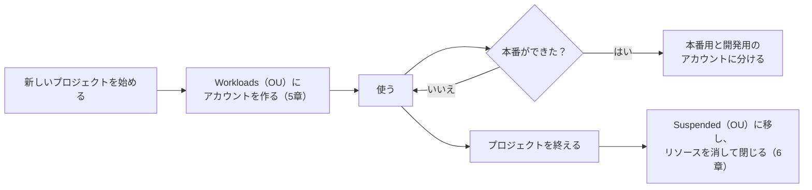
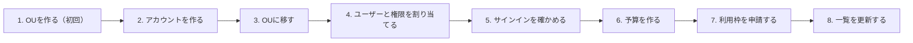

# AWSアカウントの運用

このプロジェクトで使うAWSの組織・アカウント・ユーザーの、正式な運用のルールと手順をまとめる。運用を変えたら、このドキュメントを更新し、決定の理由はADRに残す。

- 考え方の背景：[AWSのアカウントの設計と管理の考え方](../guides/aws-account-design.md)
- 作業の記録：[AWSのアカウントの準備](../setup/aws-account.md)
- 関係するADR：[0013](../adr/0013-aws-account-classic-sign-up.md)（アカウントの作り方）、[0014](../adr/0014-unify-region-tokyo.md)（リージョン）、[0015](../adr/0015-account-structure.md)（アカウントの構成）
- アカウントID、メールアドレス、パスワードなど、個人や認証に関わる情報はここに書かない。

## 1. 基本の方針

| 方針 | 内容 | 根拠 |
|---|---|---|
| 管理アカウントにはリソースを置かない | 管理アカウントは、請求と組織の管理だけに使う | [設計・管理論](../guides/aws-account-design.md) 8章の原則1、[0015](../adr/0015-account-structure.md) |
| プロジェクトごとにアカウントを分ける | プロジェクトのリソースは、そのプロジェクト用のアカウントに作る | [0015](../adr/0015-account-structure.md) |
| リージョンは東京 | すべてのリソースを東京（ap-northeast-1）に置く | [0014](../adr/0014-unify-region-tokyo.md) |
| 普段の作業は作業用のユーザーで行う | ルートユーザーは、ルートユーザーにしかできない作業と非常時だけに使う | [設計・管理論](../guides/aws-account-design.md) 6章 |
| アカウントは従来の方法で作る | 「Googleで続行」などは使わない | [0013](../adr/0013-aws-account-classic-sign-up.md) |

## 2. 構成

### 2.1 目指す構成

```
組織（個人）
└── Root
    ├── 管理アカウント（請求と組織の管理だけ。リソースは置かない）
    └── Workloads（OU）
        └── tcg-buylist-eval（このプロジェクトのアカウント）
```

将来の姿（必要になったら足す）：

```
組織（個人）
└── Root
    ├── 管理アカウント
    ├── Workloads（OU）
    │   ├── tcg-buylist-eval
    │   └── 次のプロジェクトのアカウント
    ├── Sandbox（OU）      ← ちょっとした試しが必要になったら作る
    │   └── 実験用のアカウント
    └── Suspended（OU）    ← 閉じるアカウントが出たら作る
        └── 終わったプロジェクトのアカウント
```

### 2.2 アカウントの一覧

| アカウント名 | 種類 | 置き場所 | 用途 | 状態 |
|---|---|---|---|---|
| （管理アカウント） | 管理アカウント | Root の直下 | 請求と組織の管理、IAM Identity Center | 作成済み（2026-10-27） |
| tcg-buylist-eval | メンバーアカウント | Workloads（OU） | このプロジェクトのリソース（GPUサーバー、実行環境、S3、Langfuseなど） | 作成済み（2026-10-28） |

### 2.3 組織単位（OU）の一覧

| OU | 置くもの | ルール（SCP） | 状態 |
|---|---|---|---|
| Workloads | プロジェクトのアカウント | なし（付けるかは、あとで決める。7章） | 作成済み（2026-10-28） |
| Sandbox | ちょっとした試し用のアカウント | ― | 必要になったら作る |
| Suspended | 閉じる前のアカウント | ― | 必要になったら作る |

## 3. ユーザーと権限

| ユーザー | 使う場面 | サインインの入口 |
|---|---|---|
| 作業用のユーザー（IAM Identity Center） | 普段の作業すべて（コンソール、AWS CLI、Terraform、費用の確認） | AWSアクセスポータル（ブックマーク済み） |
| ルートユーザー（各アカウント） | ルートユーザーにしかできない作業、非常時だけ | AWSのコンソールのサインインのページ |

| 許可セット | 中身 | セッションの期間 | 割り当て先 |
|---|---|---|---|
| AdministratorAccess | AWSが用意している管理者の権限 | 1時間 | 管理アカウント、tcg-buylist-eval |

- IAM Identity Centerは、管理アカウントの東京（単一リージョンインスタンス）で動いている。
- 最初のユーザーと許可セットは画面で作った。あとでTerraformの管理に取り込む（TODO 5章）。
- 権限を絞った許可セットが必要になったら、追加する。

### 3.1 ルートユーザーの管理

| アカウント | ルートユーザーの扱い |
|---|---|
| 管理アカウント | 多要素認証を設定済み。アクセスキーは作らない。パスワードは安全に保管する |
| 組織の中で作ったアカウント（tcg-buylist-evalなど） | 組織の中で作ったアカウントのルートユーザーには、最初はパスワードがない。使うときは、そのアカウントのメールアドレスで「パスワードを忘れた場合」から設定する。普段は使わない |

- ルートユーザーのメールアドレスを、使える状態に保つ。
- 多要素認証のデバイスを機種変更するときは、先にルートユーザーの多要素認証を登録し直す。

## 4. 運用のルール

### 4.1 プロジェクトの一生



| 場面 | どうするか |
|---|---|
| 新しいプロジェクトを始める | Workloads（OU）の下に、そのプロジェクトのアカウントを作る（5章） |
| ちょっとした試し | プロジェクトごとにアカウントを作るのは大げさなので、Sandbox（OU）に実験用のアカウントを1つ用意して、そこで試す |
| プロジェクトに「本番」ができた（例：M3でCard Pulseに組み込む） | そのプロジェクトを、本番用と開発用のアカウントに分ける。プロジェクトが増えてきたら、Workloadsの下にProdとNon-ProdのOUを作る（[設計・管理論](../guides/aws-account-design.md) 7.3） |
| プロジェクトを終える | アカウントをSuspended（OU）に移し、リソースを消してから閉じる（6章） |

### 4.2 名前の付け方

| 対象 | 決まり | 例 |
|---|---|---|
| アカウント名 | プロジェクトのリポジトリの名前と同じにする。本番と開発に分けたら、末尾に `-prod`・`-dev` を付ける。**小文字の英数字とハイフンだけ** を使う | `tcg-buylist-eval`、`tcg-buylist-eval-prod` |
| 実験用のアカウント名（Sandbox） | `sandbox` とする。プロジェクトに属さないことが名前で分かるようにする | `sandbox` |
| アカウントのルートユーザーのメールアドレス | 管理アカウントと同じメールアドレスに、「＋アカウント名」の別名を付ける。メールアドレスはアカウントごとに別のものが必要 | `（管理アカウントのアドレスの＠より前）+tcg-buylist-eval@（ドメイン）` |
| OU | 役割を表す英語の名前にする。システムや部署の名前にしない | `Workloads`、`Sandbox`、`Suspended` |

- 小文字の英数字とハイフンだけにするのは、Terraformのリソース名やタグ、S3のバケット名（大文字を使えない）などにもそのまま使えるようにするため。
- 環境の名前は `prod`・`dev` に揃える。`production` や `stg` などと混ぜない。
- 組織は個人のものなので、名前の前に組織名や自分の名前は付けない。リポジトリとアカウントの対応が、名前だけで分かるようにする。
- AWSの側の決まり：長さは1〜50文字、半角の英数字と記号だけ（日本語は使えない）。同じ名前のアカウントも作れてしまうので、確実に見分けるのは12桁のアカウントID。名前はあとから変更できる。
- AWSは、会社なら「組織名-目的-環境」、個人なら「名-姓-目的」のような決まった形を勧めている（[Sign up for AWS (advanced)](https://docs.aws.amazon.com/accounts/latest/reference/getting-started.html)）。このプロジェクトでは、上の決まりを使う。

### 4.3 予算

#### 決め方のルール

予算は、お金を取り分けるもの（配分）ではなく、**それぞれ独立した見張り役**。決められた範囲の費用を見張り、決めた金額に近づいたら知らせるだけ。ほかの予算と足し引きされることはない。そのため、計画として食い違わないよう、次のルールで決める。

1. **組織全体の予算** ＝ 1か月にAWS全体で使ってよい総額
2. **プロジェクトの予算** ＝ 総額の中から、プロジェクトごとに配る額
3. **プロジェクトの予算の合計 ＋ 余白 ≦ 組織全体の予算**（余白は、どのプロジェクトにも属さない費用のため）

```
組織全体の予算（60ドル）           → 組織のすべてのアカウントの合計を見張る
├── tcg-buylist-eval の予算（50ドル） → tcg-buylist-eval だけを見張る
└── 余白（10ドル）                    → 管理アカウントの費用など
```

プロジェクトの予算を、組織全体の予算より少し低くしておくと、2段階の見張り役になる。先にプロジェクトの予算が知らせ、それでも増えたら組織全体の予算が知らせる。

#### 今の予算

| 予算 | 作る場所 | 対象 | 金額 | 状態 |
|---|---|---|---|---|
| My Monthly Cost Budget | 管理アカウント | 組織全体（管理アカウントで、対象を絞り込まずに作った予算は、組織の中のすべてのアカウントの費用が対象になる） | 60ドル | 作成済み（2026-10-27） |
| tcg-buylist-eval-monthly | 管理アカウント（対象をアカウント tcg-buylist-eval に絞り込む） | tcg-buylist-eval | 50ドル | 作成済み（2026-10-28） |
| （余白） | ― | 管理アカウントの費用など | 10ドル | ― |

#### プロジェクトを増やすとき

総額を増やすか、配分を見直すかを決め、上の表を更新する。予算は自動では足されない。

| 方法 | 例（新しいプロジェクトに30ドル配る場合） |
|---|---|
| 総額を増やす | 組織全体を90ドルに上げる。月に使ってよい総額そのものを増やす判断 |
| 配分を見直す | 総額は60ドルのまま、tcg-buylist-eval を30ドルに下げ、新しいプロジェクトに20ドル配る |

- 予算は費用を止めない。知らせるだけ（[設計・管理論](../guides/aws-account-design.md) 9章）。
- Terraformで予算を作るときに、画面で作ったものと二重にならないよう整理する。

### 4.4 利用枠

- 利用枠は **アカウントごと・リージョンごと**。新しいアカウントでは、必要な利用枠を改めて申請する。
| アカウント | リージョン | 利用枠 | 申請する値 | 状態 |
|---|---|---|---|---|
| tcg-buylist-eval | 東京 | Running On-Demand G and VT instances（GPUサーバーのオンデマンド） | 4 vCPU（g6.xlarge 1台分）で再申請する | 8 vCPU は承認されなかった（2026-10-28）。値を下げて再申請する |

- 管理アカウントでは申請しない（リソースを置かないため）。
- 申請は、今入っているアカウントの上限を上げる **アカウントレベル** で行う。組織レベルの「クォータのリクエストのテンプレート」（これから作るアカウントに自動で申請する仕組み）は、今は使わない（7章）。
- 申請の状態は、Service Quotasの「クォータリクエスト履歴」で確かめる。結果は、そのアカウントのルートユーザーのメールアドレスにも届く。
- 新しいアカウントでは、高い上限は承認されにくい。**必要な最小の値から申請し、使い方（インスタンスタイプ、台数、時間、費用の管理）を具体的に書く。** 承認されなかったときは、サポートセンターでケースを再開して返信する。
- GPUのサーバーの利用枠が得られないときは、予備のWindows PC（RTX 3080）を使う（[0005](../adr/0005-gpu-environment.md)）。

## 5. 新しいアカウントを作る手順

作業用のユーザーで、管理アカウントにサインインして行う。

| # | やること | 場所 |
|---|---|---|
| 1 | （初回だけ）Workloads（OU）を作る | AWS Organizations →「AWSアカウント」→ Root を選ぶ →「アクション」→「新規作成」（組織単位） |
| 2 | アカウントを作る。名前とメールアドレスは 4.2 の決まりに従う。IAMのロールの名前は初期値（`OrganizationAccountAccessRole`）のまま | AWS Organizations →「AWSアカウントを追加」→「AWSアカウントを作成」 |
| 3 | 作ったアカウントを Workloads（OU）に移す | AWS Organizations → アカウントを選ぶ →「アクション」→「移動」 |
| 4 | 作業用のユーザーと許可セット「AdministratorAccess」を、新しいアカウントに割り当てる | IAM Identity Center（東京）→「AWSアカウント」→ アカウントを選ぶ →「ユーザーまたはグループを割り当て」 |
| 5 | AWSアクセスポータルから、新しいアカウントにサインインできることを確かめる | AWSアクセスポータル |
| 6 | 新しいアカウントの予算を作る。金額は 4.3 のルールで決め、組織全体の予算も見直す | 管理アカウントの「予算（Budgets）」 |
| 7 | 必要な利用枠を申請する（4.4） | 新しいアカウントの東京の Service Quotas |
| 8 | 2.2 のアカウントの一覧と、作業の記録を更新する | このドキュメント |



この手順は、あとでTerraformで自動化する（TODO 5章）。

## 6. アカウントを閉じる手順

1. アカウントの中のリソースをすべて消す（Terraformで作ったものは `terraform destroy`）
2. 費用が残っていないことを、Cost Explorerで確かめる
3. アカウントを Suspended（OU）に移す
4. 管理アカウントから、アカウントを閉じる
5. 2.2 のアカウントの一覧を更新する

アカウントを閉じても、90日間は再開できる状態で残り、そのあとで完全に削除される。

## 7. あとで決めること

| 項目 | 決める場所 |
|---|---|
| 使えるリージョンを東京に限るルール（SCP）を付けるか。グローバルなサービス（IAMなど）の扱いに注意が必要 | TODO 5章 |
| 必ず付けるタグ（部品、実験の構成など）と、コスト配分タグとしての有効化 | TODO 5章 |
| 複数のプロジェクトで共通に使うもの（Terraformの状態ファイルなど）の置き場所 | TODO 5章 |
| アカウントを作る手順（5章）の、Terraformでの自動化。新しいアカウントの利用枠を自動で申請する「クォータのリクエストのテンプレート」を使うかも含む | TODO 5章 |
| 画面で作ったユーザー・許可セット・割り当てを、Terraformの管理に取り込む方法 | TODO 5章 |
| 組織の中のアカウントのルートユーザーを、管理アカウントからまとめて管理するか | TODO 5章 |
| SandboxとSuspendedのOU | 必要になったとき |
| 権限を絞った許可セット（組織の管理用、システムの作業用）と、IAM Identity Centerの管理を別のアカウントに任せるか（[設計・管理論](../guides/aws-account-design.md) 5.4） | 人が増えたとき、または権限を絞りたくなったとき |

## 8. 定期的に確かめること

| 頻度 | 確かめること |
|---|---|
| 毎月 | 費用（Cost Explorer）と、予算のアラートのメール。使っていないリソースが残っていないか |
| 数か月に一度 | 管理アカウントのルートユーザーでサインインできるか。多要素認証のデバイスが手元にあるか |
| アカウントを増やしたとき | 2.2 の一覧、予算（4.3 のルールに合っているか）、利用枠、割り当て |

## 9. 変更の履歴

| 日付 | 変更 |
|---|---|
| 2026-10-28 | 初版。プロジェクトごとにアカウントを分ける構成（[0015](../adr/0015-account-structure.md)）を決めた |
| 2026-10-28 | 4.3 予算に、決め方のルール（組織全体の予算から配る）とプロジェクトを増やすときの手順を追加した。tcg-buylist-eval の予算を50ドルに決めた |
| 2026-10-28 | 4.2 名前の付け方に、使う文字（小文字の英数字とハイフン）、環境の名前、Sandboxのアカウント名、AWSの側の決まりを追加した |
