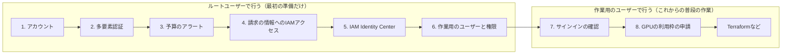
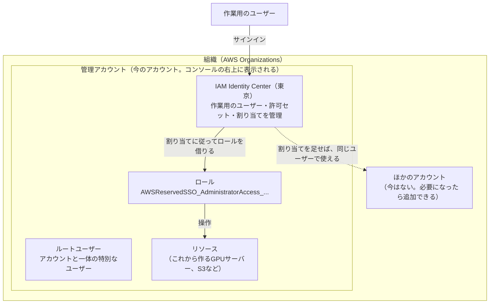
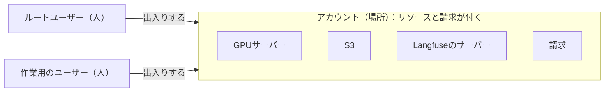
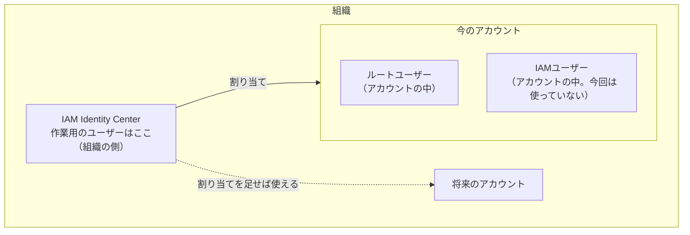
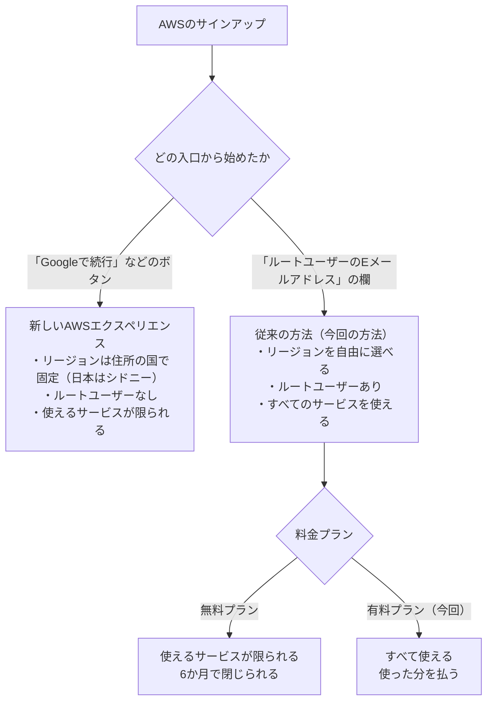
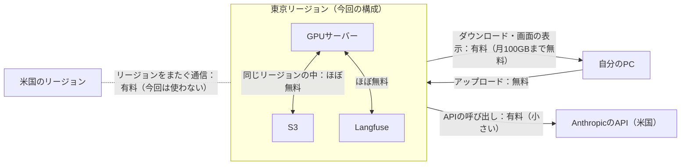
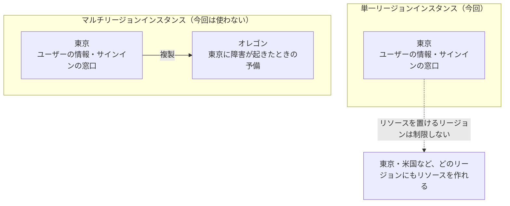
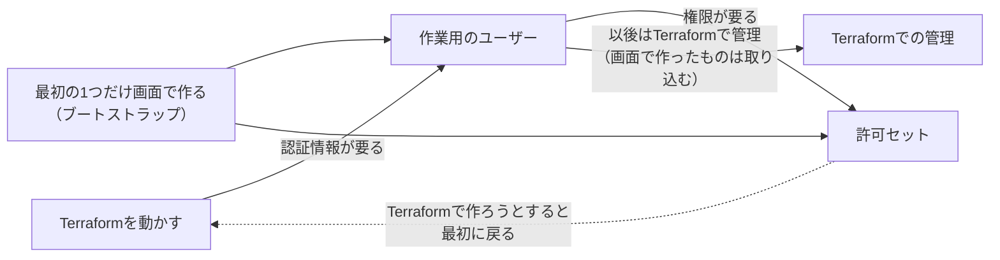
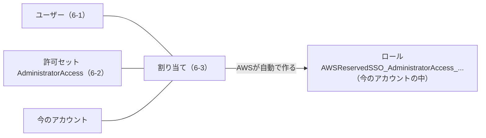
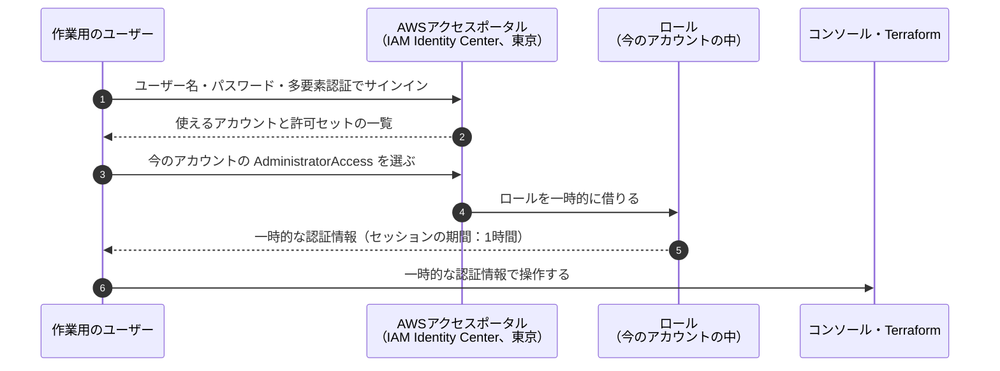

# AWSのアカウントの準備（作業の記録）

AWSのアカウントを作り、安全に、費用の心配なく使い始められる状態にするまでの記録。何を、なぜ、どのユーザーで、どの設定で行ったかと、作業の途中で出てきた疑問への答えを残す。

- 作業日：2026-10-27
- 関係するADR：[0005](../adr/0005-gpu-environment.md)（GPU環境）、[0013](../adr/0013-aws-account-classic-sign-up.md)（アカウントの作り方）、[0014](../adr/0014-unify-region-tokyo.md)（リージョンを東京に統一する）
- アカウントID、メールアドレス、パスワードなど、個人や認証に関わる情報はここに書かない。

## 1. 目的と今の状態

TerraformでGPUサーバーなどのリソースを作る前に、次の状態にする。

- アカウントの持ち主の権限（ルートユーザー）が守られている
- 使いすぎたときに気づける
- 普段の作業は、ルートユーザーではなく作業用のユーザーで行える

| 手順 | やること | 使うユーザー | 状態 |
|---|---|---|---|
| 1 | アカウントを作る | ― | 済み |
| 2 | ルートユーザーに多要素認証を設定する | ルートユーザー | 済み |
| 3 | 予算のアラートを作る | ルートユーザー | 済み |
| 4 | 請求の情報へのIAMアクセスを有効にする | ルートユーザー | 済み |
| 5 | IAM Identity Centerを有効にする | ルートユーザー | 済み |
| 6 | 作業用のユーザーと権限を作る | ルートユーザー | 済み |
| 7 | 作業用のユーザーでサインインして確かめる | 作業用のユーザー | 済み |
| 8 | GPUサーバーの利用枠を申請する | 作業用のユーザー | これから |



1〜6はルートユーザーで行う。作業用のユーザーがまだないため、最初の準備だけはルートユーザーを使うしかない。7以降は作業用のユーザーで行い、ルートユーザーは、ルートユーザーにしかできない作業（請求の重要な設定の変更、アカウントの解約など）のときだけ使う。

## 2. 基本の考え方

### 2.1 全体像



### 2.2 用語

| 用語 | 意味 | たとえ |
|---|---|---|
| 組織（AWS Organizations） | 複数のアカウントをまとめて管理する入れ物。IAM Identity Centerを組織のインスタンスで有効にしたときに、自動で作られた | 複数の建物をまとめて管理する会社 |
| 組織単位（OU） | 組織の中で、アカウントをフォルダのように分けて整理する単位。今は作っていない | 会社の部署 |
| AWSのアカウント | リソースと請求が付く単位 | 1つ1つの建物 |
| 管理アカウント | 組織を管理するアカウント。組織の中のアカウントの請求も、ここにまとめて届く。今のアカウントがこれ | 本社が入っている建物 |
| ルートユーザー | アカウントを作ったときのメールアドレスとパスワードでサインインするユーザー。何でもできる | 建物のマスターキー |
| 多要素認証（MFA） | パスワードに加えて、スマートフォンの生体認証などでも本人を確かめる仕組み | マスターキーを金庫にしまう |
| 予算のアラート（AWS Budgets） | 費用が決めた額を超えそうになったら、メールで知らせる仕組み | 電気代の使いすぎを知らせる装置 |
| IAM Identity Center | 普段の作業に使うユーザーを作って管理する仕組み | 社員証を発行する仕組み |
| 作業用のユーザー | IAM Identity Centerで作った、普段の作業に使うユーザー | 社員証を持った社員 |
| 許可セット | ユーザーに「何をしてよいか」を決める権限のまとまり | 社員証で入れる部屋の一覧 |
| 割り当て | 「どのユーザーが、どのアカウントで、どの許可セットを使えるか」の組み合わせ | 社員証と部屋の一覧を結びつける |
| ロール | 権限の付いた役割。人が一時的に借りて使う。割り当てをすると、AWSがアカウントの中に自動で作る | 部屋に入るための一時的な入館証 |
| 利用枠（Service Quotas） | サービスごとに、使える量の上限。新しいアカウントは、GPUサーバーの上限が0 | 大きな機械を使う許可 |

### 2.3 アカウントとユーザーの違い

普段のWebサービスでは「アカウント」と「ユーザー」がほぼ同じ意味で使われるが、AWSでは別のものである。

| | 意味 | 問い |
|---|---|---|
| **アカウント** | リソースと請求が付く **場所** | **どこに** 作るか、**どこに** 請求が来るか |
| **ユーザー** | サインインして操作する **人** | **誰が** 操作するか |



- 1つのアカウントには、何人ものユーザーが出入りできる。IAM Identity Centerを使うと、1人のユーザーが複数のアカウントに出入りすることもできる。
- このプロジェクトのGPUサーバー、S3、Langfuseのサーバーなどは、すべて今のアカウントの中に作られ、費用もこのアカウントに付く。それを操作するのが作業用のユーザー。
- 「管理アカウント」と「ルートユーザー」は、どちらか一方になるものではなく、種類の違うもの。管理アカウントは **場所**、ルートユーザーはその中の **人**。最初の準備は「管理アカウントに、ルートユーザーとしてサインインして」行った。手順7からは「同じ管理アカウントに、作業用のユーザーとしてサインインして」行う。場所は変わらず、入ってくる人が変わるだけ。
- 紛らわしいのは、**ルートユーザーがアカウントを作るときに一緒にできる** から。アカウント（場所）ができて、そこにルートユーザー（最初の人）が自動で付いた、という関係である。作業用のユーザーは、2人目の人として追加した。

ユーザーがどこにいるかは、種類によって違う。



| ユーザーの種類 | どこにいるか |
|---|---|
| ルートユーザー | アカウントの中。アカウントごとに1人ずつ、アカウントと一体になっている |
| IAMユーザー（今回は使っていない、昔からある方法） | アカウントの中。そのアカウントだけで使える |
| IAM Identity Centerのユーザー（作業用のユーザー） | 組織の側。IAM Identity Centerは管理アカウントで動いているが、ユーザーは組織全体のもので、組織の中のアカウントに割り当てて使う。アカウントを増やしても、割り当てを足すだけで同じユーザーで使える |

### 2.4 上下の関係

一番外側に組織があり、その中に、アカウントと作業用のユーザー（IAM Identity Center）の両方が入っている。

```
組織（一番外側の入れ物）
├── アカウント（場所）
│     ├── ルートユーザー（そのアカウントの中の人）
│     └── リソース（GPUサーバー、S3など）
└── IAM Identity Center
      └── 作業用のユーザー（組織の側の人。アカウントに割り当てて出入りする）
```

会社にたとえると、組織は会社、アカウントは会社が持っている建物、ルートユーザーは建物ごとのオーナー、作業用のユーザーは会社の社員にあたる。社員は特定の建物ではなく会社に属しているので、建物が増えても、社員証の行き先を足すだけで済む。

組織の中のアカウントは、木の形で整理される。IAM Identity Centerの「AWSアカウント」の画面や、組織の画面で、次のように表示される。

```
Root（組織のルート。ルートユーザーとは関係ない）
└── 今のアカウント（管理アカウント）
      ├── ルートユーザー（アカウントの中の特別なユーザー）
      ├── ロール AWSReservedSSO_AdministratorAccess_...（割り当てで自動で作られた）
      └── リソース（これから作るGPUサーバー、S3など）
```

- 上下の関係は **組織 ＞ アカウント** だけ。ルートユーザーはアカウントの「上」ではなく、アカウントの中にいる特別なユーザー。
- コンソールの右上には、今いるアカウント（今は管理アカウント）と、誰としてサインインしているかが表示される。作業用のユーザーでサインインすると、`AdministratorAccess/ユーザー名` のように表示される。
- 組織の画面に出てくる **「ルート」（Root）** は、組織の中のアカウントをまとめる一番上の入れ物のこと。ルートユーザーとは別物。

### 2.5 アカウントの分け方

AWSは、システムと用途（本番用・開発用など）ごとにアカウントを分けることを勧めている。費用と権限がアカウントごとにはっきり分かれ、問題が起きてもほかのシステムに影響しにくい。

#### 実務での単位

| AWSの単位 | 実務での単位 | 数 |
|---|---|---|
| 組織 | **会社**（グループ会社ごとに分けることもある） | 会社に1つが基本 |
| Root | 組織の一番上の入れ物。**システムの単位ではない** | 組織に必ず1つだけ |
| 組織単位（OU） | **アカウントの役割や用途**（本番か開発か、セキュリティ用かなど）。部署の単位で分けることは、AWSは勧めていない | 必要な数だけ |
| アカウント | **システム × 環境**（例：システムAの本番、システムAの開発） | システムと環境の数だけ |

#### 実務でよくある構成

AWSが勧めている構成（マルチアカウントの指針）に沿った例：

```
組織（会社）
└── Root
    ├── 管理アカウント
    │     組織の管理と請求のまとめ役だけ。システムは置かない
    ├── Security（OU）
    │   ├── ログ保管用アカウント（全アカウントの操作の記録を集める）
    │   └── セキュリティ監視用アカウント
    ├── Infrastructure（OU）
    │   ├── ネットワーク用アカウント
    │   └── 共通サービス用アカウント
    ├── Workloads（OU）            ← 各システムはここ
    │   ├── Prod（OU）
    │   │   ├── システムAの本番用アカウント
    │   │   └── システムBの本番用アカウント
    │   └── Non-Prod（OU）
    │       ├── システムAの開発用アカウント
    │       └── システムBの開発用アカウント
    ├── Sandbox（OU）
    │   └── 個人の実験用アカウント（自由に試せる。費用の上限を厳しくする）
    └── Suspended（OU）
        └── 使わなくなったアカウント（閉じる前の置き場）
```

- **システムはOUではなく、アカウントで分ける。** OUは、同じ役割のアカウントをまとめる「棚」。
- **OUごとにルールを付けられる**（サービスコントロールポリシー、SCP）。例：「Prodでは東京以外のリージョンを使えない」「Sandboxでは高いGPUサーバーを起動できない」。OUを役割で分けるのは、このルールを付けやすくするため。
- **管理アカウントには、システムを置かない。** 管理アカウントは組織全体を操作できる強い権限を持つので、システムのリソースは別のアカウントに置く。
- 大きな会社では、この構成を自動で作る仕組み（AWS Control Tower）を使うことが多い。

#### OUの下のOU

OUの下にOUを作ることもできる（上の例の Workloads → Prod、Non-Prod）。

| 決まりごと | 内容 |
|---|---|
| 深さの上限 | Rootの下に、OUを5階層まで重ねられる |
| アカウントの置き場所 | 1つのアカウントは、どこか1か所だけ（Rootの直下か、どれか1つのOU）に置く |
| ルールの引き継ぎ | 上のOUに付けたルール（SCP）は、下のOUとアカウントにも引き継がれる |

```
Root
└── Workloads（OU）     ルール：東京以外のリージョンを使えない
    ├── Prod（OU）      ルール：さらに、リソースの削除を制限する
    │   └── 本番用アカウント   → 両方のルールがかかる
    └── Non-Prod（OU）
        └── 開発用アカウント   → 「東京以外を使えない」だけがかかる
```

- 上の階層で共通のルールを決め、下の階層で用途ごとのルールを足していく。
- 階層は浅く保つのが一般的。深くすると、どのルールがどこから引き継がれているのか分かりにくくなる。多くの場合は2〜3階層で足りる。

#### システムでOUを分けるのは勧められない

絶対にだめではないが、システムを主な軸にしてOUを作るのは勧められていない。**OUは、同じルールをかけたいアカウントをまとめるもの** で、実務のルール（SCP）は、システムではなく **本番か開発か** で変わることが多いため。

システムでOUを分けると、同じOUの中に本番と開発が混ざり、「本番だけに削除の制限をかける」ことがOUの単位でできない。避けようとすると、システムごとに本番と開発のOUを作ることになる。

```
Root
├── システムA（OU）
│   ├── Prod（OU）     ← 本番のルール
│   └── Non-Prod（OU） ← 開発のルール
└── システムB（OU）
    ├── Prod（OU）     ← 同じ本番のルールを、もう一度付ける
    └── Non-Prod（OU） ← 同じ開発のルールを、もう一度付ける
```

| 問題 | 内容 |
|---|---|
| 同じルールを何度も付ける | システムが10個あれば、本番のルールを10か所に付ける。直すときも10か所を直す |
| 付け忘れが起きやすい | 新しいシステムを足すたびに、ルールを付け直す必要がある |
| 階層が深くなる | どのルールがどこから来ているのか、分かりにくくなる |

環境でOUを分ければ、ルールは1か所だけで済む。新しいシステムを足すときも、アカウントを正しいOUに入れるだけで、ルールが自動でかかる。

```
Root
└── Workloads（OU）
    ├── Prod（OU）     ← 本番のルールを1か所だけに付ける
    │   ├── システムAの本番用アカウント
    │   └── システムBの本番用アカウント
    └── Non-Prod（OU） ← 開発のルールを1か所だけに付ける
        ├── システムAの開発用アカウント
        └── システムBの開発用アカウント
```

- 同じ理由で、**部署でOUを分けるのも勧められていない。** 加えて、組織変更のたびにOUを作り直したり、アカウントを動かしたりする必要が出る。
- **そのシステムだけ、ほかと違うルールが必要な場合は、システムでOUを分けてよい。** 例：クレジットカードの情報を扱う決済システムに、特に厳しいルールをかける。「システムだから分ける」のではなく、「ルールが違うから分ける」と考える。

#### システムごとのルールの違いはどこで表すか

本番用でも、システムごとにルールは多少違う。ただし、その違いまでOUのルールで表す必要はない。ルールは、階層ごとに役割を分けて重ねる。

```
Root          組織全体のルール（例：組織から抜けられない、操作の記録を消せない）
└── Prod（OU）  本番に共通のルール（例：東京以外のリージョンを使えない）
    ├── システムAのアカウント   システムAだけのルール
    │     └── アカウントの中のIAMのポリシー（誰が何をしてよいか）
    └── システムBのアカウント   システムBだけのルール
          └── アカウントの中のIAMのポリシー（誰が何をしてよいか）
```

| 階層 | 何を決めるか | 仕組み |
|---|---|---|
| Root | 組織のどこでも、絶対にさせないこと | SCP |
| OU（本番・開発） | その環境の中で、絶対にさせないこと | SCP |
| アカウント | そのシステムだけに必要な制限 | SCP（アカウントにも直接付けられる） |
| アカウントの中 | 誰が、どのリソースに、何をしてよいか | IAMのポリシー、許可セット |

- **OUのルールは「最低限の柵」。** 「これだけは絶対にさせない」という大まかな禁止で、本番で共通に必要な柵はシステムが違っても同じになることが多いので、1つにまとめられる。
- **システムごとの違いは、アカウントの側で決める。** そのシステムだけの禁止はSCPをアカウントに直接付け、「誰が何をしてよいか」はアカウントの中のIAMのポリシーや許可セットで決める。
- **実際に使える権限は、すべての階層の重なりで決まる。** SCPは上限を決め、IAMのポリシーはその上限の中で許可を与える。どこか1つの階層で禁止されていれば、その操作はできない。

```
実際にできること ＝ Rootの上限 ∩ OUの上限 ∩ アカウントの上限 ∩ IAMのポリシーで許可されたこと
```

- 違いが大きく、システムのまとまりごとに別の柵が必要なら（決済システムなど）、そのときにOUを分ける。

#### 個人の規模なら

ここまで大きくする必要はない。たとえば次の程度で十分。1つのアカウントで、タグを使って分ける方法もある。

```
組織（個人）
└── Root
    ├── 管理アカウント（請求と組織の管理だけ）
    └── Workloads（OU）
        └── tcg-buylist-eval のアカウント（GPUサーバー、S3、Langfuseなど）
```

#### このプロジェクトでは

- 今は管理アカウント1つだけで、GPUサーバーなどのリソースも管理アカウントに作る計画になっている。これは「管理アカウントにはシステムを置かない」という勧めとは違う。
- 管理アカウントとは別に、このプロジェクト用のアカウントを作るかどうかは、TODO 5章の「アカウントの構成を決める」で決める。
- 判断の基準は、2.6の【重要】アカウント設計で守る原則。

| | 内容 |
|---|---|
| 作る場合の良い点 | 管理アカウントの強い権限と、システムを切り離せる。このプロジェクトの費用がアカウント単位ではっきり分かる。プロジェクトを終えたら、アカウントごと閉じられる |
| 作る場合の弱い点 | アカウントが1つ増え、最初の設定（予算のアラートなど）もそのアカウントの分が必要になる |

### 2.6 【重要】アカウント設計で守る原則

> [!IMPORTANT]
> アカウントやOUの細かい分け方は、会社ごとにかなり違う。正解は1つではない。
> **それでも、次の原則は多くの会社で共通して大事にされている。** 分け方に迷ったら、この原則に立ち返る。

#### 守る原則

| # | 原則 | なぜ大事か | 守らないと |
|---|---|---|---|
| 1 | **管理アカウントには、システムを置かない** | 管理アカウントは組織全体を操作できる強い権限を持つ。システムと同じ場所にあると、システムの不具合や乗っ取りが組織全体に広がる | システムのリソースを操作できる人が、組織全体の設定まで変えられてしまう |
| 2 | **本番と開発を分ける** | 本番は厳しく、開発は自由に、とルールを変えたい。分けておけば、開発での失敗が本番に影響しない | 開発中の誤操作で、本番のデータやサーバーを消してしまう |
| 3 | **操作の記録（ログ）は、消されない場所に集める** | 問題が起きたときに、誰が何をしたかを後から確かめるため | 乗っ取った人に記録を消され、何が起きたか分からなくなる |
| 4 | **「絶対にさせないこと」は、上の階層のルール（SCP）でまとめて防ぐ** | 1か所で決めれば、下のすべてのアカウントに自動でかかる。付け忘れが起きない | アカウントごとに設定し、どこかで付け忘れる |
| 5 | **OUは「同じルールをかけたいアカウント」でまとめる。システムや部署では分けない** | ルールは本番か開発かで変わることが多い。システムや部署で分けると、同じルールを何度も付けることになる（2.5） | ルールの重複と付け忘れが増え、階層も深くなる |
| 6 | **システムごとの違いは、アカウントの側で足す** | OUのルールは最低限の柵。違いは、アカウントに直接付けるSCPや、アカウントの中のIAMのポリシーで表す（2.5） | 違いを表すためにOUが増え続ける |

#### 財務の視点

財務の視点は、アカウントの分け方を決める大きな理由の1つ。ただし、アカウントだけで全部をまかなうのではなく、**タグと組み合わせて考える**。

アカウントで分けると、財務の管理がしやすくなる。

| 理由 | 内容 |
|---|---|
| 費用の境界がはっきりする | リソースは必ずどこか1つのアカウントに属するので、アカウントごとの費用は、何もしなくても正確に分かれる。付け忘れが起きない |
| 費用の持ち主を決めやすい | 「このアカウントの費用は、このシステムのチームが持つ」と決められる。部署ごとに費用を配分する（チャージバック）ときの単位にもなる |
| 予算をアカウントごとに作れる | アカウント単位で予算のアラートを作れる |
| 終わったら閉じられる | プロジェクトを終えたら、アカウントごと閉じれば、消し忘れによる費用も止まる |

> [!NOTE]
> 従来のアカウントの予算（AWS Budgets）は、**費用を止めるものではなく、知らせるもの**。予算を超えてもリソースは動き続ける。「予算のアクション」を使えば、予算を超えたときにルール（SCPやIAMのポリシー）をかけたり、EC2を止めたりして、制限に近いことはできる。新しいAWSエクスペリエンスにあった「支出の上限」は、従来のアカウントにはない。

アカウントで分けられるのは大きな単位まで。それより細かく見たいときは、**タグ** を使う。

```
組織
└── tcg-buylist-eval のアカウント        ← アカウントで分かる：このプロジェクトの費用
    ├── GPUサーバー       タグ：component=gpu,     config=local-h0
    ├── 実行環境          タグ：component=runner
    ├── Langfuseのサーバー タグ：component=langfuse
    └── S3                タグ：component=storage   ← タグで分かる：部品ごとの費用
```

| 道具 | 何に使うか |
|---|---|
| アカウント | 大きな単位の費用の境界（システム、プロジェクト、環境） |
| コスト配分タグ | アカウントの中の細かい単位（部品、実験の構成など）。請求の画面で有効にすると、タグごとに集計できる |
| コストカテゴリ | 複数のアカウントやタグを、「事業部」などの単位にまとめて集計する |
| Cost Explorer | アカウント、タグ、サービスごとに費用をグラフで見る |
| コスト異常検出 | いつもと違う費用の増え方を、自動で知らせる |

- タグは付け忘れることがあるので、「必ず付けるタグ」を決めて、Terraformで自動で付けるのが一般的。
- **利用枠（GPUサーバーの上限など）もアカウントごと** に決まる。プロジェクト用のアカウントを別に作る場合は、そのアカウントで申請し直す。
- このプロジェクトでは、GPUサーバーなどに「どの構成の実験か」のタグを付ければ、QCDの「コスト」（設計書 0.4）を構成ごとにAWSの側でも集計できる。

#### 会社ごとに違いが出る理由

| 理由 | 内容 |
|---|---|
| 始めた時期 | 組織やOUの仕組みが整う前から使っている会社は、昔の構成（1つのアカウント、部署ごとのアカウントなど）が残りやすい |
| 作り直しの手間 | アカウントをOUの間で動かすこと自体は簡単だが、ルール、ネットワーク、権限まで直すのは大変。理想と違うと分かっていても、そのまま使い続けることが多い |
| 会社の事情 | 業界の規制、監査の要件、チームの分け方で、正解が変わる |

よく見られるパターン（統計ではなく、一般的な傾向）：

| 会社の状況 | よくある構成 |
|---|---|
| 早くからAWSを使っている会社 | 昔からの1つのアカウント、または部署ごとのアカウントが残っている |
| AWS Control Towerなどで最近始めた会社 | AWSの勧める構成（2.5）にほぼ沿っている |
| クラウドの専門チームがある大きな会社 | 原則に沿いつつ、自社の規則に合わせて作り込んでいる |
| スタートアップや小さなチーム | 本番・検証・開発の数個のアカウントだけ。必要になったら増やす |

#### このプロジェクトでは

- 個人の規模なので、すべてを取り入れる必要はない。
- 一番大きな判断は、**原則1「管理アカウントには、システムを置かない」を取り入れるか**。今の計画では、GPUサーバーなどを管理アカウントに作ることになっていて、原則1に反する。TODO 5章の「アカウントの構成を決める」で決める。
- 原則4（例：使えるリージョンを東京に限る）も、取り入れるかを同じところで決める。
- 後から作り直すのは大変なので、**リソースを作り始める前に決める。**

## 3. 決めたこと

### 3.1 アカウントの作り方：従来の方法、有料プラン

- **従来の方法**（ルートユーザーのメールアドレスとパスワード）で作る。サインアップの画面で **「Googleで続行」などのボタンは使わない**。使うと「新しいAWSエクスペリエンス」という別の種類のアカウントが作られ、リージョンが住所の国で固定され（日本はシドニー）、ルートユーザーもない（[0013](../adr/0013-aws-account-classic-sign-up.md)）。


- **有料プラン** にする。無料プランは、使えるサービスが限られ、6か月でアカウントが閉じられ、組織に参加すると自動で有料プランになるため、このプロジェクトに合わない。

### 3.2 リージョン：東京に統一する

最初は、GPUサーバーが安い米国東部（us-east-1）にする予定だった（[0005](../adr/0005-gpu-environment.md)）。分かりやすさとデータの置き場所を重視して、東京（ap-northeast-1）に統一することにした（[0014](../adr/0014-unify-region-tokyo.md)）。

**通信料について**：通信料は、GPUサーバーが海外にあるからかかるのではなく、データがどこからどこへ流れるかで決まる。

| データの流れ | 料金 |
|---|---|
| インターネットからAWSに入る通信（画像のアップロード、モデルの重みのダウンロードなど） | 無料 |
| AWSからインターネットへ出る通信（結果のダウンロード、画面の表示、AnthropicのAPIの呼び出しなど） | 有料。ただし毎月100GBまでは無料の枠がある |
| リージョンをまたぐ通信（東京のS3と米国のGPUサーバーの間など） | 有料 |
| 同じリージョンの中の通信 | 同じアベイラビリティゾーンの中なら、ほぼ無料 |



すべてのリソースを同じリージョンにまとめれば、通信料はほぼかからない。

**費用の差**（GPUサーバー、実行環境、ディスクなどを含めた月の合計。[AWSの費用の調査](../research/aws-gpu-cost.md) より）：

| GPUを使う時間 | 米国東部 | 東京 | 差 |
|---|---|---|---|
| 5時間 | 約880円 | 約1,220円 | +約340円 |
| 10時間 | 約1,650円 | 約2,320円 | +約670円 |
| 30時間 | 約4,700円 | 約6,690円 | +約2,000円 |

- M0なら、増えるのは月数百円程度で、全体の予算（月1万円）に収まる。
- GPUの予算（月5,000円）で使える時間は、約36時間から約25時間に減る。
- 東京にする良い点：リージョンを取り違えない、画像などのデータを日本に置ける、画面の反応が速い。Opus 5.5のAPIに送る画像は、これまでどおり米国のサービスに渡る。

### 3.3 IAM Identity Centerの設定



| 設定 | 選んだ値 | 理由 | あとで変更できるか |
|---|---|---|---|
| インスタンスの種類 | 組織のインスタンス | 作業用のユーザーに、アカウントの権限を割り当てるため | ― |
| リージョンの構成 | **単一リージョンインスタンス** | ユーザーの情報を日本だけに置く。一人のプロジェクトには複製は不要 | その他のリージョンは追加できる |
| プライマリリージョン | **アジアパシフィック（東京）** | リージョンを東京に統一する方針に合わせる | **できない** |
| 保存時の暗号化 | AWS所有のキー | 追加の料金や設定が要らない | できる |
| アクセス許可セット | 有効 | 作業用のユーザーに権限を割り当てるため | できない |

### 3.4 作業用のユーザーの権限：AdministratorAccess

- 一人で使うアカウントで、Terraformでいろいろなリソースを作るため、最初は管理者の権限（AWSが用意している「AdministratorAccess」）にした。
- ルートユーザーとは違い、多要素認証付きで、一時的な認証情報でサインインする。アカウントの解約など、ルートユーザーにしかできない作業はできない。
- セッションの期間は1時間（初期値）。不便なら、最大12時間まで延ばせる。
- 必要になったら、権限を絞った許可セットを作る。

### 3.5 最初のユーザーと許可セットは画面で作る



- 許可セットやユーザーは、Terraformのファイルでも定義できる。ただし、Terraformを動かすには作業用のユーザーの認証情報が要るため、**最初の1つだけは画面で作るしかない**（ブートストラップ）。
- ルートユーザーのアクセスキーを作ってTerraformを動かす方法もあるが、安全のためにアクセスキーは作らない。
- 画面で作ったものは、あとでTerraformの管理に取り込む（インポート）。取り込み方は TODO 5章で決める。

## 4. やったこと

### 4.1 アカウントを作る

| 項目 | 内容 |
|---|---|
| サインアップのページ | https://signin.aws.amazon.com/signup?request_type=register |
| 作り方 | 従来の方法（ルートユーザーのメールアドレスとパスワード） |
| 料金プラン | 有料プラン |
| サポートプラン | ベーシックサポート（無料） |

### 4.2 ルートユーザーに多要素認証を設定する

- 場所：右上のアカウント名 →「セキュリティ認証情報」→「多要素認証（MFA）」→「MFAデバイスを割り当てる」
- 同じ画面の「アクセスキー」が空であることも確認した。

### 4.3 予算のアラートを作る

- 場所：「Billing and Cost Management」→「予算（Budgets）」→「予算を作成」→「テンプレートを使用（簡易）」→「月次コスト予算」

| 項目 | 値 |
|---|---|
| 予算名 | My Monthly Cost Budget |
| 予算額 | 60ドル（全体の予算の月1万円が目安） |
| 通知 | 実際の費用が85%・100%を超えたとき、月末の予測が100%を超えそうなとき |

- 予算はアカウント全体の合計で計算される。ほかのプロジェクトでも同じアカウントを使う場合の分け方は、TODO 5章の「アカウントの構成を決める」で決める。
- TerraformでBudgetsを作るまでのつなぎ。Terraformで作るときに、二重にならないよう整理する。
- クレジットがないので、使いすぎに気づくための一番の手段になる。

### 4.4 請求の情報へのIAMアクセスを有効にする

- 場所：右上のアカウント名 →「アカウント」→「請求情報への IAM ユーザーおよびロールのアクセス」→「編集」→「IAM アクセスをアクティブ化」
- ルートユーザーにしかできない設定。これをしないと、作業用のユーザーで費用の画面を見られない。
- この設定だけでは誰も見られるようにはならない。「請求の情報を見る権限を持つユーザーなら見られる」ようになるだけ。

### 4.5 IAM Identity Centerを有効にする

- 東京のリージョンでIAM Identity Centerを開き、「有効にする」を選んだ。設定は 3.3 のとおり。
- リージョンを選べない画面にいるときは、次のURLで直接開く：https://ap-northeast-1.console.aws.amazon.com/singlesignon/home?region=ap-northeast-1
- 有効にしたときに、組織（AWS Organizations）が自動で作られ、今のアカウントが管理アカウントになった。

### 4.6 作業用のユーザーと権限を作る

| 手順 | やったこと | たとえ |
|---|---|---|
| 6-1 | ユーザーを作った。パスワードは、招待のメールから設定する方式にした（招待のリンクの有効期限は7日間） | 社員証を作る |
| 6-2 | 許可セット「AdministratorAccess」（事前定義、セッションの期間1時間）を作った | 入れる部屋の一覧を決める |
| 6-3 | ユーザーに、今のアカウントと許可セットを割り当てた | 社員証と部屋の一覧を結びつける |



作業用のユーザーでサインインしたときの流れ（手順7で確かめる）：



- ユーザーを作っただけでは、アカウントで何もできない。6-3まで終えて初めて、そのユーザーでアカウントを操作できる。
- 6-3の割り当てをすると、AWSがアカウントの中に、許可セットの内容どおりの権限を持つロール（`AWSReservedSSO_AdministratorAccess_...`）を自動で作る。作業用のユーザーは、サインインするときにこのロールを一時的に借りて操作する。ユーザーそのものに権限を付けずにロールを借りる形にすることで、一時的な認証情報で安全に操作できる。

### 4.7 作業用のユーザーでサインインして確かめる

- 作業日：2026-10-28
- 招待のメールの「Accept invitation」から、パスワードと多要素認証を設定した。
- **作業用のユーザーは、ルートユーザーとは別の入口からサインインする。**

| ユーザー | サインインの入口 | 入力するもの |
|---|---|---|
| ルートユーザー | AWSのコンソールのサインインのページ（`console.aws.amazon.com`） | メールアドレス、パスワード、多要素認証 |
| 作業用のユーザー | **AWSアクセスポータル**（`https://xxxx.awsapps.com/start` のような、自分専用のURL） | **ユーザー名**（メールアドレスではない）、パスワード、多要素認証 |

- AWSアクセスポータルのURLは、ルートユーザーで東京のIAM Identity Centerのダッシュボードを開くと、「AWSアクセスポータルのURL」の欄で確認できる。ブックマークしておく。
- サインインの流れ：AWSアクセスポータル → 今のアカウントを選ぶ →「AdministratorAccess」を選ぶ → コンソールが開く（4.6のシーケンス図のとおり）。

確かめたこと（すべて期待どおりだった）：

| 確かめたこと | 結果 |
|---|---|
| 右上の表示 | `AdministratorAccess/ユーザー名` と、アカウントの名前 |
| 右上のリージョン | アジアパシフィック（東京） |
| 費用の画面 | 「Billing and Cost Management」を開けた（4.4の設定が効いている） |
| 予算 | My Monthly Cost Budget（60ドル）が見えた |

確かめたあと、ルートユーザーからはサインアウトする。これ以降の普段の作業は、作業用のユーザーで行う。

#### ルートユーザーを使う場面

ルートユーザーでサインインする場面は、ごくたまにある。なくなるわけではない（[ルートユーザーの認証情報が必要なタスク](https://docs.aws.amazon.com/IAM/latest/UserGuide/id_root-user.html)）。

| 場面 | 例 |
|---|---|
| アカウントそのものの設定を変えるとき | アカウントの名前、ルートユーザーのメールアドレスやパスワードの変更 |
| 請求の一部の設定 | 請求の情報へのIAMアクセスの設定（4.4）、税金に関わる一部の設定 |
| サポートプランを変えるとき | ベーシックから有料のプランへの変更や解約 |
| アカウントを閉じるとき | アカウントの解約 |
| 作業用のユーザーでサインインできなくなったとき | IAM Identity Centerの設定を誤って壊した、権限を消してしまった、などの非常時 |
| 一部の特殊な操作 | S3のバケットのポリシーで、誤って全員を締め出してしまったときの解除など |

ルートユーザーの一番大事な役割は、**作業用のユーザーで入れなくなったときの、非常用の鍵**。普段は使わなくても、いざというときに確実に使える状態にしておく。

- ルートユーザーのメールアドレスを使える状態に保つ（パスワードの再設定は、このメールアドレスに届く）
- パスワードは、パスワード管理のアプリなどで安全に保管する
- 多要素認証のデバイス（スマートフォンなど）を機種変更するときは、先にルートユーザーの多要素認証を登録し直す
- 数か月に一度、サインインできるか確かめておく

迷ったら、まず作業用のユーザーで試す。ルートユーザーでしかできない作業のときは、画面にそう表示される。

## 5. 作業中に出てきた疑問

| 疑問 | 答え |
|---|---|
| GPUサーバーを海外に置くと、通信料がかかるのでは？ | 通信料は、データがどこからどこへ流れるかで決まる。すべてのリソースを同じリージョンに置けば、ほぼかからない。リージョンをまたぐと有料になる（3.2） |
| IAM Identity Centerのリージョンを、なぜ有効にする前に選ぶのか？ | IAM Identity Centerは、1つのリージョンを選んで有効にするサービスで、あとから変えられないため（3.3） |
| 単一リージョンにすると、複数のリージョンを使う構成は組めないのか？ | 組める。IAM Identity Centerのリージョンは、ユーザーの情報の保存場所とサインインの窓口を決めるだけで、リソースを置けるリージョンは制限しない。「マルチリージョンインスタンス」は、IAM Identity Center自体を東京とオレゴンの2か所に置いて、障害に備える設定 |
| 今の設定はルートユーザーでやっているのか？ | そう。作業用のユーザーを作る作業は、すでにあるユーザー（ルートユーザー）で行うしかない。最初の準備だけルートユーザーを使うのが普通の手順（1章） |
| 許可セットはファイルで設定できないのか？ | Terraformなどでも定義できる。ただし最初の1つは、Terraformを動かす認証情報がないため画面で作る。あとでTerraformの管理に取り込む（3.5） |
| 組織とは何か？ | 複数のアカウントをまとめて管理する入れ物（2.2） |
| ユーザーとアカウントの違いは？ | アカウントは場所、ユーザーは人（2.3） |
| システム単位にアカウントを作るのか？ | AWSはそれを勧めている。個人の規模では必須ではなく、このプロジェクトでの分け方は TODO 5章で決める（2.5） |
| 実務ではどう分けるのか？システムがRoot単位になり、組織が会社単位になるのか？ | 組織は会社に1つが基本。Rootは組織に1つだけで、システムの単位ではない。システムはアカウント（システム × 環境）で分け、OUで役割ごとにまとめる。どう分けるかは設計の一部（2.5） |
| OUの下にOUを作れるのか？ | 作れる。Rootの下に5階層まで。上のOUのルール（SCP）は下に引き継がれる。階層は浅く保つのが一般的（2.5） |
| システムをOUとして分けるのはアンチパターンか？ | 主な軸にするのは勧められない。OUは同じルール（SCP）をかけたいアカウントをまとめるもので、ルールは本番か開発かで変わることが多いため。システムで分けると同じルールを何度も付けることになる。そのシステムだけ違うルールが必要な場合は、分けてよい（2.5） |
| 本番用でもシステムAとBでルールは違うのでは？1つのルールにまとめてよいのか？ | 本番の共通部分（最低限の柵）はOUのルールにまとめてよい。システムごとの違いは、アカウントに直接付けるSCPや、アカウントの中のIAMのポリシーで足す。実際の権限は、すべての階層の重なりで決まる（2.5） |
| アカウントやOUの分け方は、会社ごとに違うのか？ | かなり違う。早くから使っている会社は昔の構成が残りやすく、作り直しの手間からそのまま使い続けることも多い。一方で、管理アカウントにシステムを置かない、本番と開発を分ける、ログを消されない場所に集める、絶対にさせないことは上の階層のSCPで防ぐ、といった原則は多くの会社で共通している（統計ではなく一般的な傾向）。**原則は 2.6 にまとめた** |
| アカウントとユーザーの外に、さらに組織があるのか？ | そう。組織が一番外側の入れ物で、その中にアカウントと作業用のユーザー（IAM Identity Center）の両方が入っている。ルートユーザーはアカウントの中にいる（2.4） |
| 作業用のユーザーでサインインするようになったら、ルートユーザーはもう使わないのか？ | ごくたまに使う。アカウントの設定の変更、サポートプランの変更、アカウントの解約、作業用のユーザーで入れなくなったときの非常時など。非常用の鍵として、確実に使える状態に保つ（4.7） |
| アカウントの分け方は、財務の視点から決めることもあるのか？ | ある。アカウントは費用の境界がはっきりし、費用の持ち主や予算の単位にしやすい。細かい単位はタグで分ける。予算は通知で、制限ではない（制限に近いことは予算のアクションでできる）。利用枠もアカウントごと（2.6） |
| 今のアカウントは管理アカウントであって、ルートユーザーではないのか？ | 管理アカウントはアカウント（場所）、ルートユーザーはユーザー（人）で、種類が違う。今は「管理アカウントに、ルートユーザーとしてサインインしている」状態（2.3） |
| アカウントの中にユーザーがいるのか？ | ルートユーザーとIAMユーザーはアカウントの中。作業用のユーザー（IAM Identity Center）は組織の側にいて、アカウントに割り当てて使う（2.3） |
| コンソールの右上のアカウントは管理アカウントか？その上にルートユーザーがいるのか？ | 右上は管理アカウント。ルートユーザーは上ではなく、アカウントの中の特別なユーザー。組織の画面の「ルート」はルートユーザーとは別物（2.4） |
| IAM Identity Centerの「AWSアカウント」の画面で、「Root」というフォルダを開くと管理アカウントがある。これは正しいか？ | 正しい。組織の中のアカウントが木の形で表示されていて、「Root」は組織の一番上の入れ物（ルートユーザーとは関係ない）。今はアカウントが1つなので、Rootの直下に管理アカウントがある。Rootの下には、アカウントをフォルダのように分ける組織単位（OU）も作れる。必要かどうかは、アカウントの分け方と一緒に TODO 5章で決める（2.4、2.5） |

## 6. つまずいたこと

| つまずいたこと | 原因 | 対処 |
|---|---|---|
| 請求の情報へのIAMアクセスの設定が見つからなかった | 「Googleで続行」で、新しいAWSエクスペリエンスのアカウントを作っていた。この種類のアカウントには、ルートユーザーもこの設定もない | 従来の方法で作り直した（[0013](../adr/0013-aws-account-classic-sign-up.md)） |
| 新しいプロファイルをもう一度作ってしまった | サインアップの入口が2種類あり、見分けにくい | 上のサインアップのページを直接開き、「ルートユーザーのEメールアドレス」と「AWSアカウント名」の欄がある画面であることを確かめてから進めた |
| 無料プランの対象外になり、サインアップのクレジット（100ドル）がもらえなかった | AWSのサポートの回答では、最初から有料プランとして作られたため。誤って作ったプロファイルが関係している可能性がある | 諦めて、クレジットなしで進める。予算のアラートを最初に作った |
| 無料利用枠のアラートの設定が見つからなかった | 無料利用枠の仕組みが変わったためと思われる。有料プランでは関係ない | 飛ばした |
| リージョンを選べなかった | 予算や請求など、リージョンのないサービスの画面を開いていた | リージョンのあるサービスの画面に移るか、URLで東京を直接開く |
| 作業用のユーザーでのサインインの仕方が分からなかった | 作業用のユーザーは、普段のAWSのサインインのページではなく、AWSアクセスポータルからサインインする | ルートユーザーでIAM Identity Centerのダッシュボードを開き、AWSアクセスポータルのURLを調べてブックマークした |

## 7. これからやること

- 8\. GPUサーバーの利用枠（G・VTインスタンスのオンデマンド）を、東京で8 vCPU申請する
- 誤って作った新しいAWSエクスペリエンスのプロジェクト（「Future Startup」）を閉じる。AWS Builder IDは残してよい
