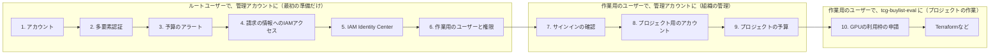
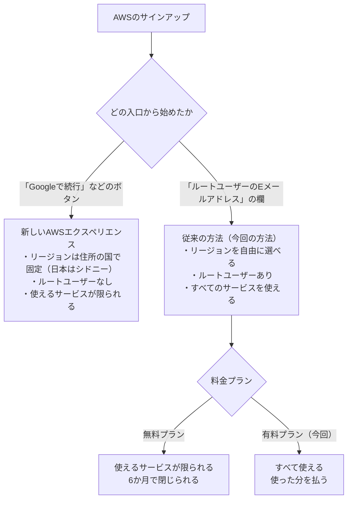
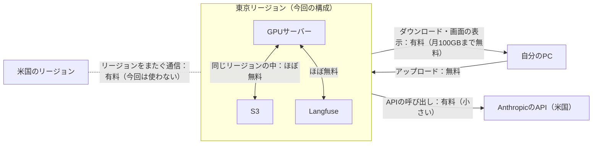
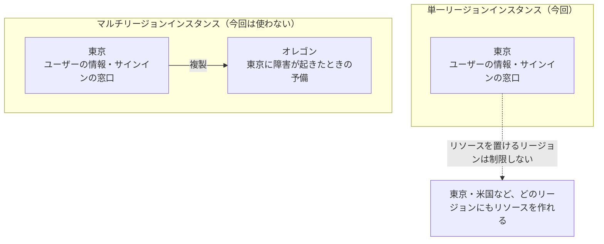
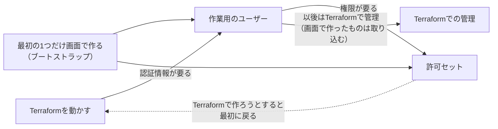
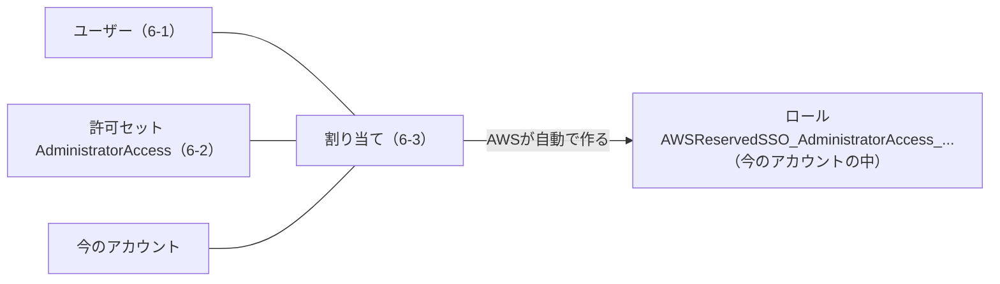
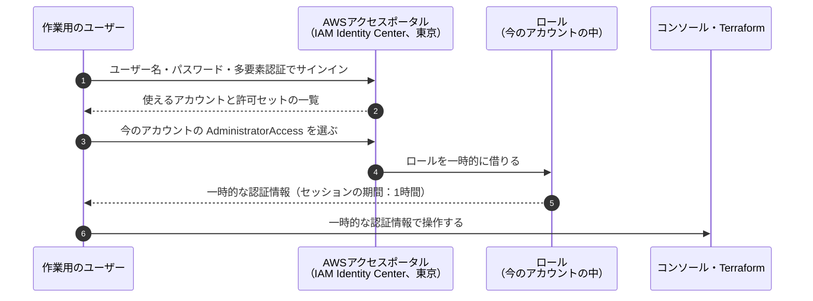
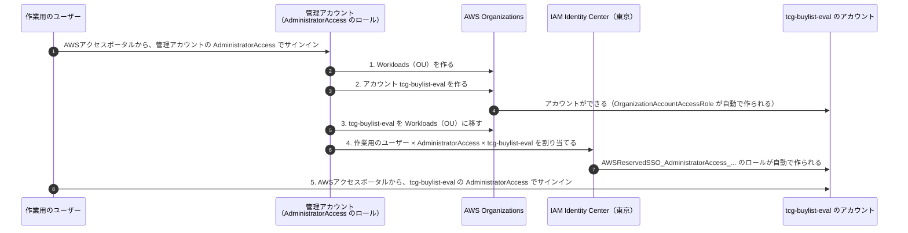

# AWSのアカウントの準備（作業の記録）

AWSのアカウントを作り、安全に、費用の心配なく使い始められる状態にするまでの記録。何を、なぜ、どのユーザーで、どの設定で行ったかと、作業の途中で出てきた疑問への答えを残す。

- 作業日：2026-10-27〜2026-10-28
- 関係するADR：[0005](../adr/0005-gpu-environment.md)（GPU環境）、[0013](../adr/0013-aws-account-classic-sign-up.md)（アカウントの作り方）、[0014](../adr/0014-unify-region-tokyo.md)（リージョンを東京に統一する）、[0015](../adr/0015-account-structure.md)（アカウントの構成）
- 考え方の背景は [AWSのアカウントの設計と管理の考え方](../guides/aws-account-design.md)、正式な運用のルールと手順は [AWSアカウントの運用](../operations/aws-accounts.md) にある。このドキュメントは、作業の記録として残す。
- アカウントID、メールアドレス、パスワードなど、個人や認証に関わる情報はここに書かない。

## 1. 目的と今の状態

TerraformでGPUサーバーなどのリソースを作る前に、次の状態にする。

- アカウントの持ち主の権限（ルートユーザー）が守られている
- 使いすぎたときに気づける
- 普段の作業は、ルートユーザーではなく作業用のユーザーで行える

| 手順 | やること | 使うユーザー | どのアカウントで | 何のために | 状態 | 記録 |
|---|---|---|---|---|---|---|
| 1 | アカウントを作る | ― | （管理アカウントになるもの） | すべての始まり。リソースと請求が付く場所を作る | 済み | 4.1 |
| 2 | ルートユーザーに多要素認証を設定する | ルートユーザー | 管理アカウント | 一番強い権限を、乗っ取りから守る | 済み | 4.2 |
| 3 | 予算のアラートを作る（組織全体、60ドル） | ルートユーザー | 管理アカウント | 使いすぎに気づけるようにする | 済み | 4.3 |
| 4 | 請求の情報へのIAMアクセスを有効にする | ルートユーザー | 管理アカウント | 作業用のユーザーからも、費用を見られるようにする | 済み | 4.4 |
| 5 | IAM Identity Centerを有効にする（東京） | ルートユーザー | 管理アカウント | 作業用のユーザーを作る仕組みを用意する。このとき組織ができた | 済み | 4.5 |
| 6 | 作業用のユーザーと権限を作る | ルートユーザー | 管理アカウント | 普段の作業を、ルートユーザーではなく作業用のユーザーで行えるようにする | 済み | 4.6 |
| 7 | 作業用のユーザーでサインインして確かめる | 作業用のユーザー | 管理アカウント | 普段の入口（AWSアクセスポータル）が使えることを確かめる | 済み | 4.7 |
| 8 | プロジェクト用のアカウントを作る（Workloads（OU）、`tcg-buylist-eval`、割り当て） | 作業用のユーザー | 管理アカウント | 管理アカウントにリソースを置かず、プロジェクトの費用と権限を分ける（[0015](../adr/0015-account-structure.md)） | 済み | 4.8 |
| 9 | プロジェクトの予算を作る（tcg-buylist-eval、50ドル） | 作業用のユーザー | 管理アカウント | プロジェクトの使いすぎに、組織全体より先に気づけるようにする | 済み | 4.8 |
| 10 | GPUサーバーの利用枠を申請する（東京） | 作業用のユーザー | **tcg-buylist-eval** | GPUサーバーを起動できるようにする（利用枠はアカウントごと） | 8 vCPUの申請に、サポートから承認できないと返事があった。同じケースに返信して4 vCPUを依頼した（回答待ち） | 4.9 |



- 1〜6はルートユーザーで行う。作業用のユーザーがまだないため、最初の準備だけはルートユーザーを使うしかない。
- 7〜9は、作業用のユーザーで管理アカウントに入って行う。組織の管理の作業（アカウントの作成、割り当て、予算）は、管理アカウントでしかできない、または管理アカウントでまとめて行う。
- 10からは、作業用のユーザーで tcg-buylist-eval に入って行う。プロジェクトのリソースに関わる作業は、プロジェクトのアカウントで行う。
- ルートユーザーは、ルートユーザーにしかできない作業と非常時だけに使う（[設計・管理論](../guides/aws-account-design.md) 6章）。

## 2. 基本の考え方

組織・アカウント・ユーザーの考え方、アカウントの分け方、守る原則、財務の視点は、[AWSのアカウントの設計と管理の考え方](../guides/aws-account-design.md) にまとめた。作業の途中で出てきた疑問（5章）の答えも、そちらの該当する章を参照している。

作業の時点（2026-10-28）の構成：

```
組織
└── Root
    ├── 管理アカウント（請求と組織の管理だけ。リソースは置かない）
    │     ├── ルートユーザー（多要素認証を設定済み。非常用）
    │     ├── IAM Identity Center（東京）
    │     │     ├── 作業用のユーザー（多要素認証を設定済み）
    │     │     └── 許可セット「AdministratorAccess」
    │     ├── ロール AWSReservedSSO_AdministratorAccess_...
    │     └── 予算：My Monthly Cost Budget（組織全体、60ドル）、tcg-buylist-eval-monthly（50ドル）
    └── Workloads（OU）
        └── tcg-buylist-eval（メンバーアカウント。このプロジェクトのリソースを置く）
              ├── ロール OrganizationAccountAccessRole（非常用）
              └── ロール AWSReservedSSO_AdministratorAccess_...（普段の作業用）
```

| 割り当て | 意味 |
|---|---|
| 作業用のユーザー × AdministratorAccess × 管理アカウント | 管理アカウントで、組織の管理の作業ができる |
| 作業用のユーザー × AdministratorAccess × tcg-buylist-eval | tcg-buylist-eval で、プロジェクトの作業ができる |

## 3. 決めたこと

### 3.1 アカウントの作り方：従来の方法、有料プラン

- **従来の方法**（ルートユーザーのメールアドレスとパスワード）で作る。サインアップの画面で **「Googleで続行」などのボタンは使わない**。使うと「新しいAWSエクスペリエンス」という別の種類のアカウントが作られ、リージョンが住所の国で固定され（日本はシドニー）、ルートユーザーもない（[0013](../adr/0013-aws-account-classic-sign-up.md)）。


- **有料プラン** にする。無料プランは、使えるサービスが限られ、6か月でアカウントが閉じられ、組織に参加すると自動で有料プランになるため、このプロジェクトに合わない。

### 3.2 リージョン：東京に統一する

最初は、GPUサーバーが安い米国東部（us-east-1）にする予定だった（[0005](../adr/0005-gpu-environment.md)）。分かりやすさとデータの置き場所を重視して、東京（ap-northeast-1）に統一することにした（[0014](../adr/0014-unify-region-tokyo.md)）。

**通信料について**：通信料は、GPUサーバーが海外にあるからかかるのではなく、データがどこからどこへ流れるかで決まる。

| データの流れ | 料金 |
|---|---|
| インターネットからAWSに入る通信（画像のアップロード、モデルの重みのダウンロードなど） | 無料 |
| AWSからインターネットへ出る通信（結果のダウンロード、画面の表示、AnthropicのAPIの呼び出しなど） | 有料。ただし毎月100GBまでは無料の枠がある |
| リージョンをまたぐ通信（東京のS3と米国のGPUサーバーの間など） | 有料 |
| 同じリージョンの中の通信 | 同じアベイラビリティゾーンの中なら、ほぼ無料 |



すべてのリソースを同じリージョンにまとめれば、通信料はほぼかからない。

**費用の差**（GPUサーバー、実行環境、ディスクなどを含めた月の合計。[AWSの費用の調査](../research/aws-gpu-cost.md) より）：

| GPUを使う時間 | 米国東部 | 東京 | 差 |
|---|---|---|---|
| 5時間 | 約880円 | 約1,220円 | +約340円 |
| 10時間 | 約1,650円 | 約2,320円 | +約670円 |
| 30時間 | 約4,700円 | 約6,690円 | +約2,000円 |

- M0なら、増えるのは月数百円程度で、全体の予算（月1万円）に収まる。
- GPUの予算（月5,000円）で使える時間は、約36時間から約25時間に減る。
- 東京にする良い点：リージョンを取り違えない、画像などのデータを日本に置ける、画面の反応が速い。Opus 5.5のAPIに送る画像は、これまでどおり米国のサービスに渡る。

### 3.3 IAM Identity Centerの設定



| 設定 | 選んだ値 | 理由 | あとで変更できるか |
|---|---|---|---|
| インスタンスの種類 | 組織のインスタンス | 作業用のユーザーに、アカウントの権限を割り当てるため | ― |
| リージョンの構成 | **単一リージョンインスタンス** | ユーザーの情報を日本だけに置く。一人のプロジェクトには複製は不要 | その他のリージョンは追加できる |
| プライマリリージョン | **アジアパシフィック（東京）** | リージョンを東京に統一する方針に合わせる | **できない** |
| 保存時の暗号化 | AWS所有のキー | 追加の料金や設定が要らない | できる |
| アクセス許可セット | 有効 | 作業用のユーザーに権限を割り当てるため | できない |

### 3.4 作業用のユーザーの権限：AdministratorAccess

- 一人で使うアカウントで、Terraformでいろいろなリソースを作るため、最初は管理者の権限（AWSが用意している「AdministratorAccess」）にした。
- ルートユーザーとは違い、多要素認証付きで、一時的な認証情報でサインインする。アカウントの解約など、ルートユーザーにしかできない作業はできない。
- セッションの期間は1時間（初期値）。不便なら、最大12時間まで延ばせる。
- 必要になったら、権限を絞った許可セットを作る。

### 3.5 最初のユーザーと許可セットは画面で作る



- 許可セットやユーザーは、Terraformのファイルでも定義できる。ただし、Terraformを動かすには作業用のユーザーの認証情報が要るため、**最初の1つだけは画面で作るしかない**（ブートストラップ）。
- ルートユーザーのアクセスキーを作ってTerraformを動かす方法もあるが、安全のためにアクセスキーは作らない。
- 画面で作ったものは、あとでTerraformの管理に取り込む（インポート）。取り込み方は TODO 5章で決める。

## 4. やったこと

### 4.1 アカウントを作る

| 項目 | 内容 |
|---|---|
| サインアップのページ | https://signin.aws.amazon.com/signup?request_type=register |
| 作り方 | 従来の方法（ルートユーザーのメールアドレスとパスワード） |
| 料金プラン | 有料プラン |
| サポートプラン | ベーシックサポート（無料） |

### 4.2 ルートユーザーに多要素認証を設定する

- 場所：右上のアカウント名 →「セキュリティ認証情報」→「多要素認証（MFA）」→「MFAデバイスを割り当てる」
- 同じ画面の「アクセスキー」が空であることも確認した。

### 4.3 予算のアラートを作る

- 場所：「Billing and Cost Management」→「予算（Budgets）」→「予算を作成」→「テンプレートを使用（簡易）」→「月次コスト予算」

| 項目 | 値 |
|---|---|
| 予算名 | My Monthly Cost Budget |
| 予算額 | 60ドル（全体の予算の月1万円が目安） |
| 通知 | 実際の費用が85%・100%を超えたとき、月末の予測が100%を超えそうなとき |

- 予算はアカウント全体の合計で計算される。管理アカウントで作った予算なので、組織の中のすべてのアカウントの費用が対象になる。プロジェクト用のアカウントの予算は別に作る（[運用](../operations/aws-accounts.md) 4.3）。
- TerraformでBudgetsを作るまでのつなぎ。Terraformで作るときに、二重にならないよう整理する。
- クレジットがないので、使いすぎに気づくための一番の手段になる。

### 4.4 請求の情報へのIAMアクセスを有効にする

- 場所：右上のアカウント名 →「アカウント」→「請求情報への IAM ユーザーおよびロールのアクセス」→「編集」→「IAM アクセスをアクティブ化」
- ルートユーザーにしかできない設定。これをしないと、作業用のユーザーで費用の画面を見られない。
- この設定だけでは誰も見られるようにはならない。「請求の情報を見る権限を持つユーザーなら見られる」ようになるだけ。

### 4.5 IAM Identity Centerを有効にする

- 東京のリージョンでIAM Identity Centerを開き、「有効にする」を選んだ。設定は 3.3 のとおり。
- リージョンを選べない画面にいるときは、次のURLで直接開く：https://ap-northeast-1.console.aws.amazon.com/singlesignon/home?region=ap-northeast-1
- 有効にしたときに、組織（AWS Organizations）が自動で作られ、今のアカウントが管理アカウントになった。

### 4.6 作業用のユーザーと権限を作る

| 手順 | やったこと | たとえ |
|---|---|---|
| 6-1 | ユーザーを作った。パスワードは、招待のメールから設定する方式にした（招待のリンクの有効期限は7日間） | 社員証を作る |
| 6-2 | 許可セット「AdministratorAccess」（事前定義、セッションの期間1時間）を作った | 入れる部屋の一覧を決める |
| 6-3 | ユーザーに、今のアカウントと許可セットを割り当てた | 社員証と部屋の一覧を結びつける |



作業用のユーザーでサインインしたときの流れ（手順7で確かめる）：



- ユーザーを作っただけでは、アカウントで何もできない。6-3まで終えて初めて、そのユーザーでアカウントを操作できる。
- 6-3の割り当てをすると、AWSがアカウントの中に、許可セットの内容どおりの権限を持つロール（`AWSReservedSSO_AdministratorAccess_...`）を自動で作る。作業用のユーザーは、サインインするときにこのロールを一時的に借りて操作する。ユーザーそのものに権限を付けずにロールを借りる形にすることで、一時的な認証情報で安全に操作できる。

### 4.7 作業用のユーザーでサインインして確かめる

- 作業日：2026-10-28
- 招待のメールの「Accept invitation」から、パスワードと多要素認証を設定した。
- **作業用のユーザーは、ルートユーザーとは別の入口からサインインする。**

| ユーザー | サインインの入口 | 入力するもの |
|---|---|---|
| ルートユーザー | AWSのコンソールのサインインのページ（`console.aws.amazon.com`） | メールアドレス、パスワード、多要素認証 |
| 作業用のユーザー | **AWSアクセスポータル**（`https://xxxx.awsapps.com/start` のような、自分専用のURL） | **ユーザー名**（メールアドレスではない）、パスワード、多要素認証 |

- AWSアクセスポータルのURLは、ルートユーザーで東京のIAM Identity Centerのダッシュボードを開くと、「AWSアクセスポータルのURL」の欄で確認できる。ブックマークしておく。
- サインインの流れ：AWSアクセスポータル → 今のアカウントを選ぶ →「AdministratorAccess」を選ぶ → コンソールが開く（4.6のシーケンス図のとおり）。

確かめたこと（すべて期待どおりだった）：

| 確かめたこと | 結果 |
|---|---|
| 右上の表示 | `AdministratorAccess/ユーザー名` と、アカウントの名前 |
| 右上のリージョン | アジアパシフィック（東京） |
| 費用の画面 | 「Billing and Cost Management」を開けた（4.4の設定が効いている） |
| 予算 | My Monthly Cost Budget（60ドル）が見えた |

確かめたあと、ルートユーザーからはサインアウトする。これ以降の普段の作業は、作業用のユーザーで行う。

#### ルートユーザーを使う場面

ルートユーザーは、ルートユーザーにしかできない作業と非常時だけに使う。場面の一覧と、非常用の鍵として保つための注意点は、[設計・管理論](../guides/aws-account-design.md) 6章にまとめた。

### 4.8 プロジェクト用のアカウントを作る

- 作業日：2026-10-28
- 決定：[0015](../adr/0015-account-structure.md)、手順：[運用](../operations/aws-accounts.md) 5章
- 1章の表の手順8・9にあたる。この節の手順の番号（1〜6）は、運用ドキュメント5章の手順の番号。



| 手順 | 誰が | どのアカウントで | どの権限で | どのサービスで | 何をしたか |
|---|---|---|---|---|---|
| 1 | 作業用のユーザー | 管理アカウント | AdministratorAccess | AWS Organizations（グローバル） | Workloads（OU）を作った |
| 2 | 作業用のユーザー | 管理アカウント | AdministratorAccess | AWS Organizations（グローバル） | アカウント `tcg-buylist-eval` を作った。メールアドレスは「＋tcg-buylist-eval」の別名、IAMのロールの名前は初期値 |
| 3 | 作業用のユーザー | 管理アカウント | AdministratorAccess | AWS Organizations（グローバル） | `tcg-buylist-eval` を Workloads（OU）に移した |
| 4 | 作業用のユーザー | 管理アカウント | AdministratorAccess | IAM Identity Center（東京） | 作業用のユーザー × AdministratorAccess × `tcg-buylist-eval` を割り当てた |
| 5 | 作業用のユーザー | **tcg-buylist-eval** | AdministratorAccess | AWSアクセスポータル | 新しいアカウントにサインインできることを確かめた |

- 手順1〜4は、組織の管理の作業なので、管理アカウントで行った（組織の操作と割り当ては、管理アカウントからしかできない）。管理アカウントを「組織の管理だけに使う」方針どおりの使い方。
- 許可セットは1つだが、割り当てたアカウントごとに、そのアカウントの中にロールが作られる。手順1〜4では管理アカウントのロールを、手順5では `tcg-buylist-eval` のロールを借りていた。
- 裏側で、2種類のロールが自動で作られた。

| ロール | いつ作られたか | 何のためか |
|---|---|---|
| `OrganizationAccountAccessRole` | 手順2（アカウントを作ったとき） | 管理アカウントから新しいアカウントに入るための、非常用のロール。普段は使わない |
| `AWSReservedSSO_AdministratorAccess_...` | 手順4（割り当てをしたとき） | 作業用のユーザーが、新しいアカウントで普段の作業をするためのロール |

- `tcg-buylist-eval` のルートユーザーは使っていない。最初はパスワードがない。

予算（手順6）：

- 作業用のユーザーで、**管理アカウント** の「予算（Budgets）」で作った。予算を1か所でまとめて管理するため。
- 「カスタマイズ（アドバンスト）」→「コスト予算」で作り、予算の範囲を「連結アカウント：tcg-buylist-eval」に絞り込んだ。絞り込まないと、組織全体の予算になる。

| 項目 | 値 |
|---|---|
| 予算名 | tcg-buylist-eval-monthly |
| 予算の更新タイプ | 定期予算（毎月繰り返す） |
| 予算額 | 50ドル（組織全体の予算60ドルから配る。[運用](../operations/aws-accounts.md) 4.3） |
| 通知 | 実際の費用が85%・100%を超えたとき、月末の予測が100%を超えそうなとき |

作業後の構成：

```
組織
└── Root
    ├── 管理アカウント
    │     ├── IAM Identity Center（東京）
    │     └── ロール AWSReservedSSO_AdministratorAccess_...
    └── Workloads（OU）
        └── tcg-buylist-eval
              ├── ロール OrganizationAccountAccessRole（非常用）
              └── ロール AWSReservedSSO_AdministratorAccess_...（普段の作業用）
```

### 4.9 GPUサーバーの利用枠を申請する

- 作業日：2026-10-28
- 使ったユーザー：作業用のユーザー
- アカウント：**tcg-buylist-eval**（管理アカウントではない。利用枠はアカウントごと）
- リージョン：**アジアパシフィック（東京）**（利用枠はリージョンごと）
- 場所：Service Quotas →「AWSのサービス」→「Amazon Elastic Compute Cloud (Amazon EC2)」→「Running On-Demand G and VT instances」→「クォータの引き上げをリクエスト」

| 項目 | 値 |
|---|---|
| 申請の仕方 | アカウントレベル（今入っているアカウントの上限を上げる） |
| 申請前の値 | 0 |
| 申請した値 | 8 vCPU（g6.xlarge は1台4 vCPU。2台まで同時に動かせる） |
| 状態 | サポートのケース（179317344600266）で、承認できないと返事があった（2026-10-28）。クォータリクエスト履歴では「オープンしたケース」のまま（2026-10-29に確認） |

- 似た名前の「All G and VT Spot Instance Requests」はスポットのもので、今回は使わない。
- 組織レベルの「クォータのリクエストのテンプレート」は、これから作るアカウントに自動で申請する仕組み。今あるアカウントには効かないので使わなかった。
- 結果が出るまで数時間〜数日かかることがある。少ない値で返ってくることもある。

#### 結果と対応

- 回答の要点：「サービスの上限は、利用の状況に応じて少しずつ上げる決まりになっている（予期しない利用の急増による高額の請求を防ぐため）。今の時点で必要な事情があれば、ケースを再開して、詳しいユースケースを返信してほしい」。
- 新しいアカウントで、利用の実績がないため、と考えられる。
- 対応（案A）：ケースを再開し、値を **4 vCPU（g6.xlarge 1台分）** に下げ、目的・インスタンス・使い方（使うときだけ起動し、Terraformで作成と削除を管理）・利用の見込み（月5〜10時間、多くて30時間）・費用の管理（予算のアラート）を書いて再申請する。M0ではGPUのサーバーは1台で足りる。
- 再申請も承認されなければ、M0は予備のWindows PC（RTX 3080、Qwen3.5-9B）で進め、AWSでの利用の実績を作ってから、M1以降に改めて申請する（[0005](../adr/0005-gpu-environment.md)、[0009](../adr/0009-models-for-m0.md)）。
- GPUのサーバーが必要になるのは実行の段階なので、M0のほかの作業（正解データ、採点器、実行スクリプトなど）は、待たずに進められる。
- 2026-10-29：サポートのケースからのメールに返信し、4 vCPU に下げてほしいと依頼した。ケースの状態は「お客様のアクション完了」になり、返信がケースに届いたことを確かめた（回答待ち）。
- 申請の値は8のまま変えていない。担当者は申請の値と違う値でも承認できるため、別の申請は出さずに、このケースで待つ。2〜3営業日たっても動かなければ、4で新しく申請し直すことを考える（そのときは使い方の欄に元のケース番号を書く）。
- 承認されたかは、クォータリクエスト履歴の状態と、利用枠の今の値（適用されたクォータの値）が4以上になったかで確かめる。
- 2026-10-29：クォータリクエスト履歴に「リクエストが見つかりません」と出たのは、画面のリージョンが東京ではなかったため。東京に切り替えると、申請が表示された。

### 4.10 誤って作ったプロジェクトを閉じる

- 作業日：2026-10-28
- 「Googleで続行」で誤って作った、新しいAWSエクスペリエンスのプロジェクト「Future Startup」（シドニー）を閉じた（[0013](../adr/0013-aws-account-classic-sign-up.md)）。
- 閉じたのはプロジェクトだけ。AWS Builder ID（個人のプロフィール）は、AWSの学習のサービスなどに使えるので残した（[設計・管理論](../guides/aws-account-design.md) 3.4）。
- 閉じたあとも、90日間は再開できる状態で残り、そのあとで完全に削除される。

## 5. 作業中に出てきた疑問

| 疑問 | 答え |
|---|---|
| GPUサーバーを海外に置くと、通信料がかかるのでは？ | 通信料は、データがどこからどこへ流れるかで決まる。すべてのリソースを同じリージョンに置けば、ほぼかからない。リージョンをまたぐと有料になる（3.2） |
| IAM Identity Centerのリージョンを、なぜ有効にする前に選ぶのか？ | IAM Identity Centerは、1つのリージョンを選んで有効にするサービスで、あとから変えられないため（3.3） |
| 単一リージョンにすると、複数のリージョンを使う構成は組めないのか？ | 組める。IAM Identity Centerのリージョンは、ユーザーの情報の保存場所とサインインの窓口を決めるだけで、リソースを置けるリージョンは制限しない。「マルチリージョンインスタンス」は、IAM Identity Center自体を東京とオレゴンの2か所に置いて、障害に備える設定 |
| 今の設定はルートユーザーでやっているのか？ | そう。作業用のユーザーを作る作業は、すでにあるユーザー（ルートユーザー）で行うしかない。最初の準備だけルートユーザーを使うのが普通の手順（1章） |
| 許可セットはファイルで設定できないのか？ | Terraformなどでも定義できる。ただし最初の1つは、Terraformを動かす認証情報がないため画面で作る。あとでTerraformの管理に取り込む（3.5） |
| 組織とは何か？ | 複数のアカウントをまとめて管理する入れ物（設計・管理論 2章） |
| ユーザーとアカウントの違いは？ | アカウントは場所、ユーザーは人（設計・管理論 3章） |
| システム単位にアカウントを作るのか？ | AWSはそれを勧めている。個人の規模では必須ではなく、このプロジェクトではプロジェクトごとにアカウントを分けることにした（[0015](../adr/0015-account-structure.md)、設計・管理論 7章） |
| 実務ではどう分けるのか？システムがRoot単位になり、組織が会社単位になるのか？ | 組織は会社に1つが基本。Rootは組織に1つだけで、システムの単位ではない。システムはアカウント（システム × 環境）で分け、OUで役割ごとにまとめる。どう分けるかは設計の一部（設計・管理論 7章） |
| OUの下にOUを作れるのか？ | 作れる。Rootの下に5階層まで。上のOUのルール（SCP）は下に引き継がれる。階層は浅く保つのが一般的（設計・管理論 7章） |
| システムをOUとして分けるのはアンチパターンか？ | 主な軸にするのは勧められない。OUは同じルール（SCP）をかけたいアカウントをまとめるもので、ルールは本番か開発かで変わることが多いため。システムで分けると同じルールを何度も付けることになる。そのシステムだけ違うルールが必要な場合は、分けてよい（設計・管理論 7章） |
| 本番用でもシステムAとBでルールは違うのでは？1つのルールにまとめてよいのか？ | 本番の共通部分（最低限の柵）はOUのルールにまとめてよい。システムごとの違いは、アカウントに直接付けるSCPや、アカウントの中のIAMのポリシーで足す。実際の権限は、すべての階層の重なりで決まる（設計・管理論 7章） |
| アカウントやOUの分け方は、会社ごとに違うのか？ | かなり違う。早くから使っている会社は昔の構成が残りやすく、作り直しの手間からそのまま使い続けることも多い。一方で、管理アカウントにシステムを置かない、本番と開発を分ける、ログを消されない場所に集める、絶対にさせないことは上の階層のSCPで防ぐ、といった原則は多くの会社で共通している（統計ではなく一般的な傾向）。**原則は設計・管理論 8章にまとめた** |
| アカウントとユーザーの外に、さらに組織があるのか？ | そう。組織が一番外側の入れ物で、その中にアカウントと作業用のユーザー（IAM Identity Center）の両方が入っている。ルートユーザーはアカウントの中にいる（設計・管理論 4章） |
| 作業用のユーザーでサインインするようになったら、ルートユーザーはもう使わないのか？ | ごくたまに使う。アカウントの設定の変更、サポートプランの変更、アカウントの解約、作業用のユーザーで入れなくなったときの非常時など。非常用の鍵として、確実に使える状態に保つ（設計・管理論 6章） |
| アカウントの分け方は、財務の視点から決めることもあるのか？ | ある。アカウントは費用の境界がはっきりし、費用の持ち主や予算の単位にしやすい。細かい単位はタグで分ける。予算は通知で、制限ではない（制限に近いことは予算のアクションでできる）。利用枠もアカウントごと（設計・管理論 9章） |
| AWS Builder IDとは何か？アカウントとは違うのか？ | 違う。AWSの学習のサービスや一部のツールを使うための個人のプロフィールで、それだけではリソースも請求も付かない。「Googleで続行」で作られ、新しいAWSエクスペリエンスのプロジェクト「Future Startup」の持ち主になっている。プロジェクトは閉じ、Builder IDは残してよい（設計・管理論 3.4） |
| 管理アカウントは、ルートユーザーで作った最初のアカウントで、AdministratorAccessが付いているアカウントのことか？tcg-buylist-evalにもAdministratorAccessがあるが、管理アカウントか？ | 管理アカウントは、最初にサインアップして組織を作ったアカウントで、組織に1つだけ。tcg-buylist-evalは管理アカウントではなく **メンバーアカウント**。AdministratorAccessは「そのアカウントの中で何でもできる」というユーザーの権限で、アカウントの種類とは関係ない。メンバーアカウントでは、AdministratorAccessでも組織の操作はできない（設計・管理論 3.3） |
| EC2とGPUのサーバーは別のサービスか？ | 別ではない。GPUのサーバーは、EC2のサーバーの種類（インスタンスタイプ）の1つ。g6.xlarge は、NVIDIA L4 のGPUが付いた型のEC2のサーバー。そのため、GPUのサーバーの利用枠は、EC2の利用枠として申請する（設計・管理論 10章） |
| クォータとは、そのアカウントで借りられるCPUのコア数の上限か？ | おおむねそう。正確には、サービスごとの使える量の上限の総称で、アカウントごと・リージョンごとに決まる。EC2のクォータは、同時に動いている分のvCPUの合計で数える（vCPUは物理コアと同じではない）。上限を上げても費用はかからず、空きが約束されるわけでもない（設計・管理論 10.1） |
| 今のアカウントは管理アカウントであって、ルートユーザーではないのか？ | 管理アカウントはアカウント（場所）、ルートユーザーはユーザー（人）で、種類が違う。今は「管理アカウントに、ルートユーザーとしてサインインしている」状態（設計・管理論 3章） |
| アカウントの中にユーザーがいるのか？ | ルートユーザーとIAMユーザーはアカウントの中。作業用のユーザー（IAM Identity Center）は組織の側にいて、アカウントに割り当てて使う（設計・管理論 3章） |
| コンソールの右上のアカウントは管理アカウントか？その上にルートユーザーがいるのか？ | 右上は管理アカウント。ルートユーザーは上ではなく、アカウントの中の特別なユーザー。組織の画面の「ルート」はルートユーザーとは別物（設計・管理論 4章） |
| IAM Identity Centerの「AWSアカウント」の画面で、「Root」というフォルダを開くと管理アカウントがある。これは正しいか？ | 正しい。組織の中のアカウントが木の形で表示されていて、「Root」は組織の一番上の入れ物（ルートユーザーとは関係ない）。今はアカウントが1つなので、Rootの直下に管理アカウントがある。Rootの下には、アカウントをフォルダのように分ける組織単位（OU）も作れる。このプロジェクトでは Workloads（OU）を作る（[0015](../adr/0015-account-structure.md)、設計・管理論 4章・7章） |

## 6. つまずいたこと

| つまずいたこと | 原因 | 対処 |
|---|---|---|
| 請求の情報へのIAMアクセスの設定が見つからなかった | 「Googleで続行」で、新しいAWSエクスペリエンスのアカウントを作っていた。この種類のアカウントには、ルートユーザーもこの設定もない | 従来の方法で作り直した（[0013](../adr/0013-aws-account-classic-sign-up.md)） |
| 新しいプロファイルをもう一度作ってしまった | サインアップの入口が2種類あり、見分けにくい | 上のサインアップのページを直接開き、「ルートユーザーのEメールアドレス」と「AWSアカウント名」の欄がある画面であることを確かめてから進めた |
| 無料プランの対象外になり、サインアップのクレジット（100ドル）がもらえなかった | AWSのサポートの回答では、最初から有料プランとして作られたため。誤って作ったプロファイルが関係している可能性がある | 諦めて、クレジットなしで進める。予算のアラートを最初に作った |
| 無料利用枠のアラートの設定が見つからなかった | 無料利用枠の仕組みが変わったためと思われる。有料プランでは関係ない | 飛ばした |
| リージョンを選べなかった | 予算や請求など、リージョンのないサービスの画面を開いていた | リージョンのあるサービスの画面に移るか、URLで東京を直接開く |
| GPUサーバーの利用枠（8 vCPU）が承認されなかった | 新しいアカウントで利用の実績がなく、上限は利用の状況に応じて少しずつ上げる決まりのため | 値を4 vCPU（1台分）に下げ、詳しい使い方を添えて再申請する。だめならM0は予備のWindows PCで進める（4.9） |
| 作業用のユーザーでのサインインの仕方が分からなかった | 作業用のユーザーは、普段のAWSのサインインのページではなく、AWSアクセスポータルからサインインする | ルートユーザーでIAM Identity Centerのダッシュボードを開き、AWSアクセスポータルのURLを調べてブックマークした |

## 7. これからやること

手順は [AWSアカウントの運用](../operations/aws-accounts.md) 5章のとおり。

- このプロジェクト用のアカウント `tcg-buylist-eval` を作る（[0015](../adr/0015-account-structure.md)）
  - Workloads（OU）を作る（済み）
  - アカウントを作り、Workloads（OU）に移す（済み）
  - 作業用のユーザーと許可セットを割り当て、サインインを確かめる（済み）
  - アカウントの予算を作る（済み）
- 10\. GPUサーバーの利用枠の再依頼（同じケースへの返信で4 vCPU、2026-10-29に送信）の結果を確かめる（4.9）
