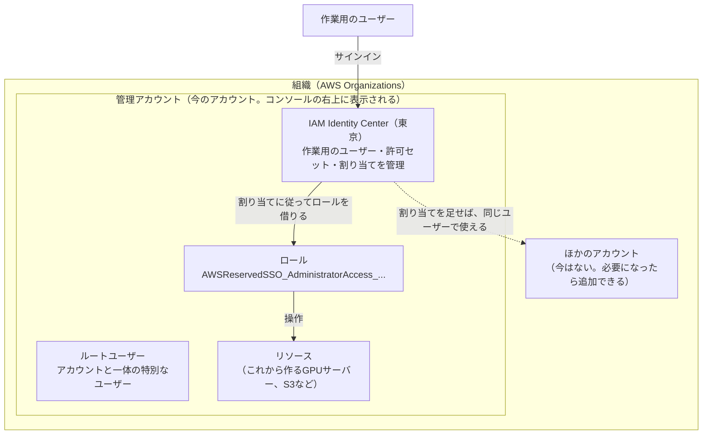

# AWSのアカウントの準備（作業の記録）

AWSのアカウントを作り、安全に、費用の心配なく使い始められる状態にするまでの記録。何を、なぜ、どのユーザーで、どの設定で行ったかと、作業の途中で出てきた疑問への答えを残す。

- 作業日：2026-10-27
- 関係するADR：[0005](../adr/0005-gpu-environment.md)（GPU環境）、[0013](../adr/0013-aws-account-classic-sign-up.md)（アカウントの作り方）。リージョンを東京に統一する決定は、ADR-0014として記録する予定
- アカウントID、メールアドレス、パスワードなど、個人や認証に関わる情報はここに書かない。

## 1. 目的と今の状態

TerraformでGPUサーバーなどのリソースを作る前に、次の状態にする。

- アカウントの持ち主の権限（ルートユーザー）が守られている
- 使いすぎたときに気づける
- 普段の作業は、ルートユーザーではなく作業用のユーザーで行える

| 手順 | やること | 使うユーザー | 状態 |
|---|---|---|---|
| 1 | アカウントを作る | ― | 済み |
| 2 | ルートユーザーに多要素認証を設定する | ルートユーザー | 済み |
| 3 | 予算のアラートを作る | ルートユーザー | 済み |
| 4 | 請求の情報へのIAMアクセスを有効にする | ルートユーザー | 済み |
| 5 | IAM Identity Centerを有効にする | ルートユーザー | 済み |
| 6 | 作業用のユーザーと権限を作る | ルートユーザー | 済み |
| 7 | 作業用のユーザーでサインインして確かめる | 作業用のユーザー | これから |
| 8 | GPUサーバーの利用枠を申請する | 作業用のユーザー | これから |

1〜6はルートユーザーで行う。作業用のユーザーがまだないため、最初の準備だけはルートユーザーを使うしかない。7以降は作業用のユーザーで行い、ルートユーザーは、ルートユーザーにしかできない作業（請求の重要な設定の変更、アカウントの解約など）のときだけ使う。

## 2. 基本の考え方

### 2.1 全体像

### 2.2 用語

| 用語 | 意味 | たとえ |
|---|---|---|
| 組織（AWS Organizations） | 複数のアカウントをまとめて管理する入れ物。IAM Identity Centerを組織のインスタンスで有効にしたときに、自動で作られた | 複数の建物をまとめて管理する会社 |
| AWSのアカウント | リソースと請求が付く単位 | 1つ1つの建物 |
| 管理アカウント | 組織を管理するアカウント。組織の中のアカウントの請求も、ここにまとめて届く。今のアカウントがこれ | 本社が入っている建物 |
| ルートユーザー | アカウントを作ったときのメールアドレスとパスワードでサインインするユーザー。何でもできる | 建物のマスターキー |
| 多要素認証（MFA） | パスワードに加えて、スマートフォンの生体認証などでも本人を確かめる仕組み | マスターキーを金庫にしまう |
| 予算のアラート（AWS Budgets） | 費用が決めた額を超えそうになったら、メールで知らせる仕組み | 電気代の使いすぎを知らせる装置 |
| IAM Identity Center | 普段の作業に使うユーザーを作って管理する仕組み | 社員証を発行する仕組み |
| 作業用のユーザー | IAM Identity Centerで作った、普段の作業に使うユーザー | 社員証を持った社員 |
| 許可セット | ユーザーに「何をしてよいか」を決める権限のまとまり | 社員証で入れる部屋の一覧 |
| 割り当て | 「どのユーザーが、どのアカウントで、どの許可セットを使えるか」の組み合わせ | 社員証と部屋の一覧を結びつける |
| ロール | 権限の付いた役割。人が一時的に借りて使う。割り当てをすると、AWSがアカウントの中に自動で作る | 部屋に入るための一時的な入館証 |
| 利用枠（Service Quotas） | サービスごとに、使える量の上限。新しいアカウントは、GPUサーバーの上限が0 | 大きな機械を使う許可 |

### 2.3 アカウントとユーザーの違い

普段のWebサービスでは「アカウント」と「ユーザー」がほぼ同じ意味で使われるが、AWSでは別のものである。

| | 意味 | 問い |
|---|---|---|
| **アカウント** | リソースと請求が付く **場所** | **どこに** 作るか、**どこに** 請求が来るか |
| **ユーザー** | サインインして操作する **人** | **誰が** 操作するか |

- 1つのアカウントには、何人ものユーザーが出入りできる。IAM Identity Centerを使うと、1人のユーザーが複数のアカウントに出入りすることもできる。
- このプロジェクトのGPUサーバー、S3、Langfuseのサーバーなどは、すべて今のアカウントの中に作られ、費用もこのアカウントに付く。それを操作するのが作業用のユーザー。
- 紛らわしいのは、**ルートユーザーがアカウントを作るときに一緒にできる** から。アカウント（場所）ができて、そこにルートユーザー（最初の人）が自動で付いた、という関係である。作業用のユーザーは、2人目の人として追加した。

ユーザーがどこにいるかは、種類によって違う。

| ユーザーの種類 | どこにいるか |
|---|---|
| ルートユーザー | アカウントの中。アカウントごとに1人ずつ、アカウントと一体になっている |
| IAMユーザー（今回は使っていない、昔からある方法） | アカウントの中。そのアカウントだけで使える |
| IAM Identity Centerのユーザー（作業用のユーザー） | 組織の側。IAM Identity Centerは管理アカウントで動いているが、ユーザーは組織全体のもので、組織の中のアカウントに割り当てて使う。アカウントを増やしても、割り当てを足すだけで同じユーザーで使える |

### 2.4 上下の関係

- 上下の関係は **組織 ＞ アカウント** だけ。ルートユーザーはアカウントの「上」ではなく、アカウントの中にいる特別なユーザー。
- コンソールの右上には、今いるアカウント（今は管理アカウント）と、誰としてサインインしているかが表示される。作業用のユーザーでサインインすると、`AdministratorAccess/ユーザー名` のように表示される。
- 組織の画面に出てくる **「ルート」（Root）** は、組織の中のアカウントをまとめる一番上の入れ物のこと。ルートユーザーとは別物。

### 2.5 アカウントの分け方

- AWSは、システムと用途（本番用・開発用など）ごとにアカウントを分けることを勧めている。費用と権限がアカウントごとにはっきり分かれ、問題が起きてもほかのシステムに影響しにくい。
- 個人の規模では必須ではない。1つのアカウントで、タグを使って分ける方法もある。
- このプロジェクトでの分け方は、TODO 5章の「費用の分け方を決める」で決める。今は管理アカウント1つだけで進める。

## 3. 決めたこと

### 3.1 アカウントの作り方：従来の方法、有料プラン

- **従来の方法**（ルートユーザーのメールアドレスとパスワード）で作る。サインアップの画面で **「Googleで続行」などのボタンは使わない**。使うと「新しいAWSエクスペリエンス」という別の種類のアカウントが作られ、リージョンが住所の国で固定され（日本はシドニー）、ルートユーザーもない（[0013](../adr/0013-aws-account-classic-sign-up.md)）。
- **有料プラン** にする。無料プランは、使えるサービスが限られ、6か月でアカウントが閉じられ、組織に参加すると自動で有料プランになるため、このプロジェクトに合わない。

### 3.2 リージョン：東京に統一する

最初は、GPUサーバーが安い米国東部（us-east-1）にする予定だった（[0005](../adr/0005-gpu-environment.md)）。分かりやすさとデータの置き場所を重視して、東京（ap-northeast-1）に統一することにした。

**通信料について**：通信料は、GPUサーバーが海外にあるからかかるのではなく、データがどこからどこへ流れるかで決まる。

| データの流れ | 料金 |
|---|---|
| インターネットからAWSに入る通信（画像のアップロード、モデルの重みのダウンロードなど） | 無料 |
| AWSからインターネットへ出る通信（結果のダウンロード、画面の表示、AnthropicのAPIの呼び出しなど） | 有料。ただし毎月100GBまでは無料の枠がある |
| リージョンをまたぐ通信（東京のS3と米国のGPUサーバーの間など） | 有料 |
| 同じリージョンの中の通信 | 同じアベイラビリティゾーンの中なら、ほぼ無料 |

すべてのリソースを同じリージョンにまとめれば、通信料はほぼかからない。

**費用の差**（GPUサーバー、実行環境、ディスクなどを含めた月の合計。[AWSの費用の調査](../research/aws-gpu-cost.md) より）：

| GPUを使う時間 | 米国東部 | 東京 | 差 |
|---|---|---|---|
| 5時間 | 約880円 | 約1,220円 | +約340円 |
| 10時間 | 約1,650円 | 約2,320円 | +約670円 |
| 30時間 | 約4,700円 | 約6,690円 | +約2,000円 |

- M0なら、増えるのは月数百円程度で、全体の予算（月1万円）に収まる。
- GPUの予算（月5,000円）で使える時間は、約36時間から約25時間に減る。
- 東京にする良い点：リージョンを取り違えない、画像などのデータを日本に置ける、画面の反応が速い。Opus 5.5のAPIに送る画像は、これまでどおり米国のサービスに渡る。

### 3.3 IAM Identity Centerの設定

| 設定 | 選んだ値 | 理由 | あとで変更できるか |
|---|---|---|---|
| インスタンスの種類 | 組織のインスタンス | 作業用のユーザーに、アカウントの権限を割り当てるため | ― |
| リージョンの構成 | **単一リージョンインスタンス** | ユーザーの情報を日本だけに置く。一人のプロジェクトには複製は不要 | その他のリージョンは追加できる |
| プライマリリージョン | **アジアパシフィック（東京）** | リージョンを東京に統一する方針に合わせる | **できない** |
| 保存時の暗号化 | AWS所有のキー | 追加の料金や設定が要らない | できる |
| アクセス許可セット | 有効 | 作業用のユーザーに権限を割り当てるため | できない |

### 3.4 作業用のユーザーの権限：AdministratorAccess

- 一人で使うアカウントで、Terraformでいろいろなリソースを作るため、最初は管理者の権限（AWSが用意している「AdministratorAccess」）にした。
- ルートユーザーとは違い、多要素認証付きで、一時的な認証情報でサインインする。アカウントの解約など、ルートユーザーにしかできない作業はできない。
- セッションの期間は1時間（初期値）。不便なら、最大12時間まで延ばせる。
- 必要になったら、権限を絞った許可セットを作る。

### 3.5 最初のユーザーと許可セットは画面で作る

- 許可セットやユーザーは、Terraformのファイルでも定義できる。ただし、Terraformを動かすには作業用のユーザーの認証情報が要るため、**最初の1つだけは画面で作るしかない**（ブートストラップ）。
- ルートユーザーのアクセスキーを作ってTerraformを動かす方法もあるが、安全のためにアクセスキーは作らない。
- 画面で作ったものは、あとでTerraformの管理に取り込む（インポート）。取り込み方は TODO 5章で決める。

## 4. やったこと

### 4.1 アカウントを作る

| 項目 | 内容 |
|---|---|
| サインアップのページ | https://signin.aws.amazon.com/signup?request_type=register |
| 作り方 | 従来の方法（ルートユーザーのメールアドレスとパスワード） |
| 料金プラン | 有料プラン |
| サポートプラン | ベーシックサポート（無料） |

### 4.2 ルートユーザーに多要素認証を設定する

- 場所：右上のアカウント名 →「セキュリティ認証情報」→「多要素認証（MFA）」→「MFAデバイスを割り当てる」
- 同じ画面の「アクセスキー」が空であることも確認した。

### 4.3 予算のアラートを作る

- 場所：「Billing and Cost Management」→「予算（Budgets）」→「予算を作成」→「テンプレートを使用（簡易）」→「月次コスト予算」

| 項目 | 値 |
|---|---|
| 予算名 | My Monthly Cost Budget |
| 予算額 | 60ドル（全体の予算の月1万円が目安） |
| 通知 | 実際の費用が85%・100%を超えたとき、月末の予測が100%を超えそうなとき |

- 予算はアカウント全体の合計で計算される。ほかのプロジェクトでも同じアカウントを使う場合の分け方は、TODO 5章で決める。
- TerraformでBudgetsを作るまでのつなぎ。Terraformで作るときに、二重にならないよう整理する。
- クレジットがないので、使いすぎに気づくための一番の手段になる。

### 4.4 請求の情報へのIAMアクセスを有効にする

- 場所：右上のアカウント名 →「アカウント」→「請求情報への IAM ユーザーおよびロールのアクセス」→「編集」→「IAM アクセスをアクティブ化」
- ルートユーザーにしかできない設定。これをしないと、作業用のユーザーで費用の画面を見られない。
- この設定だけでは誰も見られるようにはならない。「請求の情報を見る権限を持つユーザーなら見られる」ようになるだけ。

### 4.5 IAM Identity Centerを有効にする

- 東京のリージョンでIAM Identity Centerを開き、「有効にする」を選んだ。設定は 3.3 のとおり。
- リージョンを選べない画面にいるときは、次のURLで直接開く：https://ap-northeast-1.console.aws.amazon.com/singlesignon/home?region=ap-northeast-1
- 有効にしたときに、組織（AWS Organizations）が自動で作られ、今のアカウントが管理アカウントになった。

### 4.6 作業用のユーザーと権限を作る

| 手順 | やったこと | たとえ |
|---|---|---|
| 6-1 | ユーザーを作った。パスワードは、招待のメールから設定する方式にした（招待のリンクの有効期限は7日間） | 社員証を作る |
| 6-2 | 許可セット「AdministratorAccess」（事前定義、セッションの期間1時間）を作った | 入れる部屋の一覧を決める |
| 6-3 | ユーザーに、今のアカウントと許可セットを割り当てた | 社員証と部屋の一覧を結びつける |

- ユーザーを作っただけでは、アカウントで何もできない。6-3まで終えて初めて、そのユーザーでアカウントを操作できる。
- 6-3の割り当てをすると、AWSがアカウントの中に、許可セットの内容どおりの権限を持つロール（`AWSReservedSSO_AdministratorAccess_...`）を自動で作る。作業用のユーザーは、サインインするときにこのロールを一時的に借りて操作する。ユーザーそのものに権限を付けずにロールを借りる形にすることで、一時的な認証情報で安全に操作できる。

## 5. 作業中に出てきた疑問

| 疑問 | 答え |
|---|---|
| GPUサーバーを海外に置くと、通信料がかかるのでは？ | 通信料は、データがどこからどこへ流れるかで決まる。すべてのリソースを同じリージョンに置けば、ほぼかからない。リージョンをまたぐと有料になる（3.2） |
| IAM Identity Centerのリージョンを、なぜ有効にする前に選ぶのか？ | IAM Identity Centerは、1つのリージョンを選んで有効にするサービスで、あとから変えられないため（3.3） |
| 単一リージョンにすると、複数のリージョンを使う構成は組めないのか？ | 組める。IAM Identity Centerのリージョンは、ユーザーの情報の保存場所とサインインの窓口を決めるだけで、リソースを置けるリージョンは制限しない。「マルチリージョンインスタンス」は、IAM Identity Center自体を東京とオレゴンの2か所に置いて、障害に備える設定 |
| 今の設定はルートユーザーでやっているのか？ | そう。作業用のユーザーを作る作業は、すでにあるユーザー（ルートユーザー）で行うしかない。最初の準備だけルートユーザーを使うのが普通の手順（1章） |
| 許可セットはファイルで設定できないのか？ | Terraformなどでも定義できる。ただし最初の1つは、Terraformを動かす認証情報がないため画面で作る。あとでTerraformの管理に取り込む（3.5） |
| 組織とは何か？ | 複数のアカウントをまとめて管理する入れ物（2.2） |
| ユーザーとアカウントの違いは？ | アカウントは場所、ユーザーは人（2.3） |
| システム単位にアカウントを作るのか？ | AWSはそれを勧めている。個人の規模では必須ではなく、このプロジェクトでの分け方は TODO 5章で決める（2.5） |
| アカウントの中にユーザーがいるのか？ | ルートユーザーとIAMユーザーはアカウントの中。作業用のユーザー（IAM Identity Center）は組織の側にいて、アカウントに割り当てて使う（2.3） |
| コンソールの右上のアカウントは管理アカウントか？その上にルートユーザーがいるのか？ | 右上は管理アカウント。ルートユーザーは上ではなく、アカウントの中の特別なユーザー。組織の画面の「ルート」はルートユーザーとは別物（2.4） |

## 6. つまずいたこと

| つまずいたこと | 原因 | 対処 |
|---|---|---|
| 請求の情報へのIAMアクセスの設定が見つからなかった | 「Googleで続行」で、新しいAWSエクスペリエンスのアカウントを作っていた。この種類のアカウントには、ルートユーザーもこの設定もない | 従来の方法で作り直した（[0013](../adr/0013-aws-account-classic-sign-up.md)） |
| 新しいプロファイルをもう一度作ってしまった | サインアップの入口が2種類あり、見分けにくい | 上のサインアップのページを直接開き、「ルートユーザーのEメールアドレス」と「AWSアカウント名」の欄がある画面であることを確かめてから進めた |
| 無料プランの対象外になり、サインアップのクレジット（100ドル）がもらえなかった | AWSのサポートの回答では、最初から有料プランとして作られたため。誤って作ったプロファイルが関係している可能性がある | 諦めて、クレジットなしで進める。予算のアラートを最初に作った |
| 無料利用枠のアラートの設定が見つからなかった | 無料利用枠の仕組みが変わったためと思われる。有料プランでは関係ない | 飛ばした |
| リージョンを選べなかった | 予算や請求など、リージョンのないサービスの画面を開いていた | リージョンのあるサービスの画面に移るか、URLで東京を直接開く |

## 7. これからやること

- 7\. 作業用のユーザーでサインインして確かめる
  - 招待のメールの「Accept invitation」から、パスワードと多要素認証を設定する
  - AWSアクセスポータルのURL（`https://xxxx.awsapps.com/start` のような形）をブックマークする
  - 作業用のユーザーで「Billing and Cost Management」を開き、費用の画面を見られるか確かめる
  - 確かめたら、ルートユーザーからサインアウトする
- 8\. GPUサーバーの利用枠（G・VTインスタンスのオンデマンド）を、東京で8 vCPU申請する
- 誤って作った新しいAWSエクスペリエンスのプロジェクト（「Future Startup」）を閉じる。AWS Builder IDは残してよい
