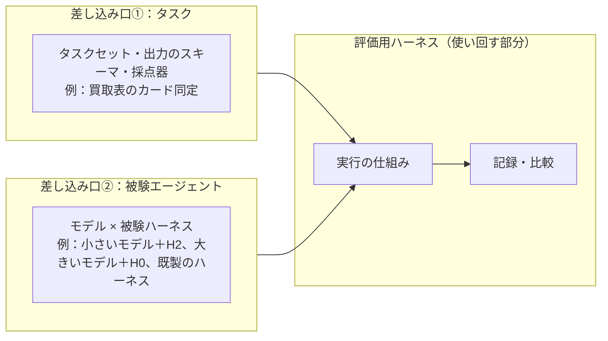
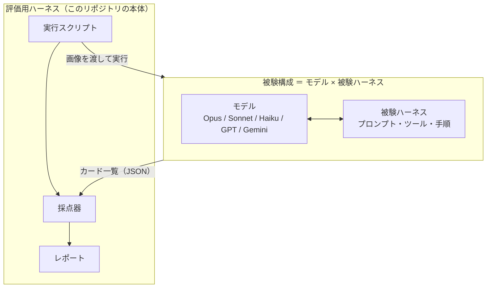
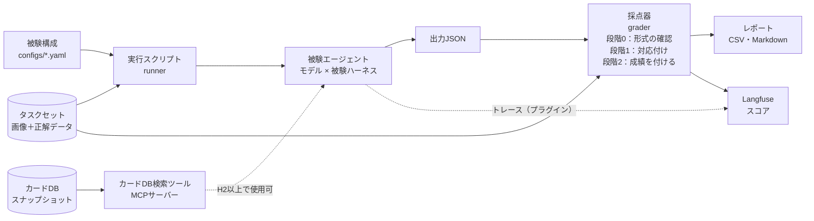
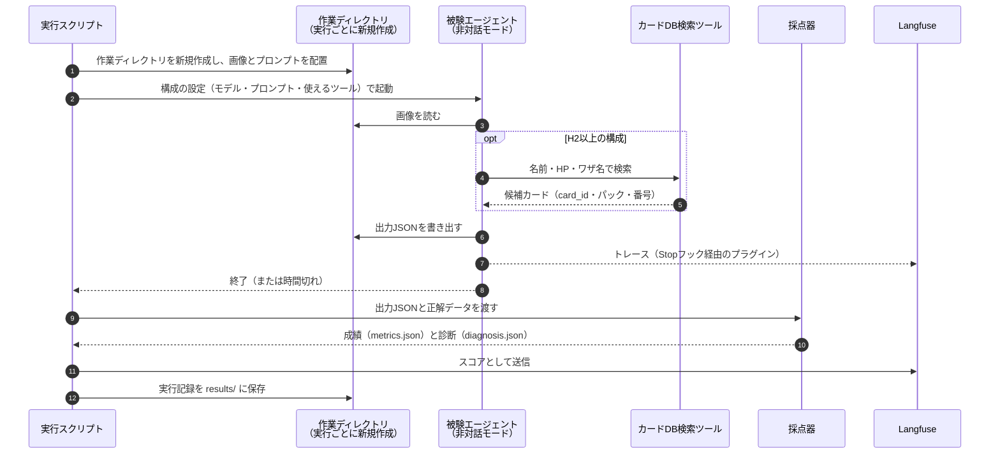
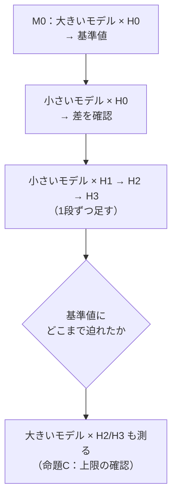
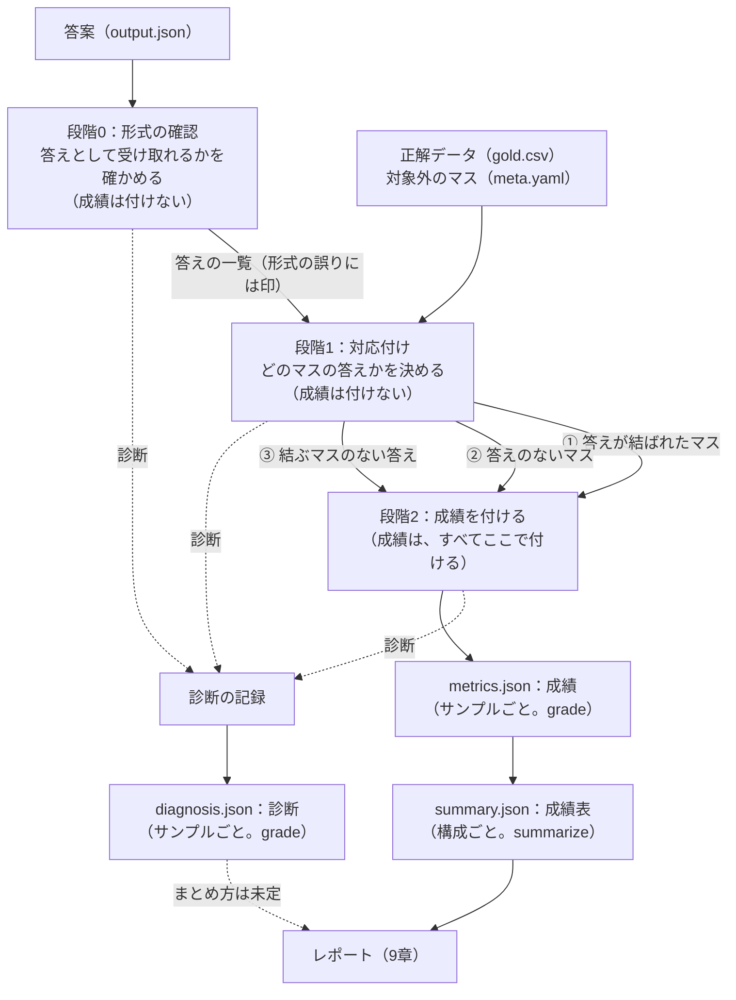
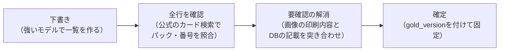

# 買取表カード同定タスク 評価用ハーネス 設計案

作成日：2026年10月26日（たたき台）

リポジトリ名：`tcg-buylist-eval`（buylist はTCG業界で「買取表」を指す一般的な呼び方）

関連ドキュメント：`model-and-harness.md`（モデルとハーネス）、`harness-design-and-evaluation.md`（ハーネス設計と評価）、`agent-harness-design-notes.md`（手順の強制の強さ、LLMとハーネスの貢献の切り分け、ツール呼び出し）

---

## 0. プロジェクトの目的

### 0.1 ひとことで言うと

> **「モデルの性能に頼らず、ハーネスの設計で、品質を保ったまま速く安くタスクをこなせるか」を、数字で確かめる。**
> **あわせて、そのための評価用ハーネスを、タスクと被験エージェントを差し替えて使い回せる仕組みとして作り上げる。**
> 最初の題材は、ポケカの買取表画像からカードを特定するタスクとする。

### 0.2 背景

| 背景 | 内容 |
|---|---|
| モデルの性能とコスト | 性能の高いモデルほど出力の精度は高いが、そのぶんコスト（API代・利用枠・時間）がかかる |
| 性能をカバーする仕組み | 性能の低いモデルでも、周りの仕組み（**ハーネス**）しだいで性能をある程度カバーできる。同じモデルでもハーネスの違いだけで成績が大きく変わることが知られている |
| 現状の問題 | 多くの場合、**すべてのタスクに同じ汎用ハーネス**（Claude Codeなど）を使っている。汎用ハーネスに小さいモデルを入れても、性能をカバーする仕組みが働きにくい |
| 自分の立ち位置 | LLMモデルの開発は計算資源が必要で個人には難しい。そこで、**ハーネスの設計** に注力する |
| 評価の必要性 | ハーネス設計は、改善したかどうかを測れないと「勘」の積み重ねになる。**評価の仕組みが設計の土台** になる |

用語：**エージェント ＝ LLMモデル ＋ ハーネス**。Claude Codeのような製品はハーネスにあたる。

### 0.3 このプロジェクトの目的

このプロジェクトは、2つの目的を持つ。

| 目的 | 内容 |
|---|---|
| **第一の目的：ハーネスの設計が出力に与える影響を確かめる** | 被験ハーネスの作り込み・設計によって、出力の品質・速さ・コストがどう変わるかを、数字で確かめる。理想の結果は、小さいモデルと作り込んだハーネスで性能を上げること |
| **第二の目的：エージェント評価用のハーネスの仕組みを作り上げる** | タスクと被験エージェントを差し替えて、同じ方法で何度でも評価できる仕組みを作る。あるタスクで作り込んだ被験エージェントを取り外し、別の被験エージェントや、別のタスク向けに作り込んだ被験エージェントをはめ込んで、再び検証できるようにする |

#### 第一の目的で達成したいこと

| 項目 | 内容 |
|---|---|
| ① 仮説を数字で確かめる | 「小さいモデル＋タスクに合わせて作り込んだハーネス」が「大きいモデル＋素の状態」にどこまで迫れるかを測る |
| ② ハーネスの部品の採否を決める | カードDB検索、自己検証などの部品が、作る・維持する手間に見合うだけQCDを改善するかを判断する |
| ③ 実運用につなげる | 合格した構成を、TCG価格データ基盤 **Card Pulse** のデータ取り込みに組み込む |

#### 第二の目的で達成したいこと

| 項目 | 内容 |
|---|---|
| ① 評価の土台を作る | モデル × ハーネスの組み合わせを、同じタスク・同じ採点方法で、何度でも比べられる仕組みを作る |
| ② 被験エージェントを差し替えられる | 新しい被験エージェントを、評価用ハーネスのコードを変えずに、設定だけで追加できる |
| ③ タスクを差し替えられる | 新しいタスクを、タスクセット・出力のスキーマ・採点器を足すだけで追加できる。実行の仕組みは変えない |

②と③が、第二の目的を達成できたかどうかの基準になる。

評価用ハーネスには、2つの差し込み口がある。



- **タスクの差し込み口**：タスクごとに変わるもの。タスクセットだけでなく、出力の形式と採点の方法もタスクごとに変わる。
- **被験エージェントの差し込み口**：評価されるもの。自分で作り込む被験ハーネス（H0〜H3など）が中心で、Claude Codeなどの既製のハーネスは、比べる相手の1つになる。

#### 2つの目的の優先順位

- **M0では第一の目的を優先する。** 第二の目的は、差し込み口の境界（評価する側と評価される側、タスクごとに変わる部分と使い回す部分）を守る形で進める。
- タスクが1つしかない段階で、汎用の仕組みを作り込みすぎない。本格的な一般化は、2つ目のタスクを扱うときに行う。
- 差し込み口の具体的な設計（設定ファイルの形、採点器の入出力の決まりなど）は、別途決める。

### 0.4 評価の考え方：QCD

最終的にエージェントに求める性能は、**品質・速さ・コスト** の3つ（製造業でいうQCD）。

```
目標：品質が合格ラインを満たす という条件のもとで、時間 と コスト を最小にする
```

- 品質は「高いほど良い」ではなく **合格ライン** で判定する。
- 速さとコストは、AIの処理だけでなく **人間の確認・修正の手間** まで含めて考える。
- このタスクでは、間違ったカードに価格が紐付くとデータが気付かれないまま汚れるため、**誤答を最も重く見る**。

### 0.5 なぜ「買取表のカード特定」を題材にするのか

| 理由 | 内容 |
|---|---|
| 自動で採点できる | 出力が表形式なので、正解データと項目ごとに機械的に比べられる |
| ハーネスの効果が出やすい | 失敗の多くは「パックや番号を知らない」という知識不足で、ツール（カードDB検索など）で補える典型的なタスク |
| 名前だけでは解けない | 同じ名前のカードが複数ある（サンプルではレシラムが3種類）ため、読み取り・照合・検証の工夫が成績に直結する |
| 評価用ハーネスを作りやすい | 入力は画像、出力はJSONで、エージェントが環境を書き換えない。環境のリセットがほぼ不要 |
| 実際に役立つ | Card Pulseの価格データ収集にそのまま使える |

### 0.6 成果物

| 成果物 | 内容 |
|---|---|
| 評価用ハーネス | このリポジトリ（`tcg-buylist-eval`）。タスクと被験エージェントを差し替えられる評価の仕組み。タスクセット、実行スクリプト、採点器、レポート |
| 比較結果 | 「どのモデル × どのハーネスが、合格ラインを満たし、最も速く安いか」の表 |
| 知見 | どの部品が、どのモデル・どの世代のカードで効くか。記事やOSSの方向性の根拠にする |
| 部品 | 合格したハーネスの部品（カードDB、検索ツールなど）。Card Pulseでも使う |

---

## 1. 評価の対象とスコープ

### 1.1 何を評価するか

X上に投稿されるポケカの **買取表画像** を入力として、掲載されているカードを **一意に特定** するタスクを、エージェント（モデル × ハーネス）がどれだけうまくこなせるかを評価する。

### 1.2 明らかにしたいこと

| 問い | 内容 |
|---|---|
| 仮説の検証 | 「小さいモデル＋作り込んだハーネス」が「大きいモデル＋素の状態」にどこまで迫れるか（`model-and-harness.md` 命題B） |
| QCD | 品質（合格ライン）を満たす構成の中で、時間と利用枠の消費が最も少ないのはどれか |
| 失敗の傾向 | どの段階（読み取り／特定／形式）で、どんな間違いが起きるか |

### 1.3 用語：「評価する側」と「評価される側」

この設計では、2種類のハーネスが登場する。混同しないように呼び分ける。

| 呼び方 | 中身 | 例 |
|---|---|---|
| **評価用ハーネス**（評価する側） | 試験を運営し、採点し、成績を出す仕組み | 実行スクリプト、採点器、レポート出力 |
| **被験ハーネス**（評価される側） | モデルと組み合わせてタスクを解く仕組み | プロンプト、カードDB検索ツール、自己検証の手順 |



### 1.4 スコープ外

| 対象外 | 理由・担当 |
|---|---|
| Xからの画像収集の自動化 | 別の仕組み（利用規約の確認が必要） |
| 価格の時系列分析 | Card Pulse側の役割 |
| 買取表以外の画像（販売価格表など） | まずは買取表に絞る。後で拡張を検討 |

---

## 2. タスク定義

### 2.1 入力と出力

| | 内容 |
|---|---|
| 入力 | 買取表画像1枚（＋任意のメタ情報：店舗名、更新日） |
| 出力 | 掲載カードの一覧（JSON、スキーマは5.3） |

### 2.2 カードの主キー

**カード名ではカードを一意に特定できない。** 実際、サンプルの買取表にはレシラムが3枚あり、すべて収録パックが違う。

さらに、Geminiの出力ではBW1の「055/053」が2枚（ゼクロムとレシラム）あった。ブラックコレクションとホワイトコレクションのように、**型番＋番号だけでも一意にならない可能性** がある。

→ 主キーは **ローカルのカードDBが発行する `card_id`** にする。`card_id` は、パック・型番・番号の組から一意に決まるようにDB側で設計する（12章の未決事項）。

#### M0（カードDBがない段階）は仮のキーで始める

カードDBを作るのはM1から（11章）。M0ではDBがないので `card_id` を発行できない。そこで、M0では **仮のキー** を使う。

| 方法 | 内容 |
|---|---|
| 案1：パック名＋カード番号 | 例：「プラズマゲイル」＋「077/070」。正解データ作成時に公式のカード検索で確認した値を使う |
| 案2：公式サイトのカードID | 公式のカード詳細ページにIDがあれば、それを使う（URLの形式などは要確認） |

- 案1を使う場合、パック名の表記ゆれ（「拡張パック「プラズマゲイル」」と「プラズマゲイル」など）を揃える正規化ルールを決めておく。
- M1でカードDBを作ったら、仮のキーを `card_id` に置き換え、正解データの `gold_version` を上げる。
- 正解データの作成は人間が公式サイトを検索する作業なので、M0でもツールは要らない。

### 2.3 「不明」の扱い

確信が持てない場合、無理に特定せず **「不明」と答えてよい** ことをタスク仕様で明示する（`spec.yaml` の R-10）。不明の場合は、候補（`candidates`）を出してよい（R-11）。人間の確認が速くなる。

成績は、正解・保留・誤答の3つに分ける（[ADR-0038](adr/0038-score-by-assertion.md)。決め方は8.4）。

| 成績 | Card Pulseへの影響 | 評価上の扱い |
|---|---|---|
| 正解 | 正しいデータが入る | 加点（正解率に数える） |
| 保留 | 人間が確認すれば済む。不明と答えたもののほか、形式を守れなかったもの、答えのないもの（抜け）も入る | 0点（保留率と、その内訳として記録する） |
| 誤答 | **間違ったカードに価格が紐付き、データが気付かれないまま汚れる** | 減点（誤答率に数える。一番重い） |

---

## 3. 全体アーキテクチャ

### 3.1 構成要素



| 構成要素 | 役割 | 属する層 |
|---|---|---|
| タスクセット | 画像、正解データ、メタ情報 | 評価用 |
| 被験構成 | モデルと被験ハーネスの組み合わせを定義する設定ファイル | 評価用（定義のみ） |
| 被験エージェント | モデル × 被験ハーネス。被験ハーネスは、自分で作り込むもの（H0〜H3など）が中心で、既製のハーネス（Claude Code、Codex、Gemini CLIなど）は比べる相手の1つ | **評価される側** |
| 実行スクリプト | 作業場所の用意、エージェントの起動、時間制限、結果の回収 | 評価用 |
| カードDB | カード情報のスナップショット。正解データ作成と検索ツールの両方で使う | 共通の資産 |
| カードDB検索ツール | 名前・HP・ワザ名などでカードを検索する | **被験ハーネスの部品** |
| 採点器 | 出力の形式を確かめ（段階0）、正解データと対応付け（段階1）、成績を付ける（段階2）。成績と診断を出す（8章） | 評価用 |
| レポート／Langfuse | 結果の比較、失敗の分析 | 評価用 |

### 3.2 1回の実行の流れ



コーディングタスクと違い、エージェントはリポジトリを書き換えない。そのため **環境のリセットは「実行ごとに新しい作業ディレクトリを作る」だけで済む。**

---

## 4. ディレクトリ構成

```
tcg-buylist-eval/
├── README.md                 目的、用語、使い方
├── docs/
│   ├── design.md             この設計書
│   ├── task-spec.md          タスク仕様（被験エージェントに渡す仕様の元）
│   └── gold-guideline.md     正解データの作成ルール
├── schemas/
│   ├── output.schema.json    被験エージェントの出力形式
│   └── gold.md               正解データの列定義
├── tasks/                    ① タスクセット（1買取表＝1フォルダ）
│   └── <task_id>/
│       ├── meta.yaml         出典、日付、分割（dev/test）
│       ├── gold.csv          正解データ
│       └── input.jpg         画像（公開リポジトリでは .gitignore）
├── carddb/                   カードDB
│   ├── README.md             取得元、取得日、バージョン
│   └── snapshot/             DB本体（.gitignore または別配布）
├── configs/                  被験構成（モデル × 被験ハーネス）
│   ├── opus-h0.yaml
│   ├── sonnet-h0.yaml
│   └── sonnet-h2.yaml
├── subject/                  被験ハーネスの部品
│   ├── prompts/              H0〜H3のプロンプト
│   └── tools/card-db-search/ カードDB検索ツール（MCPサーバー）
├── runner/                   ②③ 実行スクリプト（評価用）
├── graders/                  ④ 採点器（評価用）
├── reporters/                ⑤ レポート出力、Langfuse送信（評価用）
└── results/                  実行結果（.gitignore）
    └── <run_id>/
        ├── output.json
        ├── metrics.json
        └── run.yaml          実行条件の記録
```

`subject/` は **評価される側** で、`runner/`・`graders/`・`reporters/` は **評価する側**。フォルダで分けておき、評価する側が被験ハーネスの中身に依存しないようにする。

---

## 5. データ設計

### 5.1 タスクのメタ情報（`meta.yaml`）

```yaml
task_id: torekingu-akiba-2026-10-25
source:
  url: https://x.com/...          # 出典のポストURL
  shop: トレキング NEW AKIHABARA
  updated_at: 2026-10-25          # 買取表に書かれた更新日
  collected_at: 2026-10-26
layout:
  rows: 3
  cols: 7
card_count: 21
era: [BW]                         # 収録カードの世代（分析用）
split: dev                        # dev または test（10章）
gold_version: 1
```

### 5.2 正解データ（`gold.csv`）

| 列 | 内容 | 例 |
|---|---|---|
| `row` | 段（上から1始まり） | 1 |
| `col` | 列（左から1始まり） | 1 |
| `name` | 画像に印刷されているカード名 | リザードン |
| `hp` | 画像に印刷されているHP | 160 |
| `price_jpy` | 買取価格 | 1800000 |
| `provisional_key` | 仮のキー（M0で使用。2.2） | プラズマゲイル#077/070 |
| `card_id` | カードDBのID（主キー。M1以降） | （DB設計で決定） |
| `pack` | 収録パック | プラズマゲイル |
| `set_code` | 型番 | BW7 |
| `number` | カード番号 | 077/070 |
| `rarity` | レアリティ | UR |
| `verified_by` | 確認した人 | kajiwara |
| `verified_at` | 確認日 | 2026-10-26 |
| `note` | 補足 | 「画像にEXの表記なし」など |

**画像に印刷されている情報**（名前・HP・価格）と、**DBで確定する情報**（card_id・パック・番号）を分けて持つ。採点の際に「読み取りミス」と「特定ミス」を区別できるようにするため。

### 5.3 被験エージェントの出力（`output.schema.json`）

出力例：

```json
{
  "task_id": "torekingu-akiba-2026-10-25",
  "grid": { "rows": 3, "cols": 7 },
  "cards": [
    {
      "position": { "row": 1, "col": 1 },
      "printed": { "name": "リザードン", "hp": 160, "attacks": ["ばくれつだん"] },
      "price_jpy": 1800000,
      "identification": {
        "status": "identified",
        "card_id": "xxxx",
        "pack": "プラズマゲイル",
        "set_code": "BW7",
        "number": "077/070",
        "rarity": "UR",
        "candidates": [],
        "confidence": 0.9
      }
    }
  ]
}
```

| フィールド | 内容 |
|---|---|
| `position` | 段・列。採点時の対応付けに使う |
| `printed` | 画像から読み取った情報。ワザ名はカードを特定する重要な手がかり |
| `identification.status` | `identified`（特定した）または `unknown`（不明） |
| `identification.candidates` | 不明の場合の候補（`card_id` のリスト） |
| `identification.confidence` | 0〜1の自己申告の確信度（分析用。採点には使わない） |
| `identification.card_id` | カードDBのID。**M0（DBなし）では空でよい**。採点は `pack`＋`number` から仮のキーを作って行う |

### 5.4 カードDB（スナップショット）

| 列 | 内容 |
|---|---|
| `card_id` | 主キー |
| `name` | カード名 |
| `hp` | HP |
| `attacks` | ワザ名の一覧 |
| `pack` | 収録パック |
| `set_code` | 型番 |
| `number` | カード番号 |
| `rarity` | レアリティ |
| `snapshot_date` | 取得日 |

- **Web検索ではなくローカルのスナップショットを使う**。時期によって検索結果が変わると評価を再現できないため。外部サイトへのアクセスを繰り返さずに済む点も大きい。
- 取得元の利用規約を確認してから作る。
- このDBは、Card Pulse側でもカードマスタとして使える。
- **正解のカードだけを入れたDBにしない**。検索すると答えしか出てこず、タスクが簡単になりすぎる（**答えの漏れ**）。対象の世代（まずはBW期など）のカードをひととおり入れ、同名カード（レシラムの別バージョンなど）が候補として並ぶ状態にする。
- 作るかどうか自体を、M0の結果で判断する（6.5）。

### 5.5 実行記録（`run.yaml`）

後から「なぜ結果が変わったのか」を追えるように、実行条件をすべて残す。

| 項目 | 例 |
|---|---|
| `run_id` | 実行ごとの一意なID |
| `task_id`／`config_id`／`repeat` | 何を、どの構成で、何回目に実行したか |
| `runtime` と `runtime_version` | claude-code 2.x など |
| `model` | 実際に使われたモデル名 |
| `config_hash` | 構成ファイルとプロンプトのハッシュ値 |
| `carddb_version` | 使ったカードDBのバージョン |
| `gold_version` | 採点に使った正解データのバージョン |
| `started_at`／`duration_sec` | 開始時刻と所要時間 |
| `exit_status` | 正常終了／時間切れ／エラー |
| `langfuse_trace_id` | トレースとの対応付け |

---

## 6. 被験構成（configs）

### 6.1 比較の軸

| 軸 | 値の例 |
|---|---|
| 実行環境（ランタイム） | Claude Code、Codex CLI、Gemini CLI |
| モデル | 大・中・小（例：Opus／Sonnet／Haiku） |
| 被験ハーネスの段階 | H0〜H3 |

### 6.2 被験ハーネスの段階

| 段階 | 内容 | 使えるツール | ねらい |
|---|---|---|---|
| **H0：素の状態** | 画像を渡し、一度に一覧を出させる | なし | 基準値。サンプルのGeminiの結果に近い |
| **H1：分割** | 格子を把握させ、1枚ずつ読み取らせる手順を指示する | なし | 読み取りミスと抜けを減らす |
| **H2：照合** | 読み取った名前・HP・ワザ名でカードDBを検索させ、card_idを確定させる | カードDB検索 | **知識不足をツールで補う**（本命） |
| **H3：自己検証** | DBの情報と画像の印刷内容が一致するか確かめさせる。合わなければ読み直し、それでもだめなら「不明」 | カードDB検索 | 誤答を「不明」に変え、データを汚さない |

H0からH3は積み上げ式にし、**隣り合う段階の差分が1つだけ** になるようにする。

### 6.3 構成ファイルの例

```yaml
id: sonnet-h2
runtime: claude-code
model: sonnet
harness:
  level: H2
  prompt: subject/prompts/h2.md
  tools: [card-db-search]
  web_search: false        # 再現性のため、原則オフ
  max_turns: 40
  timeout_sec: 600
repeats: 3                 # ばらつきを見るための繰り返し回数
```

### 6.4 実験の組み立て



### 6.5 部品は「仮説」として扱い、評価で採否を決める

被験ハーネスの各部品は「入れれば良くなるはず」という **仮説** にすぎない。評価で確かめてから採用する。

| 部品 | 仮説 | 評価で確かめること |
|---|---|---|
| カードDB検索（H2） | 知識不足による特定ミスが減る | 特定ミスがどれだけ減ったか |
| 1枚ずつの切り出し（H1） | 読み取りミスや抜けが減る | 読み取りの正答率、抜けの件数 |
| 自己検証（H3） | 誤答が「不明」の答え（保留）に変わる | 誤答率が下がり、その分だけ保留率が上がっているか |

どの部品も、判断の基準は同じ。

```
採用する ⇔ QCDの改善幅 ＞ その部品を作る・維持するコスト
```

特にカードDBは、作ったあとも新しいパックが出るたびに更新が必要になる。改善幅だけでなく **維持の手間** も判断材料に入れる。

#### 答えはモデルとカードの世代によって変わる

| 条件 | DBの必要性 |
|---|---|
| 大きいモデル × 古いカード（BW期など） | 低いかもしれない。モデルがすでに知識として持っている可能性がある |
| 小さいモデル × 古いカード | 高いかもしれない。本命の検証対象 |
| **どのモデルでも × 新しいカード** | **ほぼ必須**。モデルの学習時期より後に出たカードは、そもそも知りようがない |

- 部品の採否は **「モデル × タスクの中身」ごと** に判断する。これが「モデルとタスクに合わせてハーネスを設計する」ということ。
- モデルが更新されると答えが変わることがある。モデルの更新時には基準値を取り直し、部品の採否も見直す。**評価は1回で終わりではなく、繰り返し使うもの** であり、評価用ハーネスをリポジトリとして持つ理由もここにある。

#### カードDBを作るかどうかの判断（M0 → M1）

| M0の結果 | 判断 |
|---|---|
| 大きいモデルでもH0では特定ミスが多い | DBで知識を補う価値が大きい → M1に進む |
| 小さいモデルだけ特定ミスが多い | 「小さいモデル＋DBで差が縮まるか」という本命の検証ができる → M1に進む |
| どのモデルもH0でほぼ正解する | DBの優先度は下がる。より難しい買取表（新しいカード、画質が悪い、世代が混在など）を探してから判断する |

---

## 7. 実行スクリプト（runner）

### 7.1 1回の実行でやること

| 手順 | 内容 |
|---|---|
| 1. 作業ディレクトリの作成 | 実行ごとに新しい一時ディレクトリを作り、画像とプロンプトだけを置く |
| 2. 構成の反映 | モデル、プロンプト、使えるツール（MCPの設定）を構成ファイルから組み立てる |
| 3. 起動 | 非対話モード（Claude Codeの `-p`、Codexの `exec` など）で起動する。画像の渡し方はランタイムごとに確認する |
| 4. 時間制限 | `timeout_sec` を超えたら打ち切り、時間切れとして記録する |
| 5. 回収 | 出力JSONを回収する。見つからない、または壊れている場合は形式エラーとして記録する |
| 6. 記録 | `run.yaml` と出力を `results/<run_id>/` に保存する |

### 7.2 方針

| 方針 | 内容 |
|---|---|
| ランタイムの差を吸収する | ランタイムごとに「起動方法」「ツールの渡し方」「出力の回収方法」だけをアダプタとして分ける。採点以降は共通にする |
| 権限は最小にする | 作業ディレクトリの外には書き込ませない。H0とH1ではツールを渡さない |
| サブスク認証で動かす | 手元のサブスク認証のまま実行する。利用枠を消費するので、実行回数（タスク数 × 構成数 × 繰り返し）を事前に見積もる |
| 失敗も結果として残す | 時間切れや形式エラーも「その構成の成績」として採点に含める |

**Webアプリで実行した結果（今回のGemini Argonのサンプルなど）は自動化できない。** 手動実行の参考値として、同じ採点器で採点だけ行う。

---

## 8. 採点器（grader）

採点器は、被験エージェントの出力（答案）を正解データと突き合わせて、**成績** と **診断** の2つを出す（[ADR-0037](adr/0037-results-and-diagnosis.md)）。採点は採点器（Go）だけが行い、LLMは使わない（[ADR-0033](adr/0033-grading-by-grader-not-langfuse.md)）。

| 出すもの | 答える問い |
|---|---|
| 成績 | エージェントが断定した答えを、そのまま確定データとして使ってよいか |
| 診断 | 被験ハーネスのどの部品を直せばよいか |

- この章には、採点器が何をするかを、今の決まりのとおりに書く。それぞれの決まりの理由は、リンク先のADRにある。
- まだ決めていないところは「未定」と書き、TODO 11章の項目を示す。
- 出力と正解データの項目は、タスクのフォルダのスキーマ（`tasks/buylist-card-id/schemas/output.schema.json`、`gold.schema.yaml`）が正しい。5.2・5.3 は、まだ古いまま（TODO 3章）。

### 8.1 全体：段階（縦の軸）と、出すもの（横の軸）

採点は、段階0・段階1・段階2の順に進む（[ADR-0058](adr/0058-grading-flow-by-stage.md)）。成績は段階2だけで付け、診断はどの段階でも記録する。そのあと、構成ごとに集計する（[ADR-0023](adr/0023-grader-interface.md)）。



| 段階 | すること | 成績 | 診断に記録すること |
|---|---|---|---|
| 段階0：形式の確認（8.2） | 答えとして受け取れるかを確かめる | 付けない。形式の誤りに印を付けて、先に渡す | 形式の誤り（種類・場所・出てきた値） |
| 段階1：対応付け（8.3） | どの答えが、どのマスについてのものかを決める | 付けない。①〜③を段階2に渡す | 位置ずれ、印刷名の読み違い、同じ位置に複数の答え |
| 段階2：成績を付ける（8.4） | ①〜③のそれぞれに、成績を付ける | **すべてここで付ける** | 値ごとの違い、表記だけの違い、食い違い、候補、抜け、余分 など（8.5） |
| 集計（8.6、8.7） | サンプルと繰り返しをまとめる | 割合と内訳、合格の判定 | 種類ごとの件数 |

- 成績は `metrics.json`、診断は `diagnosis.json` と、別のファイルに出す（[ADR-0059](adr/0059-grades-and-diagnosis-in-separate-files.md)。8.6）。
- 段階の番号は、ADR-0052〜0058 の「段階1（対応付け）」「段階2（成績を付ける）」に合わせた。段階0は、ADR-0058 では「受け取り」と呼んでいる。
- 試験に見立てると、段階0は答案が読める字で書かれているかを見る作業、段階1は答えをどの問題への答えかに仕分ける作業、段階2は点を付ける作業にあたる。診断は、どの作業の途中でも書く「気づいたことのメモ」にあたる。
- 採点の前に、正解データ（`gold.csv`）と `meta.yaml` が、それぞれのスキーマと値の一覧に合っているかを確かめる。合わなければ、採点器の失敗として止める（`gold-guideline.yaml` の S-08、[ADR-0019](adr/0019-gold-schema-machine-readable.md)、[ADR-0035](adr/0035-sample-meta.md)）。答案の採点ではないので、段階には入れない。

### 8.2 段階0：形式の確認

答案を、出力のスキーマ（`output.schema.json`）で確かめる。採点器は確かめるだけで、出力を直さない。スキーマに合わせて出力させるのは、被験ハーネスの部品である（[ADR-0044](adr/0044-schema-enforcement-is-harness-part.md)）。

形式の誤りは3種類に分け、起きた単位に印を付ける（[ADR-0041](adr/0041-format-error-kinds-and-units.md)）。成績は付けず、段階2で保留にする。

| 種類 | 中身 | 単位 | 段階2での扱い |
|---|---|---|---|
| 読めない | JSONとして読めない、出力がない、時間切れ | 出力全体 | 答えを1つも渡さない。すべてのマスが保留（内訳：形式の誤り） |
| 形の誤り | 必要なフィールドがない、型が違う、余計なフィールドがある | 出力全体の部分（`grid`、`cards` など）なら出力全体。カードの中なら、そのカード | 印の付いた単位が保留（内訳：形式の誤り） |
| 語彙の外 | 値の一覧にない値（例：版が `初版`） | そのカードの、その値 | 仕様の軸なら、その軸を「指定なし」（断定していない）として成績を決める。`status` なら、そのカードを保留（[ADR-0042](adr/0042-out-of-vocabulary-values.md)） |

- どの種類も、診断に、種類・場所・出てきた値を記録する。値の一覧の中の値に近いかどうかは、判断しない（ADR-0042）。
- 合格ラインの「形式の誤り」は、3種類の合計で数える（ADR-0041）。

**未定**（TODO 11章）：
- カードの中に形の誤りがある答えを、段階1で結ぶか（案：位置と印刷名が読めれば、ほかの答えと同じく結び、段階2でそのマスを保留にする）
- 答えや候補に `name` がないとき、空や空白だけの名前、候補の1つに名前がないときの扱い
- 語彙の外の軸を「指定なし」と読み替えて保留になったとき、保留の内訳をどれにするか（案：形式の誤り）

### 8.3 段階1：対応付け

答案の答えを1つずつ、正解データのどのマスについての答えかを決めて、答えとマスを結ぶ（[ADR-0051](adr/0051-position-shift-not-graded.md)、[ADR-0052](adr/0052-matching-procedure.md)）。成績は付けない。

使うのは、読んだものだけである。答え（カードの名前・パック・番号・仕様と価格）は使わない（ADR-0051、[ADR-0057](adr/0057-answer-card-name-is-graded.md)）。

| 使うもの | 出力のどこ | 正解データのどこ |
|---|---|---|
| 位置 | `position` | `row`、`col` |
| 印刷名 | `reading.name` | `name`（`card_name` ではない） |
| HP・価格の文字（迷ったときの手がかり） | `reading.hp`、`reading.price_text` | `hp`、`price_text` |

手順（ADR-0052）：

| 手順 | 結ぶもの | 診断に記録すること |
|---|---|---|
| 1 | 位置も印刷名もそろう答えとマス | ― |
| 2 | 残りの答えと、まだ結ばれていないマスのうち、印刷名がそろうもの | 位置ずれ |
| 3 | 残りの答えと、まだ結ばれていないマスのうち、位置がそろうもの | 印刷名の読み違い |
| 4 | それでも残ったもの | 答えは「③ 結ぶマスのない答え」、マスは「② 答えのないマス」として渡す |

- 1つの手順を、すべての答えについて終えてから、次の手順に進む。答えを書いた順番で、結び方が変わらないようにするため。
- 手順を変えたら、採点器の版（`grader_version`）を上げる（ADR-0052）。

手順の中の決まり：

| 決まり | 中身 |
|---|---|
| 印刷名がそろうとは | 全角・半角や空白だけの違いは、そろったとみなす。「EX」と「ex」は分ける（[ADR-0045](adr/0045-card-name-strict-match.md)）。似ている印刷名（1文字違いなど）は、そろったとみなさない |
| 同じ印刷名のマスが複数あるとき（手順2） | HP・価格の文字・位置の近さで、1つに絞る。絞れなければ結ばず、手順3に回す |
| 1つのマスに、結べる答えが複数あるとき | どの答えも、そのマスと結ぶ。どれか1つを選ばない。同じ位置に答えが複数あれば、診断に「同じ位置に複数の答え」と記録する（[ADR-0055](adr/0055-competing-answers-for-one-cell.md)） |
| 対象外のマス（`meta.yaml` の `excluded`） | 結ぶ相手に含める。印刷名は、`excluded` の `name`（画像に印刷されている通りの名前）と比べる（ADR-0052、ADR-0057） |

段階2に渡すもの：

| 渡すもの | 中身 |
|---|---|
| ① 答えが結ばれたマス | 答えが1つ以上結ばれたマス。対象外のマスも含む |
| ② 答えのないマス | どの答えとも結ばれなかったマス（抜け） |
| ③ 結ぶマスのない答え | どのマスとも結ばれなかった答え（余分） |

### 8.4 段階2：成績を付ける

①〜③のそれぞれに、成績を付ける（ADR-0058）。成績の問いは、「エージェントが断定した答えを、そのまま確定データとして使ってよいか」である（[ADR-0038](adr/0038-score-by-assertion.md)）。

#### 成績の意味と内訳

成績の意味は1つにし、原因は内訳に残す（ADR-0058）。

| 成績 | 意味 | 内訳（原因） | 原因が分かる段階 |
|---|---|---|---|
| 正解 | そのまま確定データとして使える | ― | 段階2 |
| 保留 | 確定データにできないが、汚しもしない。人が確かめる | エージェントが不明と示した | 段階2 |
| | | 形式の誤り | 段階0 |
| | | 抜け | 段階1（② 答えのないマス） |
| 誤答 | 確定データを汚す。**一番重い** | 正解データのカードを間違えた | 段階2 |
| | | ないカードを断定した | 段階1（③ 結ぶマスのない答え） |

（ADR-0038、[ADR-0053](adr/0053-missing-card-withheld.md)、[ADR-0054](adr/0054-extra-answer-counted-as-wrong.md)）

#### ①〜③に成績を付ける決まり

| 段階1から渡されるもの | 成績 | 内訳 | ADR |
|---|---|---|---|
| ① 答えが結ばれたマス | 答えを、そのマスの正解と比べて決める（下の「① の成績の決め方」） | 上の表のとおり | 0038、0039 |
| ① のうち、結ばれた答えが複数あるマス | 断定した値が食い違っていれば誤答（1件）。食い違いがなければ、断定した値を合わせて1つの答えにし、① と同じに決める | 正解データのカードを間違えた | 0055 |
| ① のうち、対象外のマス | 数えない | ― | 0054 |
| ① のうち、段階0で印の付いた答え | 保留（段階1で結ぶかは未定。8.2） | 形式の誤り | 0041 |
| ② 答えのないマス | 保留 | 抜け。出力全体が読めなかったときは、形式の誤り | 0053、0041 |
| ③ 結ぶマスのない答えで、カードか価格を断定している | 誤答 | ないカードを断定した | 0054 |
| ③ のうち、何も断定していないもの、すでに結ばれた答えとまったく同じ中身のもの | 数えない | ― | 0054 |

- 答えどうしの食い違いを比べるとき、断定していない値（`status` が `unknown` のときのカード、null の価格、「指定なし」の軸）は、食い違いに数えない。値が同じかどうかは、下の「値の比べ方」で決める（ADR-0055）。

#### ① の成績の決め方

出力の項目を、成果物（確定データになるもの）と中間結果（途中で読んだもの）に分け、成績は成果物だけで決める（[ADR-0039](adr/0039-deliverables-and-intermediates.md)、[ADR-0047](adr/0047-output-reading-and-answer.md)、ADR-0057）。

| | 項目 | 出力のどこ | 使い道 |
|---|---|---|---|
| 成果物 | カードの名前、パック、番号、仕様の各軸（版・加工・スタンプ）、価格 | `answer.status`、`answer.card`、`answer.price_jpy` | 成績 |
| 中間結果 | 格子の大きさ、位置、印刷名、HP、ワザ、価格の文字。候補、確信度 | `grid`、`position`、`reading`、`answer.candidates`、`answer.confidence` | 対応付け（位置・印刷名）と、診断 |

次の順で決める（ADR-0039）。

1. **誤答**：断定した値が、1つでも正解と違う。
   - `status` が `identified` で、カードの名前・パック・番号のどれかが違う（ADR-0057）
   - 仕様の軸を断定して（「指定なし」以外の値を出して）、正解と違う。正解が「指定なし」の軸は比べない（[ADR-0027](adr/0027-provisional-key-variant.md)）
   - 「その他の加工」「その他のスタンプ」を出したのに、正解が「ノーマル」「なし」（[ADR-0043](adr/0043-vocabulary-from-concepts.md)）
   - 価格を断定して、正解と違う。カードを不明と答えていても、価格を断定して違えば誤答
   - 正解に価格がないのに、価格を断定した（[ADR-0048](adr/0048-price-null-is-withheld.md)）
2. **保留**：誤答ではなく、正解に値があるのに、断定しなかった項目がある。
   - `status` が `unknown`
   - 正解に値がある仕様の軸を「指定なし」とした。「その他」の値で、正解が具体的な種類のときも、その軸は保留（ADR-0043）
   - 正解に価格があるのに、価格を null とした（ADR-0048）
3. **正解**：上のどちらでもない。断定した値がすべて正しい（正解が「指定なし」の軸を除く）。

値の比べ方：

| 項目 | 正解データの列 | 比べ方 |
|---|---|---|
| カードの名前 | `card_name` | 文字どおりに比べる。全角・半角や空白の違いも、「EX」と「ex」の違いも、違いとする（ADR-0057） |
| パック | `pack` | 決まった語（シリーズの名前、商品の種類、かぎかっこ）を外してから比べる（[ADR-0029](adr/0029-provisional-key-pack-name.md)）。外す語の一覧は未定（TODO 11章） |
| 番号 | `number` | 文字どおりに比べる（[ADR-0026](adr/0026-provisional-key-pack-number-variant.md)、ADR-0027） |
| 仕様の各軸 | `edition`、`finish`、`stamp` | 軸ごとに比べる。正解が「指定なし」の軸は比べない（ADR-0027） |
| 価格 | `price_jpy` | 円の整数で比べる |

正解データの名前の列は2つあり、比べる相手が違う（ADR-0057）。

| 正解データの列 | 中身 | 比べる出力 | 段階 |
|---|---|---|---|
| `name` | 画像に印刷されている通りの名前 | `reading.name` | 段階1（対応付け）、診断 |
| `card_name` | カードの正式な名前 | `answer.card.name` | 段階2（成績） |

**未定**（TODO 11章）：パックの名前から外す語の一覧と、その置き場所。EXなどの英字の正しい書き方（正解データの作り方）。

### 8.5 診断

診断は、被験ハーネスのどの部品を直せばよいかを示す（ADR-0037）。成績には使わない。どの段階でも記録し、1枚のカードに重なる失敗は、項目ごとに記録する。診断は、成績とは別のファイル `diagnosis.json` に出す（ADR-0059。8.6）。

| 記録する段階 | 診断の種類 | 判定 | 直す部品 | ADR |
|---|---|---|---|---|
| 段階0 | 形式の誤り（読めない・形の誤り・語彙の外） | 8.2 のとおり。種類・場所・出てきた値を記録する | 出力の形を守らせる部分（プロンプト、スキーマの強制、出力の検証）。語彙の外は、値の一覧の伝え方か、一覧そのもの | 0041、0042 |
| 段階1 | 位置ずれ | 手順2で結ばれた（答えに書いた位置と、結ばれたマスの位置が違う） | 格子の把握（H1：分割） | 0051、0052 |
| 段階1 | 印刷名の読み違い | 手順3で結ばれた | 画像の読み取り | 0052 |
| 段階1 | 同じ位置に複数の答え | 同じ位置を書いた答えが複数ある | 格子の把握（H1：分割） | 0055 |
| 段階2 | 抜け | ② 答えのないマス | 格子の把握（H1：分割） | 0053 |
| 段階2 | 余分、余分（断定なし） | ③ 結ぶマスのない答え。何も断定していないものは「余分（断定なし）」 | ― | 0054 |
| 段階2 | 重複 | すでに結ばれた答えと、まったく同じ中身の答えがある | ― | 0054、0055 |
| 段階2 | 対象外のマスへの答え | 対象外のマスと結ばれた答え | ― | 0054 |
| 段階2 | 答えどうしの食い違い | 1つのマスに結んだ答えが、同じ項目に違う値を断定している。食い違った答えの中に、正解と合う答えがあったかも記録する | 出力の検証 | 0055 |
| 段階2 | 答えの中の食い違い | パック・番号は正解と合うのに、答えの名前が違う | ― | 0057 |
| 段階2 | 答えの名前の表記だけの違い | 答えの名前が、全角・半角や空白だけ違う。成績は誤答 | 出力の書き方 | 0057 |
| 段階2 | 印刷名の表記だけの違い／読み違い | 印刷名を正解と厳密に比べ、全角・半角や空白だけの違いと、それ以外に分ける | 出力の書き方／画像の読み取り | 0045 |
| 段階2 | 価格の位置 | 出力の価格が、隣のマスの正解の価格と一致する | 格子の把握（H1：分割） | 0040 |
| 段階2 | 価格の読み取り | `reading.price_text` が正解と違う | 画像の読み取り | 0040 |
| 段階2 | 価格の換算 | `price_text` は正解と同じなのに、`answer.price_jpy` が違う | 換算の決まりの伝え方（プロンプト） | 0040 |
| 段階2 | 価格の読み落とし | 正解に価格があるのに、null | 画像の読み取り | 0048 |
| 段階2 | 特定の読み取り | 印刷名・HPが正解と違い、パック・番号も違う | 画像の読み取り | 0040 |
| 段階2 | 特定の照合 | 印刷名・HPは正しいのに、パック・番号が違う | 照合（H2：カードDB検索）、自己検証（H3） | 0040 |
| 段階2 | 候補 | 候補の数、候補の中に正解（パック・番号）があったか、何番目か。候補がなければ「候補なし」 | 正解があった：照合（H2）、自己検証（H3）。なかった：画像の読み取り、カードの知識・検索（H2） | 0046 |
| 段階2 | 知識による補完の候補 | 正解が「指定なし」の軸に、値を断定した。画像にないEXを付けた | ― | 0039 |

- 「直す部品」が「―」のものは、ADRで決めていない。
- 「被験エージェントの作業のどこで外れたか」（読み取り・照合・換算など。[ADR-0040](adr/0040-intermediate-results-for-diagnosis.md)）は、採点の段階（段階0〜2）とは別のものである。

**未定**（TODO 11章「診断のスキーマを決める」）：`diagnosis.json` の1件の記録の形、同じ流れの中で重なる診断の優先、被験構成ごとのまとめ方、スキーマのファイルの書き方と置き場所。答えの名前とパック・番号の組み合わせでの診断の分け方（同名カードの取り違え）、候補の名前を比べるか。

### 8.6 結果のファイル

採点器は、3つのファイルを出す。成績と診断は、別のファイルにする（[ADR-0059](adr/0059-grades-and-diagnosis-in-separate-files.md)）。

| ファイル | 単位 | 中身（責務） | 作るもの | いつ、誰が呼ぶか | 読むもの |
|---|---|---|---|---|---|
| `metrics.json` | 1つのサンプルの、1回の実行（答案1枚） | 成績：カードごとの成績、足し算できる件数（`counts`）、その答案の率（`scores`） | 採点器の `grade` | 実行のたびに、実行スクリプトが呼ぶ | `summarize`、Langfuse（`scores` を写す）、人 |
| `diagnosis.json` | `metrics.json` と同じ（2つで1組） | 診断：段階0〜2で見つけたことの一覧 | 採点器の `grade`（`metrics.json` と一緒に出す） | `metrics.json` と同じ | 被験ハーネスを直す人、レポート（診断の件数と一覧。まとめ方は未定） |
| `summary.json` | 1つの被験構成の、すべてのサンプルと繰り返し | 成績表：件数を足してから出した率と内訳、ばらつき、合格の判定 | 採点器の `summarize` | 未定（案：被験構成の実行がすべて終わったあと、実行スクリプトが呼ぶ） | レポート（比較表の1行）。レポートは、中身の意味を知らずに表示する |

- 試験に見立てると、`metrics.json` は答案1枚の採点結果（どの問題が○か×か）、`diagnosis.json` は同じ答案に書き込む赤ペンのメモ（どこで、なぜ間違えたか）、`summary.json` は生徒1人の成績表にあたる。
- `summary.json` を採点器が作るのは、「件数を足してから率を出す」という集計の仕方がタスクごとに違い、それを採点器の中に閉じ込めるためである。レポートは、タスクの中身を知らなくて済む（ADR-0023）。

コマンドが受け取るものと、出すもの（ADR-0023、ADR-0059）：

| コマンド | 受け取るもの | 出すもの |
|---|---|---|
| `grade` | 1つのサンプルの出力JSON、正解データ、メタ情報、実行の情報（`run.json`） | `metrics.json` と `diagnosis.json`（サンプル1つ分） |
| `summarize` | 1つの被験構成の、すべての `metrics.json`、`task.yaml`（合格ライン）、実行の情報 | `summary.json` |

`metrics.json` は、タスクが変わっても共通の外側の形と、タスクごとの中身に分ける（ADR-0023）。

| 部分 | 共通か | 中身 |
|---|---|---|
| `task`、`sample_id`、各種の版 | 共通 | どのタスク・サンプル・採点器・正解データの版で採点したか |
| `run` | 共通 | 誰が解いたか。実行スクリプトから受け取った `run.json` を、中身を読まずに書き写す（[ADR-0018](adr/0018-results-include-subject-info.md)） |
| `status` | 共通 | `graded`（採点できた）／`format_error`（出力がスキーマに合わない）／`no_output`（出力がない） |
| `counts` | 形は共通、名前はタスクごと | 足し算できる件数。`summarize` はこれを足して集計する |
| `scores` | 形は共通、名前はタスクごと | サンプル1つ分の率などの数値 |
| `details` | タスクごと | カードごとの成績。評価用ハーネスは中身を読まない。診断は入れない（ADR-0059） |

- `diagnosis.json` も、どの実行のどのサンプルかを表す部分（`task`、`sample_id`、各種の版、`run`）は、`metrics.json` と同じ形にする。2つは、`run_id` と `sample_id` でつなぐ（ADR-0059）。
- 実行スクリプトは、`metrics.json` の `scores` をそのまま、スコアとしてLangfuseに送る。Langfuseの中で、点数を作ったり直したりしない（ADR-0033）。

**未定**（TODO 11章「成績のスキーマを決める」「診断のスキーマを決める」）：
- カードごとの成績の記録（`details` の中身）。成績と内訳のほか、成果物の項目ごとに、合っていたか・断定したかを記録する（ADR-0039）
- `counts` と `scores` の名前と中身。ADR-0023 の例は、正解・保留・誤答を決める前に書いたもの
- `summary.json` の中身（8.7 の指標）
- `status` の値と、形式の誤りの単位（ADR-0041）との関係
- `summarize` を、いつ・誰が呼ぶか
- `diagnosis.json` の1件の記録の形（8.5）と、診断を被験構成ごとにどうまとめるか（`summarize` が数えるか、レポートが `diagnosis.json` を読むか）

### 8.7 指標

**品質**

| 指標 | 定義 | 見たいこと |
|---|---|---|
| 正解率（`identified_rate`） | 正解 ÷ 正解データの枚数 | 買取表のどれだけを、正しく取れたか |
| **誤答率**（`wrong_rate`） | 誤答 ÷ 正解データの枚数。内訳：正解データのカードを間違えた／ないカードを断定した | 確定データを、どれだけ汚すか（**最重要**） |
| 保留率 | 保留 ÷ 正解データの枚数。内訳：エージェントが不明と示した／形式の誤り／抜け | 人が確かめる量は、どれくらいか |
| 適合率 | 正解 ÷（正解＋誤答） | 断定した答えを、どれだけ信用できるか |
| 有効スコア | 正解 − w × 誤答（w は仮に2）。保留は0点 | 1つの数字で比べたいときの総合点 |
| 価格・印刷名の正答率 | 一致件数 ÷ 正解データの枚数 | 読み取りの精度 |
| 形式の誤り | 3種類の合計と、種類ごとの件数 | 形式を守れているか |

- 余分の断定があると、正解率・保留率・誤答率の合計は100％を超える。超えた分が、ないカードを断定した割合になる（ADR-0054）。
- 人が確かめる手間の目安として、位置ずれの件数を、保留率の隣に並べる（ADR-0051）。
- 保留になったカードのうち、候補に正解があった割合を出す（[ADR-0046](adr/0046-gold-in-candidates-diagnosis.md)）。

**速さ・コスト**

| 指標 | 取り方 |
|---|---|
| 所要時間 | 実行スクリプトで計測 |
| トークン数・ターン数 | 結果のフォルダのトレース（[ADR-0050](adr/0050-trace-as-jsonl.md)） |
| 保留の件数 | 成績から。人が確かめる手間の目安 |

**安定性**：同じタスク×構成を `repeats` 回実行し、正解率の平均・最悪値・標準偏差を見る（[ADR-0024](adr/0024-show-harness-changes-and-effects.md)）。

### 8.8 合格ライン（仮）

0.4 のQCDの考え方に従い、**品質は合格ラインで判定し、その中で速さとコストを比べる。** 合格ラインは `task.yaml` の `pass` に書く。

| 条件 | 仮の基準 | `task.yaml` の項目 |
|---|---|---|
| 誤答率 | 2％以下 | `wrong_rate` |
| 正解率 | 80％以上 | `identified_rate` |
| 形式の誤り | 0件（3種類の合計） | `format_errors` |

- 保留だけの上限はない。保留が増えると、正解率が下がる形で効く。
- 基準の数値は、M0の結果を見てから決め直す。

---

## 9. レポートと失敗分析

### 9.1 比較表（出力イメージ）

| 構成 | 正解率 | 誤答率 | 保留率 | 適合率 | 平均時間 | 平均トークン | 合格 |
|---|---|---|---|---|---|---|---|
| opus-h0 | ？ | ？ | ？ | ？ | ？ | ？ | ？ |
| sonnet-h0 | ？ | ？ | ？ | ？ | ？ | ？ | ？ |
| sonnet-h2 | ？ | ？ | ？ | ？ | ？ | ？ | ？ |

- ローカルにはCSVとMarkdownで出力する。
- Langfuseでは、タスクセットをデータセット、構成を実験（Experiment）として扱い、スコアを送って比較画面で見る。

### 9.2 失敗の分類

失敗は、採点器が診断として自動で分類する。診断の種類と、どの段階で記録するか、直す部品は 8.5 にまとめた。レポートでは、診断の種類ごとの件数と、該当するカードの一覧を出す（[ADR-0037](adr/0037-results-and-diagnosis.md)）。診断は `diagnosis.json` から読む（ADR-0059）。出し方は、診断のスキーマと一緒に決める（未定。TODO 11章）。

設計のはじめに、サンプルの買取表で見つけた例と、8.5 の診断との対応：

| 例 | 8.5 の診断 |
|---|---|
| Geminiが「ギラティナ」「ダークライ」「ビクティニ」にEXを付けた（3件） | 知識による補完の候補 |
| レシラム3種で、パックを取り違えやすい（印刷名は同じで、パックが違う） | 特定の照合 |
| ピカチュウのパックが「ブラック／ホワイト」の2択のまま | 候補（候補に正解があったか） |

---

## 10. 正解データの作り方

### 10.1 作成の流れ



### 10.2 ルール

| ルール | 理由 |
|---|---|
| **全行を確認する**（印を付けた行だけでなく） | 下書きの誤りがそのまま正解データに残るのを防ぐ |
| 下書きに使ったモデルを記録する | そのモデルに有利な偏りが入っていないかを後で確認できる |
| 印刷名は「画像に書いてある通り」に記録する | 知識による補完を正解にしてしまわないため |
| 正解データを直したらバージョンを上げる | 過去の採点結果と比べられなくなるのを防ぐ |

### 10.3 タスクセットの構成

| 観点 | 方針 |
|---|---|
| 分割 | **dev**（被験ハーネスの改善に使う）と **test**（最終比較だけに使う）に分ける。devだけでハーネスを調整し、testで答え合わせする |
| 多様性 | 店舗、レイアウト（段・列の数）、世代（BW／XY／SM／SV）、画質を散らす |
| **新しいカード** | モデルの学習時期より後に発売されたカードが載った買取表を必ず入れる。古いカードだけだと、モデルの知識で当たってしまい、カードDBの必要性を正しく測れない（6.5）。実際の運用でも最新弾のカードは流れてくる |
| 規模の目安 | M0は1〜3枚（20〜60カード）、M2で10枚以上 |

**devとtestを分ける理由**：同じタスクで何度もハーネスを調整すると、そのタスクに過剰に合わせ込んだハーネスができてしまう。新しい買取表にも通用するかは、調整に使っていないtestで確かめる。

---

## 11. マイルストーン

| 段階 | 内容 | 完了の目安 |
|---|---|---|
| **M0** | 買取表1〜3枚の正解データを手作業で作る（**仮のキー**を使い、カードDBは作らない）／H0だけを2モデルで実行／ローカルの採点器とCSV出力。最初は手動で実行して出力JSONを保存するだけでもよい | 「大きいモデルと小さいモデルのH0で、正解率と誤答率がこう違う」という表が1枚出る。その結果でカードDBを作るかどうかを判断できる（6.5） |
| M1 | **M0の結果でDBの必要性を確認してから** 着手する／カードDBのスナップショットと検索ツールを作る／仮のキーを `card_id` に移行／H2を追加／Langfuse連携 | 小さいモデルのH0とH2の差が数字で出る |
| M2 | H1・H3を追加／繰り返し実行でばらつきを測る／タスクを10枚以上に増やし、dev/testに分ける | 合格ラインを満たす構成の中で、最も安く速い構成が分かる |
| M3 | 合格した構成をCard Pulseのデータ取り込みに組み込む | 新しい買取表が自動で取り込まれ、保留の分だけが人間に回る |

---

## 12. 未決事項

| 項目 | 選択肢 | おすすめ |
|---|---|---|
| 主キーの定義 | 型番＋番号／パック＋番号／公式サイトのID | M0は仮のキー（パック名＋番号、または公式ID）。M1でカードDBが独自の `card_id` を発行し、公式IDは別の列で持つ |
| カードDBの取得元 | 公式のカード検索／有志のデータベース | 利用規約を確認してから決める |
| 実装言語 | Python／Go | Python（LangfuseのSDKがあり、将来Inspectに移る場合も素直） |
| 最初のランタイム | Claude Code／Codex／Gemini CLI | Claude Code（Langfuseプラグインあり）から始め、M2でCodexを追加 |
| 誤答の重み w | 1〜5 | 仮に2。Card Pulseで誤データが与える影響を見て調整 |
| リポジトリの置き場所 | 独立リポジトリ／Card Pulseの中 | 独立リポジトリ。カードDBは両方から参照する |
| 公開範囲 | 公開／非公開 | 公開する場合、画像・正解データ・カードDBの扱いを先に決める（13章） |

---

## 13. リスクと注意点

| リスク | 対策 |
|---|---|
| 買取表画像の著作権 | 画像は店舗の著作物。公開リポジトリには画像をコミットせず、出典URLと日付だけを残す |
| 収集方法の利用規約 | Xやカードの公式サイトの利用規約を確認してから、収集とDB作成を行う |
| 利用枠の消費 | 実行回数を事前に見積もる。M0は少数から始める |
| 結果のばらつき | 繰り返し実行し、平均だけでなく最悪値を見る |
| モデルやランタイムの更新 | 実行記録にバージョンを残し、更新後は基準値を取り直す |
| 正解データの誤り | 全行の確認、バージョン管理、疑わしい行の再確認 |
| 答えの漏れ | カードDBに正解のカードだけを入れない。対象世代のカードをひととおり入れる |
| 古いカードへの偏り | 新しいカードが載った買取表をタスクセットに入れる |
| devへの過剰適合 | testは最終比較にだけ使う |

---

## 14. まとめ

| 項目 | 方針 |
|---|---|
| リポジトリ名 | `tcg-buylist-eval`（商標を名前に入れず、将来ほかのTCGにも広げられるようにする） |
| 評価対象 | 買取表画像からカードを一意に特定するタスク |
| 主キー | カードDBの `card_id`（名前や型番＋番号だけでは一意にならない） |
| 採点の考え方 | **正解・保留・誤答** に分け、**誤答率** を最重要指標にする。成績は段階2だけで付け、診断は段階ごとに記録する（8章） |
| 被験ハーネス | H0（素）→ H1（分割）→ H2（DB照合）→ H3（自己検証）を1段ずつ積み上げて比べる |
| 部品の採否 | 各部品は **仮説**。「QCDの改善幅 ＞ 作る・維持するコスト」なら採用する。答えは **モデル × カードの世代** で変わる |
| カードDB | M0では作らない（仮のキーで始める）。**M0の結果で必要性を判断してから** M1で作る |
| 再現性 | ローカルのカードDB、実行ごとの作業ディレクトリ、実行条件の記録 |
| 最初の一歩 | M0：サンプルの買取表の正解データを仮のキーで作り、H0を2モデルで比べる |
