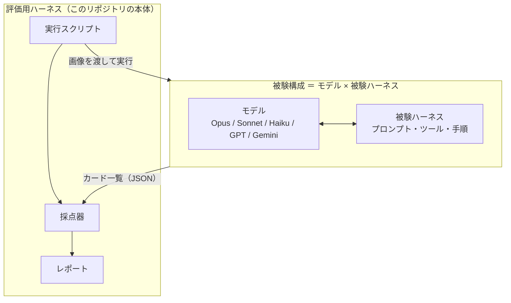
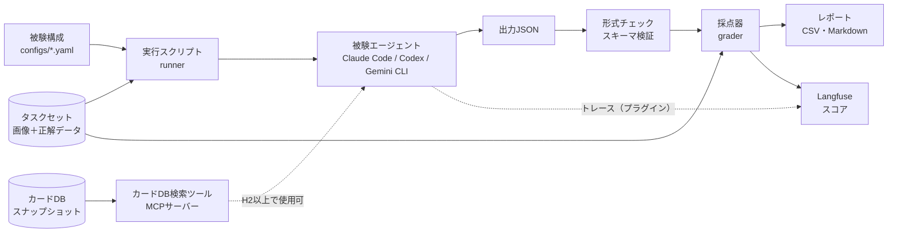
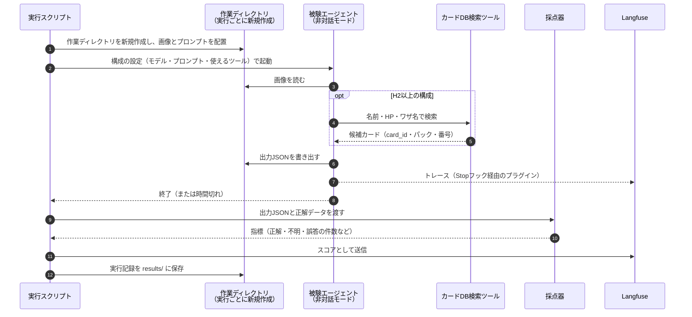
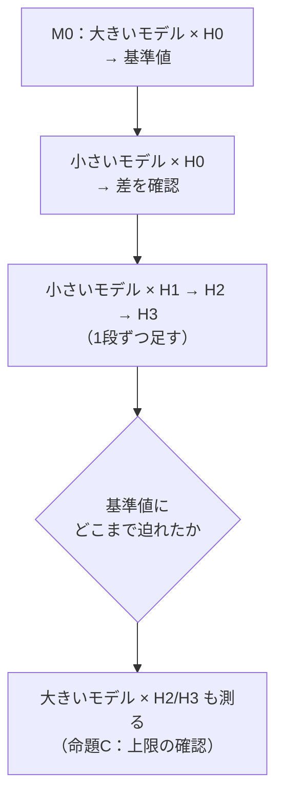
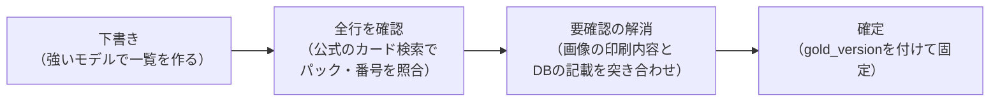

# 買取表カード同定タスク 評価用ハーネス 設計案

作成日：2026年10月26日（たたき台）

リポジトリ名：`tcg-buylist-eval`（buylist はTCG業界で「買取表」を指す一般的な呼び方）

関連ドキュメント：`model-and-harness.md`（モデルとハーネス）、`harness-design-and-evaluation.md`（ハーネス設計と評価）

---

## 0. プロジェクトの目的

### 0.1 ひとことで言うと

> **「モデルの性能に頼らず、ハーネスの設計で、品質を保ったまま速く安くタスクをこなせるか」を、数字で確かめるための評価基盤を作る。**
> 最初の題材は、ポケカの買取表画像からカードを特定するタスクとする。

### 0.2 背景

| 背景 | 内容 |
|---|---|
| モデルの性能とコスト | 性能の高いモデルほど出力の精度は高いが、そのぶんコスト（API代・利用枠・時間）がかかる |
| 性能をカバーする仕組み | 性能の低いモデルでも、周りの仕組み（**ハーネス**）しだいで性能をある程度カバーできる。同じモデルでもハーネスの違いだけで成績が大きく変わることが知られている |
| 現状の問題 | 多くの場合、**すべてのタスクに同じ汎用ハーネス**（Claude Codeなど）を使っている。汎用ハーネスに小さいモデルを入れても、性能をカバーする仕組みが働きにくい |
| 自分の立ち位置 | LLMモデルの開発は計算資源が必要で個人には難しい。そこで、**ハーネスの設計** に注力する |
| 評価の必要性 | ハーネス設計は、改善したかどうかを測れないと「勘」の積み重ねになる。**評価の仕組みが設計の土台** になる |

用語：**エージェント ＝ LLMモデル ＋ ハーネス**。Claude Codeのような製品はハーネスにあたる。

### 0.3 このプロジェクトで達成したいこと

| 目的 | 内容 |
|---|---|
| ① 評価の土台を作る | モデル × ハーネスの組み合わせを、同じタスク・同じ採点方法で、何度でも比べられる仕組みを作る |
| ② 仮説を数字で確かめる | 「小さいモデル＋タスクに合わせて作り込んだハーネス」が「大きいモデル＋素の状態」にどこまで迫れるかを測る |
| ③ ハーネスの部品の採否を決める | カードDB検索、自己検証などの部品が、作る・維持する手間に見合うだけQCDを改善するかを判断する |
| ④ 実運用につなげる | 合格した構成を、TCG価格データ基盤 **Card Pulse** のデータ取り込みに組み込む |

### 0.4 評価の考え方：QCD

最終的にエージェントに求める性能は、**品質・速さ・コスト** の3つ（製造業でいうQCD）。

```
目標：品質が合格ラインを満たす という条件のもとで、時間 と コスト を最小にする
```

- 品質は「高いほど良い」ではなく **合格ライン** で判定する。
- 速さとコストは、AIの処理だけでなく **人間の確認・修正の手間** まで含めて考える。
- このタスクでは、間違ったカードに価格が紐付くとデータが気付かれないまま汚れるため、**誤答を最も重く見る**。

### 0.5 なぜ「買取表のカード特定」を題材にするのか

| 理由 | 内容 |
|---|---|
| 自動で採点できる | 出力が表形式なので、正解データと項目ごとに機械的に比べられる |
| ハーネスの効果が出やすい | 失敗の多くは「パックや番号を知らない」という知識不足で、ツール（カードDB検索など）で補える典型的なタスク |
| 名前だけでは解けない | 同じ名前のカードが複数ある（サンプルではレシラムが3種類）ため、読み取り・照合・検証の工夫が成績に直結する |
| 評価用ハーネスを作りやすい | 入力は画像、出力はJSONで、エージェントが環境を書き換えない。環境のリセットがほぼ不要 |
| 実際に役立つ | Card Pulseの価格データ収集にそのまま使える |

### 0.6 成果物

| 成果物 | 内容 |
|---|---|
| 評価用ハーネス | このリポジトリ（`tcg-buylist-eval`）。タスクセット、実行スクリプト、採点器、レポート |
| 比較結果 | 「どのモデル × どのハーネスが、合格ラインを満たし、最も速く安いか」の表 |
| 知見 | どの部品が、どのモデル・どの世代のカードで効くか。記事やOSSの方向性の根拠にする |
| 部品 | 合格したハーネスの部品（カードDB、検索ツールなど）。Card Pulseでも使う |

---

## 1. 評価の対象とスコープ

### 1.1 何を評価するか

X上に投稿されるポケカの **買取表画像** を入力として、掲載されているカードを **一意に特定** するタスクを、エージェント（モデル × ハーネス）がどれだけうまくこなせるかを評価する。

### 1.2 明らかにしたいこと

| 問い | 内容 |
|---|---|
| 仮説の検証 | 「小さいモデル＋作り込んだハーネス」が「大きいモデル＋素の状態」にどこまで迫れるか（`model-and-harness.md` 命題B） |
| QCD | 品質（合格ライン）を満たす構成の中で、時間と利用枠の消費が最も少ないのはどれか |
| 失敗の傾向 | どの段階（読み取り／特定／形式）で、どんな間違いが起きるか |

### 1.3 用語：「評価する側」と「評価される側」

この設計では、2種類のハーネスが登場する。混同しないように呼び分ける。

| 呼び方 | 中身 | 例 |
|---|---|---|
| **評価用ハーネス**（評価する側） | 試験を運営し、採点し、成績を出す仕組み | 実行スクリプト、採点器、レポート出力 |
| **被験ハーネス**（評価される側） | モデルと組み合わせてタスクを解く仕組み | プロンプト、カードDB検索ツール、自己検証の手順 |



### 1.4 スコープ外

| 対象外 | 理由・担当 |
|---|---|
| Xからの画像収集の自動化 | 別の仕組み（利用規約の確認が必要） |
| 価格の時系列分析 | Card Pulse側の役割 |
| 買取表以外の画像（販売価格表など） | まずは買取表に絞る。後で拡張を検討 |

---

## 2. タスク定義

### 2.1 入力と出力

| | 内容 |
|---|---|
| 入力 | 買取表画像1枚（＋任意のメタ情報：店舗名、更新日） |
| 出力 | 掲載カードの一覧（JSON、スキーマは5.3） |

### 2.2 カードの主キー

**カード名ではカードを一意に特定できない。** 実際、サンプルの買取表にはレシラムが3枚あり、すべて収録パックが違う。

さらに、Geminiの出力ではBW1の「055/053」が2枚（ゼクロムとレシラム）あった。ブラックコレクションとホワイトコレクションのように、**型番＋番号だけでも一意にならない可能性** がある。

→ 主キーは **ローカルのカードDBが発行する `card_id`** にする。`card_id` は、パック・型番・番号の組から一意に決まるようにDB側で設計する（12章の未決事項）。

#### M0（カードDBがない段階）は仮のキーで始める

カードDBを作るのはM1から（11章）。M0ではDBがないので `card_id` を発行できない。そこで、M0では **仮のキー** を使う。

| 方法 | 内容 |
|---|---|
| 案1：パック名＋カード番号 | 例：「プラズマゲイル」＋「077/070」。正解データ作成時に公式のカード検索で確認した値を使う |
| 案2：公式サイトのカードID | 公式のカード詳細ページにIDがあれば、それを使う（URLの形式などは要確認） |

- 案1を使う場合、パック名の表記ゆれ（「拡張パック「プラズマゲイル」」と「プラズマゲイル」など）を揃える正規化ルールを決めておく。
- M1でカードDBを作ったら、仮のキーを `card_id` に置き換え、正解データの `gold_version` を上げる。
- 正解データの作成は人間が公式サイトを検索する作業なので、M0でもツールは要らない。

### 2.3 「不明」の扱い

確信が持てない場合、無理に特定せず **「不明」と答えてよい** ことをタスク仕様で明示する。

| 回答 | Card Pulseへの影響 | 評価上の扱い |
|---|---|---|
| 正解 | 正しいデータが入る | 加点 |
| 不明 | 人間が確認すれば済む | 0点（要確認件数として記録） |
| 誤答 | **間違ったカードに価格が紐付き、データが気付かれないまま汚れる** | 減点 |

不明の場合は、候補（`candidates`）を出してよい。人間の確認が速くなる。

---

## 3. 全体アーキテクチャ

### 3.1 構成要素



| 構成要素 | 役割 | 属する層 |
|---|---|---|
| タスクセット | 画像、正解データ、メタ情報 | 評価用 |
| 被験構成 | モデルと被験ハーネスの組み合わせを定義する設定ファイル | 評価用（定義のみ） |
| 実行スクリプト | 作業場所の用意、エージェントの起動、時間制限、結果の回収 | 評価用 |
| カードDB | カード情報のスナップショット。正解データ作成と検索ツールの両方で使う | 共通の資産 |
| カードDB検索ツール | 名前・HP・ワザ名などでカードを検索する | **被験ハーネスの部品** |
| 形式チェック | 出力がスキーマに合っているかを確かめる | 評価用 |
| 採点器 | 正解データと照合して指標を計算する | 評価用 |
| レポート／Langfuse | 結果の比較、失敗の分析 | 評価用 |

### 3.2 1回の実行の流れ



コーディングタスクと違い、エージェントはリポジトリを書き換えない。そのため **環境のリセットは「実行ごとに新しい作業ディレクトリを作る」だけで済む。**

---

## 4. ディレクトリ構成

```
tcg-buylist-eval/
├── README.md                 目的、用語、使い方
├── docs/
│   ├── design.md             この設計書
│   ├── task-spec.md          タスク仕様（被験エージェントに渡す仕様の元）
│   └── gold-guideline.md     正解データの作成ルール
├── schemas/
│   ├── output.schema.json    被験エージェントの出力形式
│   └── gold.md               正解データの列定義
├── tasks/                    ① タスクセット（1買取表＝1フォルダ）
│   └── <task_id>/
│       ├── meta.yaml         出典、日付、分割（dev/test）
│       ├── gold.csv          正解データ
│       └── input.jpg         画像（公開リポジトリでは .gitignore）
├── carddb/                   カードDB
│   ├── README.md             取得元、取得日、バージョン
│   └── snapshot/             DB本体（.gitignore または別配布）
├── configs/                  被験構成（モデル × 被験ハーネス）
│   ├── opus-h0.yaml
│   ├── sonnet-h0.yaml
│   └── sonnet-h2.yaml
├── subject/                  被験ハーネスの部品
│   ├── prompts/              H0〜H3のプロンプト
│   └── tools/card-db-search/ カードDB検索ツール（MCPサーバー）
├── runner/                   ②③ 実行スクリプト（評価用）
├── graders/                  ④ 採点器（評価用）
├── reporters/                ⑤ レポート出力、Langfuse送信（評価用）
└── results/                  実行結果（.gitignore）
    └── <run_id>/
        ├── output.json
        ├── metrics.json
        └── run.yaml          実行条件の記録
```

`subject/` は **評価される側** で、`runner/`・`graders/`・`reporters/` は **評価する側**。フォルダで分けておき、評価する側が被験ハーネスの中身に依存しないようにする。

---

## 5. データ設計

### 5.1 タスクのメタ情報（`meta.yaml`）

```yaml
task_id: torekingu-akiba-2026-10-25
source:
  url: https://x.com/...          # 出典のポストURL
  shop: トレキング NEW AKIHABARA
  updated_at: 2026-10-25          # 買取表に書かれた更新日
  collected_at: 2026-10-26
layout:
  rows: 3
  cols: 7
card_count: 21
era: [BW]                         # 収録カードの世代（分析用）
split: dev                        # dev または test（10章）
gold_version: 1
```

### 5.2 正解データ（`gold.csv`）

| 列 | 内容 | 例 |
|---|---|---|
| `row` | 段（上から1始まり） | 1 |
| `col` | 列（左から1始まり） | 1 |
| `name` | 画像に印刷されているカード名 | リザードン |
| `hp` | 画像に印刷されているHP | 160 |
| `price_jpy` | 買取価格 | 1800000 |
| `provisional_key` | 仮のキー（M0で使用。2.2） | プラズマゲイル#077/070 |
| `card_id` | カードDBのID（主キー。M1以降） | （DB設計で決定） |
| `pack` | 収録パック | プラズマゲイル |
| `set_code` | 型番 | BW7 |
| `number` | カード番号 | 077/070 |
| `rarity` | レアリティ | UR |
| `verified_by` | 確認した人 | kajiwara |
| `verified_at` | 確認日 | 2026-10-26 |
| `note` | 補足 | 「画像にEXの表記なし」など |

**画像に印刷されている情報**（名前・HP・価格）と、**DBで確定する情報**（card_id・パック・番号）を分けて持つ。採点の際に「読み取りミス」と「特定ミス」を区別できるようにするため。

### 5.3 被験エージェントの出力（`output.schema.json`）

出力例：

```json
{
  "task_id": "torekingu-akiba-2026-10-25",
  "grid": { "rows": 3, "cols": 7 },
  "cards": [
    {
      "position": { "row": 1, "col": 1 },
      "printed": { "name": "リザードン", "hp": 160, "attacks": ["ばくれつだん"] },
      "price_jpy": 1800000,
      "identification": {
        "status": "identified",
        "card_id": "xxxx",
        "pack": "プラズマゲイル",
        "set_code": "BW7",
        "number": "077/070",
        "rarity": "UR",
        "candidates": [],
        "confidence": 0.9
      }
    }
  ]
}
```

| フィールド | 内容 |
|---|---|
| `position` | 段・列。採点時の対応付けに使う |
| `printed` | 画像から読み取った情報。ワザ名はカードを特定する重要な手がかり |
| `identification.status` | `identified`（特定した）または `unknown`（不明） |
| `identification.candidates` | 不明の場合の候補（`card_id` のリスト） |
| `identification.confidence` | 0〜1の自己申告の確信度（分析用。採点には使わない） |
| `identification.card_id` | カードDBのID。**M0（DBなし）では空でよい**。採点は `pack`＋`number` から仮のキーを作って行う |

### 5.4 カードDB（スナップショット）

| 列 | 内容 |
|---|---|
| `card_id` | 主キー |
| `name` | カード名 |
| `hp` | HP |
| `attacks` | ワザ名の一覧 |
| `pack` | 収録パック |
| `set_code` | 型番 |
| `number` | カード番号 |
| `rarity` | レアリティ |
| `snapshot_date` | 取得日 |

- **Web検索ではなくローカルのスナップショットを使う**。時期によって検索結果が変わると評価を再現できないため。外部サイトへのアクセスを繰り返さずに済む点も大きい。
- 取得元の利用規約を確認してから作る。
- このDBは、Card Pulse側でもカードマスタとして使える。
- **正解のカードだけを入れたDBにしない**。検索すると答えしか出てこず、タスクが簡単になりすぎる（**答えの漏れ**）。対象の世代（まずはBW期など）のカードをひととおり入れ、同名カード（レシラムの別バージョンなど）が候補として並ぶ状態にする。
- 作るかどうか自体を、M0の結果で判断する（6.5）。

### 5.5 実行記録（`run.yaml`）

後から「なぜ結果が変わったのか」を追えるように、実行条件をすべて残す。

| 項目 | 例 |
|---|---|
| `run_id` | 実行ごとの一意なID |
| `task_id`／`config_id`／`repeat` | 何を、どの構成で、何回目に実行したか |
| `runtime` と `runtime_version` | claude-code 2.x など |
| `model` | 実際に使われたモデル名 |
| `config_hash` | 構成ファイルとプロンプトのハッシュ値 |
| `carddb_version` | 使ったカードDBのバージョン |
| `gold_version` | 採点に使った正解データのバージョン |
| `started_at`／`duration_sec` | 開始時刻と所要時間 |
| `exit_status` | 正常終了／時間切れ／エラー |
| `langfuse_trace_id` | トレースとの対応付け |

---

## 6. 被験構成（configs）

### 6.1 比較の軸

| 軸 | 値の例 |
|---|---|
| 実行環境（ランタイム） | Claude Code、Codex CLI、Gemini CLI |
| モデル | 大・中・小（例：Opus／Sonnet／Haiku） |
| 被験ハーネスの段階 | H0〜H3 |

### 6.2 被験ハーネスの段階

| 段階 | 内容 | 使えるツール | ねらい |
|---|---|---|---|
| **H0：素の状態** | 画像を渡し、一度に一覧を出させる | なし | 基準値。サンプルのGeminiの結果に近い |
| **H1：分割** | 格子を把握させ、1枚ずつ読み取らせる手順を指示する | なし | 読み取りミスと抜けを減らす |
| **H2：照合** | 読み取った名前・HP・ワザ名でカードDBを検索させ、card_idを確定させる | カードDB検索 | **知識不足をツールで補う**（本命） |
| **H3：自己検証** | DBの情報と画像の印刷内容が一致するか確かめさせる。合わなければ読み直し、それでもだめなら「不明」 | カードDB検索 | 誤答を「不明」に変え、データを汚さない |

H0からH3は積み上げ式にし、**隣り合う段階の差分が1つだけ** になるようにする。

### 6.3 構成ファイルの例

```yaml
id: sonnet-h2
runtime: claude-code
model: sonnet
harness:
  level: H2
  prompt: subject/prompts/h2.md
  tools: [card-db-search]
  web_search: false        # 再現性のため、原則オフ
  max_turns: 40
  timeout_sec: 600
repeats: 3                 # ばらつきを見るための繰り返し回数
```

### 6.4 実験の組み立て



### 6.5 部品は「仮説」として扱い、評価で採否を決める

被験ハーネスの各部品は「入れれば良くなるはず」という **仮説** にすぎない。評価で確かめてから採用する。

| 部品 | 仮説 | 評価で確かめること |
|---|---|---|
| カードDB検索（H2） | 知識不足による特定ミスが減る | 特定ミスがどれだけ減ったか |
| 1枚ずつの切り出し（H1） | 読み取りミスや抜けが減る | 読み取りの正答率、抜けの件数 |
| 自己検証（H3） | 誤答が「不明」に変わる | 誤答率が下がり、その分だけ不明率が上がっているか |

どの部品も、判断の基準は同じ。

```
採用する ⇔ QCDの改善幅 ＞ その部品を作る・維持するコスト
```

特にカードDBは、作ったあとも新しいパックが出るたびに更新が必要になる。改善幅だけでなく **維持の手間** も判断材料に入れる。

#### 答えはモデルとカードの世代によって変わる

| 条件 | DBの必要性 |
|---|---|
| 大きいモデル × 古いカード（BW期など） | 低いかもしれない。モデルがすでに知識として持っている可能性がある |
| 小さいモデル × 古いカード | 高いかもしれない。本命の検証対象 |
| **どのモデルでも × 新しいカード** | **ほぼ必須**。モデルの学習時期より後に出たカードは、そもそも知りようがない |

- 部品の採否は **「モデル × タスクの中身」ごと** に判断する。これが「モデルとタスクに合わせてハーネスを設計する」ということ。
- モデルが更新されると答えが変わることがある。モデルの更新時には基準値を取り直し、部品の採否も見直す。**評価は1回で終わりではなく、繰り返し使うもの** であり、評価用ハーネスをリポジトリとして持つ理由もここにある。

#### カードDBを作るかどうかの判断（M0 → M1）

| M0の結果 | 判断 |
|---|---|
| 大きいモデルでもH0では特定ミスが多い | DBで知識を補う価値が大きい → M1に進む |
| 小さいモデルだけ特定ミスが多い | 「小さいモデル＋DBで差が縮まるか」という本命の検証ができる → M1に進む |
| どのモデルもH0でほぼ正解する | DBの優先度は下がる。より難しい買取表（新しいカード、画質が悪い、世代が混在など）を探してから判断する |

---

## 7. 実行スクリプト（runner）

### 7.1 1回の実行でやること

| 手順 | 内容 |
|---|---|
| 1. 作業ディレクトリの作成 | 実行ごとに新しい一時ディレクトリを作り、画像とプロンプトだけを置く |
| 2. 構成の反映 | モデル、プロンプト、使えるツール（MCPの設定）を構成ファイルから組み立てる |
| 3. 起動 | 非対話モード（Claude Codeの `-p`、Codexの `exec` など）で起動する。画像の渡し方はランタイムごとに確認する |
| 4. 時間制限 | `timeout_sec` を超えたら打ち切り、時間切れとして記録する |
| 5. 回収 | 出力JSONを回収する。見つからない、または壊れている場合は形式エラーとして記録する |
| 6. 記録 | `run.yaml` と出力を `results/<run_id>/` に保存する |

### 7.2 方針

| 方針 | 内容 |
|---|---|
| ランタイムの差を吸収する | ランタイムごとに「起動方法」「ツールの渡し方」「出力の回収方法」だけをアダプタとして分ける。採点以降は共通にする |
| 権限は最小にする | 作業ディレクトリの外には書き込ませない。H0とH1ではツールを渡さない |
| サブスク認証で動かす | 手元のサブスク認証のまま実行する。利用枠を消費するので、実行回数（タスク数 × 構成数 × 繰り返し）を事前に見積もる |
| 失敗も結果として残す | 時間切れや形式エラーも「その構成の成績」として採点に含める |

**Webアプリで実行した結果（今回のGemini Argonのサンプルなど）は自動化できない。** 手動実行の参考値として、同じ採点器で採点だけ行う。

---

## 8. 採点器（grader）

### 8.1 対応付け

予測したカードと正解データを、まず **位置（段・列）** で対応付ける。位置が読み違えられている場合に備えて、対応が付かなかったものは **価格＋名前** で補助的に対応付け、「位置ずれ」として記録する。

### 8.2 項目ごとの判定

| 項目 | 判定方法 |
|---|---|
| 件数 | 抜け（正解にあるが予測にない）、余分（予測にあるが正解にない） |
| 価格 | 完全一致 |
| 印刷名 | 正規化（全角・半角、空白、「EX」「ex」などの表記）してから完全一致 |
| HP | 完全一致（読み取りの精度を見る補助指標） |
| **同定** | `status` と `card_id` から、**正解・不明・誤答** の3つに分ける（M0では `card_id` の代わりに仮のキーで比べる） |

### 8.3 指標

**品質**

| 指標 | 定義 | 見たいこと |
|---|---|---|
| 同定正答率 | 正解 ÷ 正解データの全枚数 | 全体としてどれだけ特定できたか |
| **誤答率** | 誤答 ÷ 全枚数 | データを汚す危険の大きさ（**最重要**） |
| 不明率 | 不明 ÷ 全枚数 | 人間の確認が必要になる量 |
| 適合率 | 正解 ÷（正解＋誤答） | 「特定した」と言ったものがどれだけ信用できるか |
| 価格・印刷名の正答率 | 一致件数 ÷ 全枚数 | 読み取りの精度 |
| 有効スコア | 正解 − w × 誤答（w は仮に2） | 1つの数字で比べたいときの総合点 |

**速さ・コスト**

| 指標 | 取り方 |
|---|---|
| 所要時間 | 実行スクリプトで計測 |
| トークン数・ターン数 | Langfuseのトレース |
| 要確認件数 | 不明の件数（人間の手間の目安） |

**安定性**：同じタスク×構成を `repeats` 回実行し、同定正答率の **最悪値** とばらつきを見る。

### 8.4 合格ライン（仮）

QCDの考え方（`model-and-harness.md` 8章）に従い、**品質は合格ラインで判定し、その中で速さとコストを比べる。**

| 条件 | 仮の基準 |
|---|---|
| 誤答率 | 2％以下 |
| 同定正答率 | 80％以上 |
| 形式エラー | 0件 |

基準の数値は、M0の結果を見てから決め直す。

---

## 9. レポートと失敗分析

### 9.1 比較表（出力イメージ）

| 構成 | 同定正答率 | 誤答率 | 不明率 | 適合率 | 平均時間 | 平均トークン | 合格 |
|---|---|---|---|---|---|---|---|
| opus-h0 | ？ | ？ | ？ | ？ | ？ | ？ | ？ |
| sonnet-h0 | ？ | ？ | ？ | ？ | ？ | ？ | ？ |
| sonnet-h2 | ？ | ？ | ？ | ？ | ？ | ？ | ？ |

- ローカルにはCSVとMarkdownで出力する。
- Langfuseでは、タスクセットをデータセット、構成を実験（Experiment）として扱い、スコアを送って比較画面で見る。

### 9.2 失敗の分類

採点器が自動で分類し、改善の仮説を立てる材料にする。

| 分類 | 判定の目安 | サンプルでの例 |
|---|---|---|
| 読み取りミス | 価格やHPが正解と違う | － |
| **知識による補完** | 画像にない情報が出力に付いている | Geminiが「ギラティナ」「ダークライ」「ビクティニ」にEXを付けた（3件） |
| 特定ミス | 印刷名は合っているが、card_idが違う | （レシラム3種で起きやすい） |
| 特定できず | 候補を1つに絞れていない | ピカチュウのパックが「ブラック／ホワイト」の2択のまま |
| 抜け・余分 | 件数の不一致 | － |
| 位置ずれ | 位置での対応付けに失敗した | － |
| 形式エラー | スキーマ違反、出力なし | － |

---

## 10. 正解データの作り方

### 10.1 作成の流れ



### 10.2 ルール

| ルール | 理由 |
|---|---|
| **全行を確認する**（印を付けた行だけでなく） | 下書きの誤りがそのまま正解データに残るのを防ぐ |
| 下書きに使ったモデルを記録する | そのモデルに有利な偏りが入っていないかを後で確認できる |
| 印刷名は「画像に書いてある通り」に記録する | 知識による補完を正解にしてしまわないため |
| 正解データを直したらバージョンを上げる | 過去の採点結果と比べられなくなるのを防ぐ |

### 10.3 タスクセットの構成

| 観点 | 方針 |
|---|---|
| 分割 | **dev**（被験ハーネスの改善に使う）と **test**（最終比較だけに使う）に分ける。devだけでハーネスを調整し、testで答え合わせする |
| 多様性 | 店舗、レイアウト（段・列の数）、世代（BW／XY／SM／SV）、画質を散らす |
| **新しいカード** | モデルの学習時期より後に発売されたカードが載った買取表を必ず入れる。古いカードだけだと、モデルの知識で当たってしまい、カードDBの必要性を正しく測れない（6.5）。実際の運用でも最新弾のカードは流れてくる |
| 規模の目安 | M0は1〜3枚（20〜60カード）、M2で10枚以上 |

**devとtestを分ける理由**：同じタスクで何度もハーネスを調整すると、そのタスクに過剰に合わせ込んだハーネスができてしまう。新しい買取表にも通用するかは、調整に使っていないtestで確かめる。

---

## 11. マイルストーン

| 段階 | 内容 | 完了の目安 |
|---|---|---|
| **M0** | 買取表1〜3枚の正解データを手作業で作る（**仮のキー**を使い、カードDBは作らない）／H0だけを2モデルで実行／ローカルの採点器とCSV出力。最初は手動で実行して出力JSONを保存するだけでもよい | 「大きいモデルと小さいモデルのH0で、同定正答率と誤答率がこう違う」という表が1枚出る。その結果でカードDBを作るかどうかを判断できる（6.5） |
| M1 | **M0の結果でDBの必要性を確認してから** 着手する／カードDBのスナップショットと検索ツールを作る／仮のキーを `card_id` に移行／H2を追加／Langfuse連携 | 小さいモデルのH0とH2の差が数字で出る |
| M2 | H1・H3を追加／繰り返し実行でばらつきを測る／タスクを10枚以上に増やし、dev/testに分ける | 合格ラインを満たす構成の中で、最も安く速い構成が分かる |
| M3 | 合格した構成をCard Pulseのデータ取り込みに組み込む | 新しい買取表が自動で取り込まれ、不明分だけが人間に回る |

---

## 12. 未決事項

| 項目 | 選択肢 | おすすめ |
|---|---|---|
| 主キーの定義 | 型番＋番号／パック＋番号／公式サイトのID | M0は仮のキー（パック名＋番号、または公式ID）。M1でカードDBが独自の `card_id` を発行し、公式IDは別の列で持つ |
| カードDBの取得元 | 公式のカード検索／有志のデータベース | 利用規約を確認してから決める |
| 実装言語 | Python／Go | Python（LangfuseのSDKがあり、将来Inspectに移る場合も素直） |
| 最初のランタイム | Claude Code／Codex／Gemini CLI | Claude Code（Langfuseプラグインあり）から始め、M2でCodexを追加 |
| 誤答の重み w | 1〜5 | 仮に2。Card Pulseで誤データが与える影響を見て調整 |
| リポジトリの置き場所 | 独立リポジトリ／Card Pulseの中 | 独立リポジトリ。カードDBは両方から参照する |
| 公開範囲 | 公開／非公開 | 公開する場合、画像・正解データ・カードDBの扱いを先に決める（13章） |

---

## 13. リスクと注意点

| リスク | 対策 |
|---|---|
| 買取表画像の著作権 | 画像は店舗の著作物。公開リポジトリには画像をコミットせず、出典URLと日付だけを残す |
| 収集方法の利用規約 | Xやカードの公式サイトの利用規約を確認してから、収集とDB作成を行う |
| 利用枠の消費 | 実行回数を事前に見積もる。M0は少数から始める |
| 結果のばらつき | 繰り返し実行し、平均だけでなく最悪値を見る |
| モデルやランタイムの更新 | 実行記録にバージョンを残し、更新後は基準値を取り直す |
| 正解データの誤り | 全行の確認、バージョン管理、疑わしい行の再確認 |
| 答えの漏れ | カードDBに正解のカードだけを入れない。対象世代のカードをひととおり入れる |
| 古いカードへの偏り | 新しいカードが載った買取表をタスクセットに入れる |
| devへの過剰適合 | testは最終比較にだけ使う |

---

## 14. まとめ

| 項目 | 方針 |
|---|---|
| リポジトリ名 | `tcg-buylist-eval`（商標を名前に入れず、将来ほかのTCGにも広げられるようにする） |
| 評価対象 | 買取表画像からカードを一意に特定するタスク |
| 主キー | カードDBの `card_id`（名前や型番＋番号だけでは一意にならない） |
| 採点の考え方 | **正解・不明・誤答** に分け、**誤答率** を最重要指標にする |
| 被験ハーネス | H0（素）→ H1（分割）→ H2（DB照合）→ H3（自己検証）を1段ずつ積み上げて比べる |
| 部品の採否 | 各部品は **仮説**。「QCDの改善幅 ＞ 作る・維持するコスト」なら採用する。答えは **モデル × カードの世代** で変わる |
| カードDB | M0では作らない（仮のキーで始める）。**M0の結果で必要性を判断してから** M1で作る |
| 再現性 | ローカルのカードDB、実行ごとの作業ディレクトリ、実行条件の記録 |
| 最初の一歩 | M0：サンプルの買取表の正解データを仮のキーで作り、H0を2モデルで比べる |
